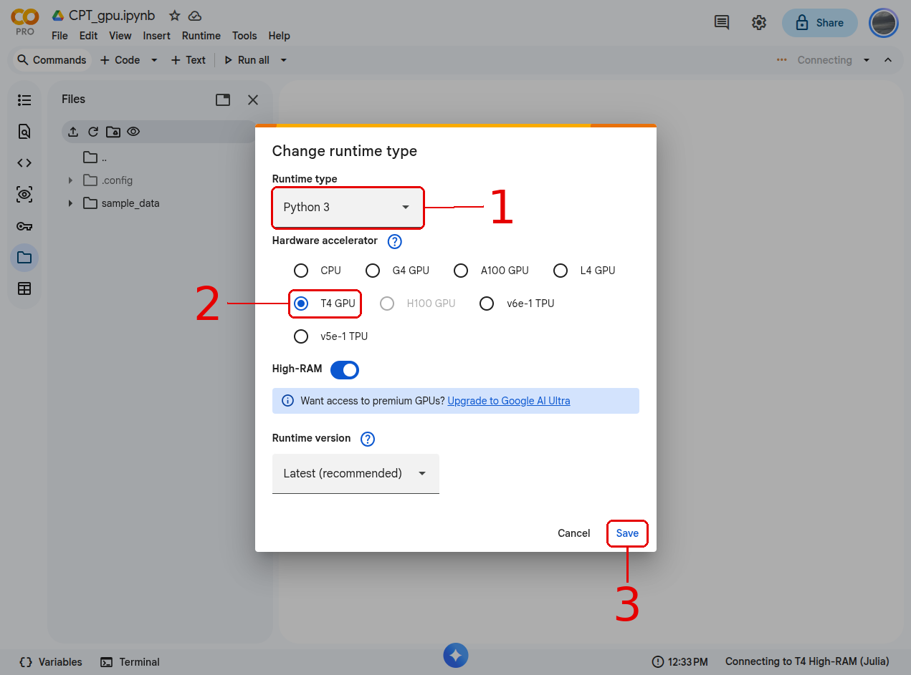
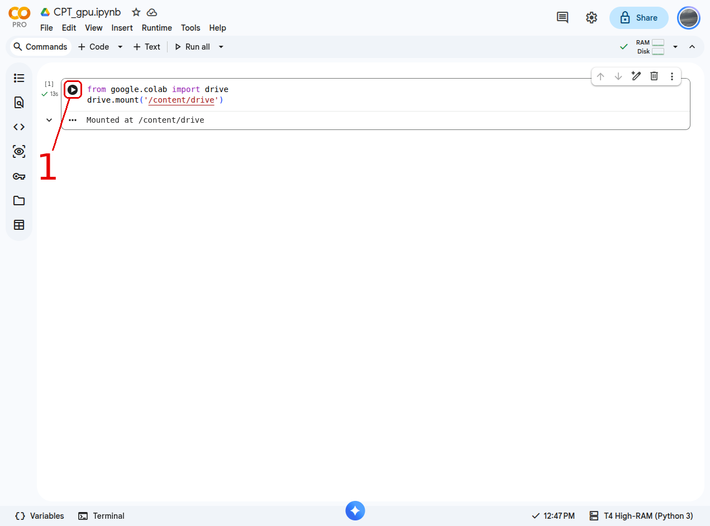
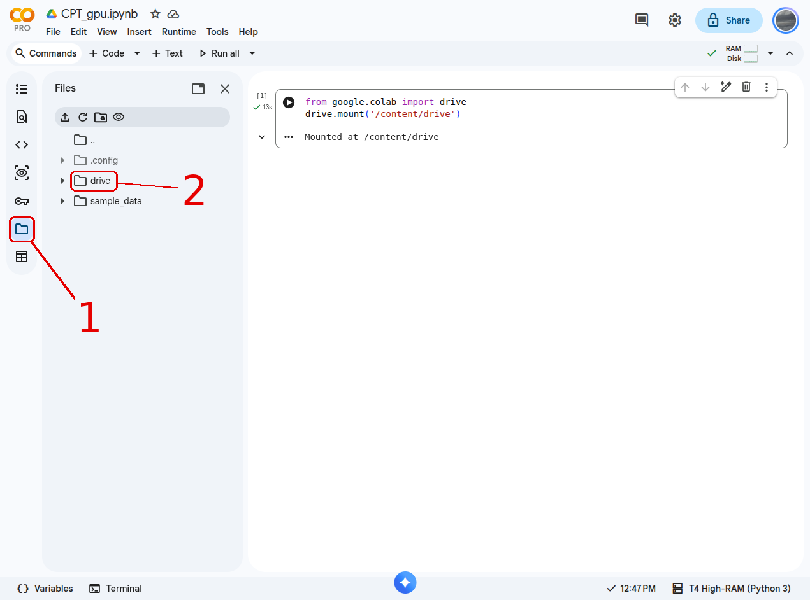
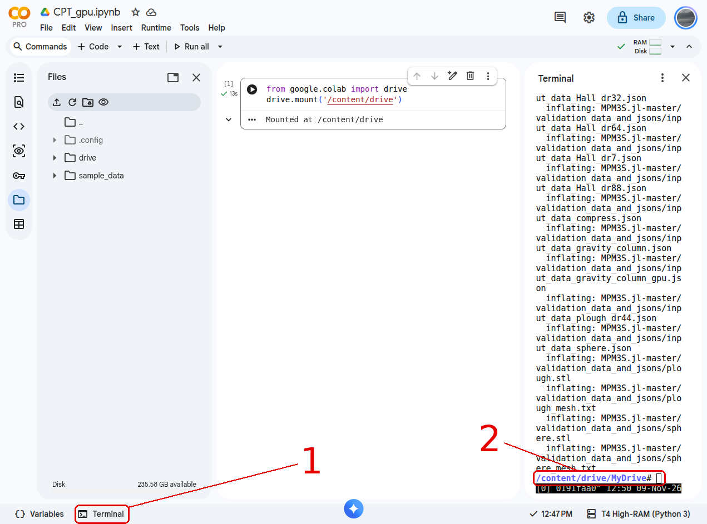
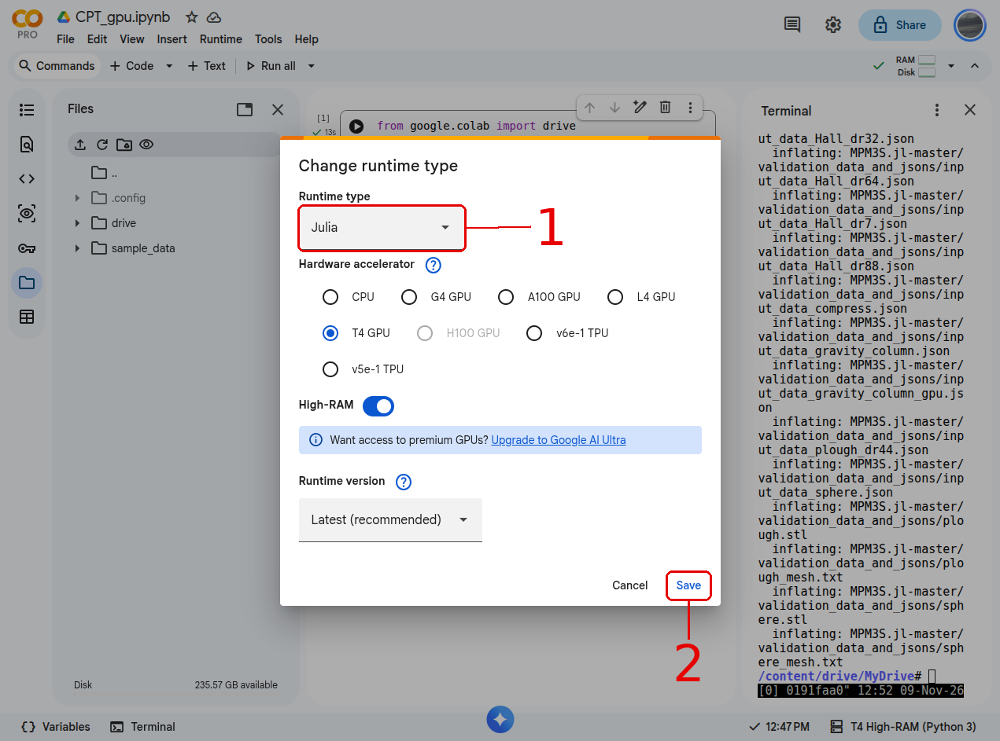
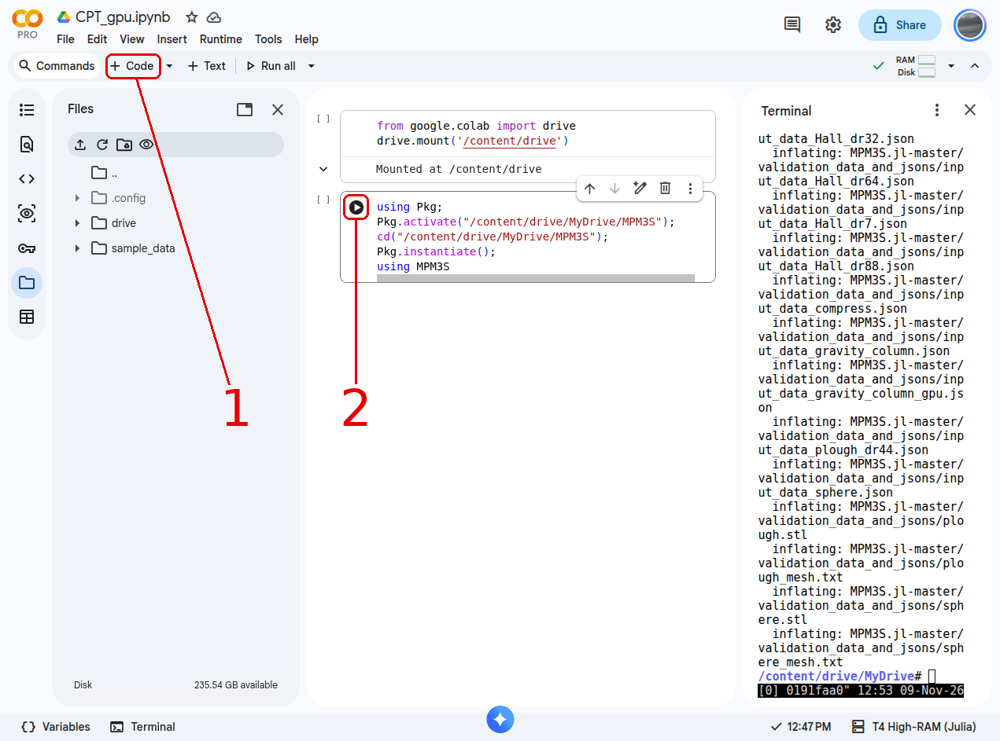
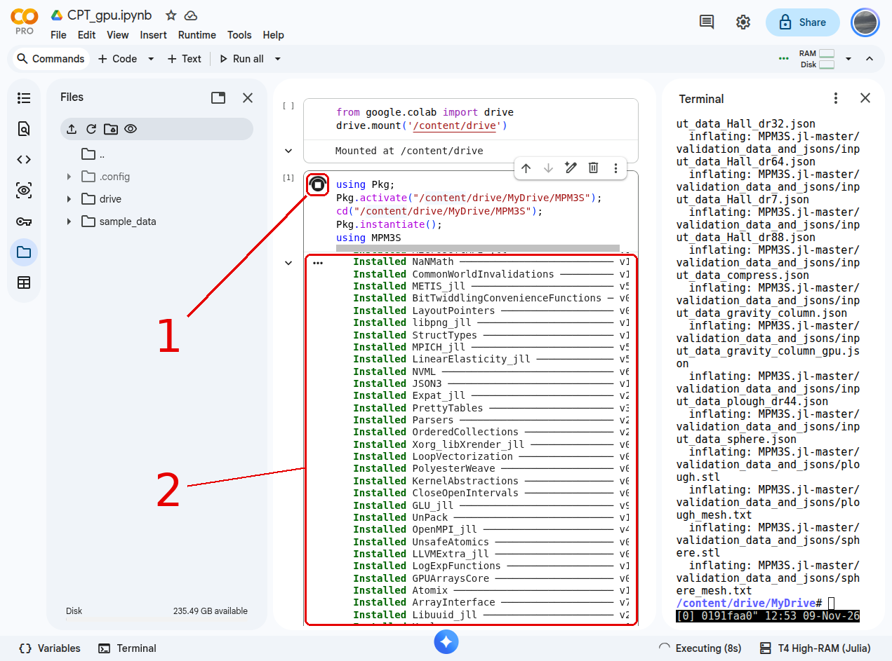
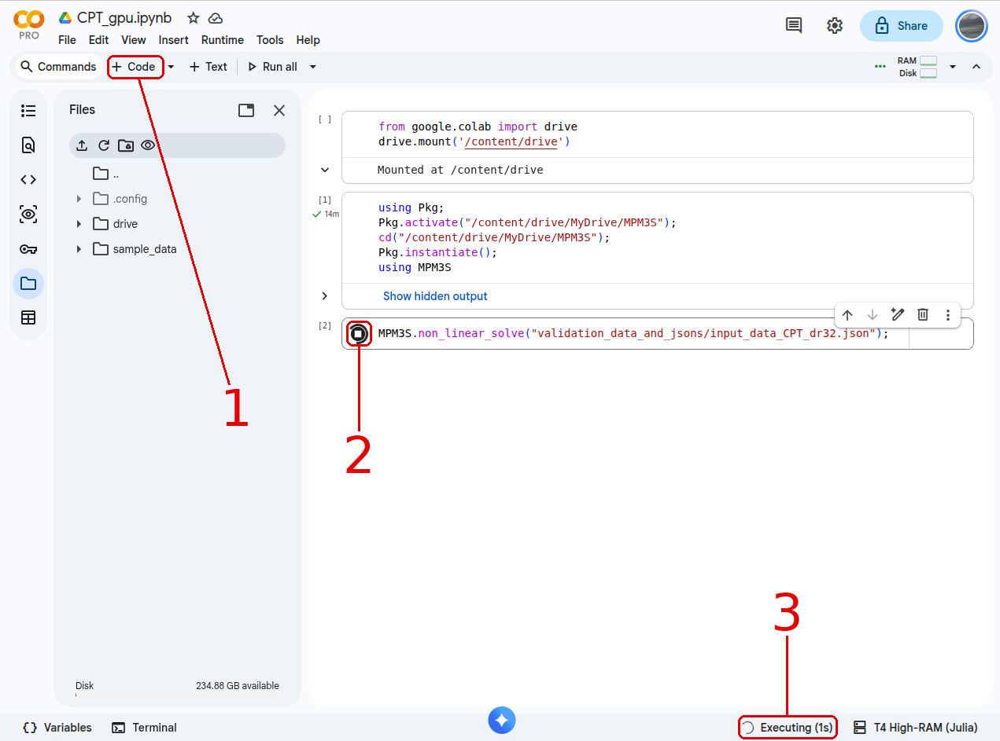
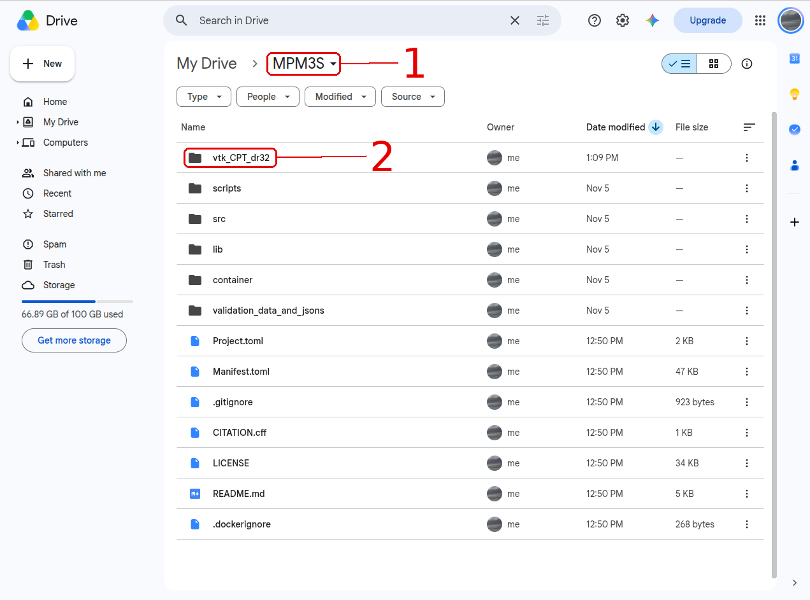

# Cloud computing

[Google Colab](https://colab.research.google.com) runs MPM3S in your web browser on a Google machine with an NVIDIA GPU, so nothing has to be installed on your own computer. MPM3S is kept in your Google Drive, which Colab connects to.

## Before you start

1. Download the MPM3S ZIP from GitHub, as in [Downloading MPM3S from GitHub](julia.md#downloading-mpm3s-from-github) (the *ZIP* tab). Leave it zipped.
2. Upload `MPM3S.jl-master.zip` to *My Drive* in [Google Drive](https://drive.google.com): *New → File upload*. A single ZIP uploads much faster than the unzipped folder.
3. Open [Google Colab](https://colab.research.google.com), signed in to the same Google account, and choose *New notebook*. Colab saves it in the *Colab Notebooks* folder of your Drive.

## Colab set-up

Click a screenshot to open it full size.

<div class="step-viewer" markdown>

<div class="step" markdown>

[{ .step-img }](../../img/colab_tutorial/colab_step_1.png)

**1. Start a Python runtime with a GPU.** Choose *Runtime → Change runtime type*. Set *Runtime type* to *Python 3* (1) and *Hardware accelerator* to *T4 GPU* (2), then click *Save* (3). The notebook starts in Python because Google Drive can only be connected from Python; it is switched to Julia in step 5.

</div>

<div class="step" markdown>

[{ .step-img }](../../img/colab_tutorial/colab_step_2.png)

**2. Connect your Google Drive.** Paste this into the first code cell and click its run button (1):

```python
from google.colab import drive
drive.mount('/content/drive')
```

Allow Colab to access your Google Drive when asked. The cell prints `Mounted at /content/drive`: *My Drive* is now the folder `/content/drive/MyDrive`.

</div>

<div class="step" markdown>

[{ .step-img }](../../img/colab_tutorial/colab_step_3.png)

**3. Check that the drive is connected.** Click the *Files* icon (1) in the left sidebar. A `drive` folder (2) is now listed; inside it, `MyDrive` holds the ZIP you uploaded. If `drive` is missing, click the refresh icon at the top of the panel.

</div>

<div class="step" markdown>

[{ .step-img }](../../img/colab_tutorial/colab_step_4.png)

**4. Unzip MPM3S in the terminal.** Click *Terminal* (1) at the bottom of the window. In the terminal (2), run:

```bash
cd /content/drive/MyDrive
unzip MPM3S.jl-master.zip
mv MPM3S.jl-master MPM3S
```

`unzip` lists each file as it is extracted (`inflating: ...`). This leaves an `MPM3S` folder in your Drive, so it only has to be done once.

</div>

<div class="step" markdown>

[{ .step-img }](../../img/colab_tutorial/colab_step_5.png)

**5. Switch the runtime to Julia.** Open *Runtime → Change runtime type* again, set *Runtime type* to *Julia* (1), keep *T4 GPU*, and click *Save* (2). Google Drive stays connected, and the runtime name at the bottom right of the window now ends in *(Julia)*.

</div>

<div class="step" markdown>

[{ .step-img }](../../img/colab_tutorial/colab_step_6.png)

**6. Install MPM3S.** Click *+ Code* (1) to add a cell, paste this into it and click its run button (2):

```julia
using Pkg;
Pkg.activate("/content/drive/MyDrive/MPM3S");
cd("/content/drive/MyDrive/MPM3S");
Pkg.instantiate();
using MPM3S
```

Do not run the first cell again: it is Python, and the notebook now runs Julia.

</div>

<div class="step" markdown>

[{ .step-img }](../../img/colab_tutorial/colab_step_7.png)

**7. Wait for the packages to install.** While the cell runs, its run button becomes a spinning stop button (1) and the bottom bar shows *Executing*. `Pkg.instantiate()` installs the packages MPM3S needs (2), which can take several minutes, and `using MPM3S` then loads it. When a green tick appears next to the cell, MPM3S is ready.

</div>

<div class="step" markdown>

[{ .step-img }](../../img/colab_tutorial/colab_step_8.png)

**8. Run a problem.** Click *+ Code* (1) to add a cell, paste the command for the problem into it and click its run button (2). [Tutorial 3](../TutorialProblems/Tutorial_3.md), for example, is run with:

```julia
MPM3S.non_linear_solve("validation_data_and_jsons/input_data_CPT_dr32.json");
```

Step 6 left Julia in the `MPM3S` folder, so the path is relative to it, as on your own computer. The input file must have `"GPU": "on"`, as Tutorial 3's does. The bottom bar shows *Executing* (3) until the analysis has finished.

</div>

<div class="step" markdown>

[{ .step-img }](../../img/colab_tutorial/colab_step_9.png)

**9. Find the results in your Google Drive.** The output files are saved in your Google Drive, in the `MPM3S` folder. Open [Google Drive](https://drive.google.com) and go to *My Drive → MPM3S* (1): Tutorial 3 writes its output to `vtk_CPT_dr32` (2), which fills up while the analysis runs. To view the results, right-click the folder, choose *Download*, and open the files in ParaView, as in [Viewing the output](viewing_output.md).

</div>

</div>

## Your own problems

Upload the problem's folder into `MPM3S` in your Drive, for example `MPM3S/my_runs/input_data.json`, and give that path in step 8: `MPM3S.non_linear_solve("my_runs/input_data.json");`. Set `"GPU": "on"` in the input file to use Colab's GPU.

!!! warning "STL files must be converted to a mesh text file first"
    MPM3S meshes each `.stl` file with Gmsh and saves the mesh as the text file named in the input file's [`"mesh cache"`](../UsingTheSoftware/InputFormat/rigid_bodies.md#stl-files). Gmsh does not run on Colab, so make the text file on your own computer, with MPM3S [installed with Julia](julia.md#mpm3s-installation), and upload it to the same folder as the `.stl` file. For the cone of [Tutorial 3](../TutorialProblems/Tutorial_3.md), from the `MPM3S` folder:

    ```julia-repl
    julia> using MPM3S
    julia> MPM3S.RigidBodies.body_mesh("validation_data_and_jsons/CPT.stl", "validation_data_and_jsons/CPT_mesh.txt");
    ```

    - The first path is the `.stl` file, and the second is the text file to write; give it the name used for `"mesh cache"` in the input file.
    - If the text file already exists, it is read rather than made again, so delete it first whenever the `.stl` file changes.
    - The tutorials' `.stl` files already come with their text files (e.g. `CPT_mesh.txt`), so they run on Colab as they are.

## Starting a new session

Colab wipes its machine when a session ends, but the `MPM3S` folder stays in your Drive. To carry on, open the notebook again and repeat steps 1, 2, 5, 6 and 7: skip the unzip in step 4. The packages are installed again in step 7, as they are lost with the machine. The results from earlier runs stay in your Drive.
