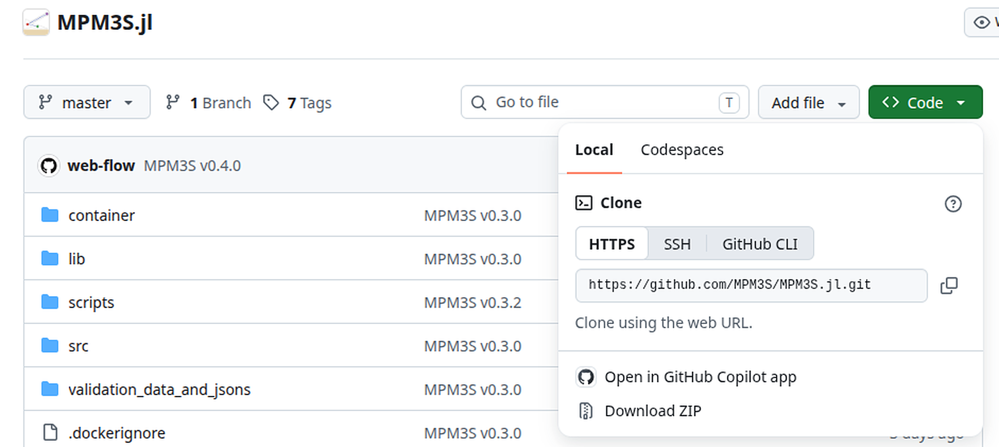

# Julia (PC)

The simplest deployment is to install Julia and run MPM3S from source. Julia and MPM3S are both operated through the [command/terminal window](#terminal-window). This page is for your own computer; to install on an HPC and run as Slurm batch jobs, see [HPC installed with Julia](hpc_julia.md).

!!! note "Add your GitHub account to your computer (while MPM3S.jl is private)"
    --8<-- "github_account.md"

    On your computer, `git clone` uses the token: when it asks for your GitHub username and password, give the token as the password. On Windows, Git may instead open a window to sign in to GitHub in your browser. On Linux, run `git config --global credential.helper store` once before cloning to have git remember the token; Windows and macOS remember it for you. Downloading the ZIP from the GitHub website needs no token, only signing in there.

--8<-- "terminal_window.md"

## Julia installation

Install Julia with the [`juliaup`](https://github.com/JuliaLang/juliaup) toolchain manager, as recommended at [julialang.org/downloads](https://julialang.org/downloads/), by running the command for your system in the [command/terminal window](#terminal-window):

=== "Windows"

    ```powershell
    winget install --name Julia --id 9NJNWW8PVKMN -e -s msstore
    ```

    - Alternatively, install *Julia* from the Microsoft Store, or use the `.exe` installer from [julialang.org/downloads](https://julialang.org/downloads/).

=== "Linux"

    ```bash
    curl -fsSL https://install.julialang.org | sh
    ```

=== "macOS"

    ```bash
    curl -fsSL https://install.julialang.org | sh
    ```

Close and reopen the window, then verify the install with `julia --version`.

## Downloading MPM3S from GitHub

Released versions of MPM3S are published at [github.com/MPM3S/MPM3S.jl](https://github.com/MPM3S/MPM3S.jl), which always holds the latest release.

=== "git clone"

    Use `git clone` to pull the code from GitHub into an `MPM3S` folder in your current directory:

    ```bash
    git clone https://github.com/MPM3S/MPM3S.jl.git MPM3S
    cd MPM3S
    ```

=== "ZIP"

    Go to [github.com/MPM3S/MPM3S.jl](https://github.com/MPM3S/MPM3S.jl), use the green *Code* button and choose *Download ZIP*:

    { #fig-github-zip width="70%" }

    Unzip it wherever you want to keep it and rename the folder to `MPM3S`.

--8<-- "rename_folder.md"

Both methods produce an `MPM3S` folder containing the Julia code.

**Updating to a new release.** Each release is added on top of the previous one and tagged (`v0.2.5`, …). If you cloned with git, run `git pull` inside the `MPM3S` folder; a copy cloned before v0.2.4 needs cloning again once. Otherwise, download the ZIP again into a fresh folder. Keep your own input files outside the `MPM3S` folder, so an update never clashes with them.

## MPM3S installation

**1. Download the code** from GitHub, as described above.

**2. Start Julia and install the MPM3S package.** Open a PowerShell (Windows) or terminal (Linux/macOS) window and start Julia with:

```bash
julia -t 4
```
`-t 4` sets the number of CPU threads. Four threads is sufficient when the analysis is on a GPU; for a CPU run, set the number of threads to the number of physical cores minus 2. Julia runs on one thread if `-t` is omitted.

In the Julia REPL, change directory to `MPM3S` and install the MPM3S package. This installs the exact dependencies recorded in `Manifest.toml`:

```julia-repl
julia> cd("path/to/MPM3S")
julia> using Pkg;
julia> Pkg.activate(".")
julia> Pkg.instantiate()
julia> using MPM3S
```

If everything succeeds the REPL prints the package versions being resolved.

**3. Run a problem.** Step 2 left Julia in the `MPM3S` folder with MPM3S loaded, and MPM3S is always run from there: every path is relative to the `MPM3S` folder. The tutorial input files are in `validation_data_and_jsons`, so Tutorial 1, for example, is run with:

=== "CPU"

    ```julia-repl
    julia> MPM3S.non_linear_solve("validation_data_and_jsons/input_data_gravity_column.json");
    ```

    - The path to the input file is relative to the `MPM3S` folder.
    - The semicolon stops the REPL printing the material-point data that is returned.
    - The input file must have `"GPU": "off"`.

=== "GPU"

    ```julia-repl
    julia> MPM3S.non_linear_solve("validation_data_and_jsons/input_data_CPT_dr32.json");
    ```

    - The path to the input file is relative to the `MPM3S` folder; Tutorial 3's input file has `"GPU": "on"`.
    - The semicolon stops the REPL printing the material-point data that is returned.
    - The input file must have `"GPU": "on"`, and the machine needs an NVIDIA GPU with CUDA.

This steps through the load increments set in the input file and writes the `.vtu`, `.vtk` and `.csv` output files to the `MPM3S` folder. To run your own problem, put its input file in a folder inside `MPM3S`, for example `my_runs/input_data.json`, and give that path: `MPM3S.non_linear_solve("my_runs/input_data.json")`.

!!! warning "Important"
    The paths to any `.stl` files in `input_data.json` are relative to the input file, not to the folder Julia is running in. The simplest set-up is to keep the `.stl` files in the same folder as `input_data.json`.

Open the VTU/VTK files in [ParaView](https://www.paraview.org/) (or [VisIt](https://visit-dav.github.io/visit-website/)) to inspect the deformed mesh and the stress / displacement fields.
