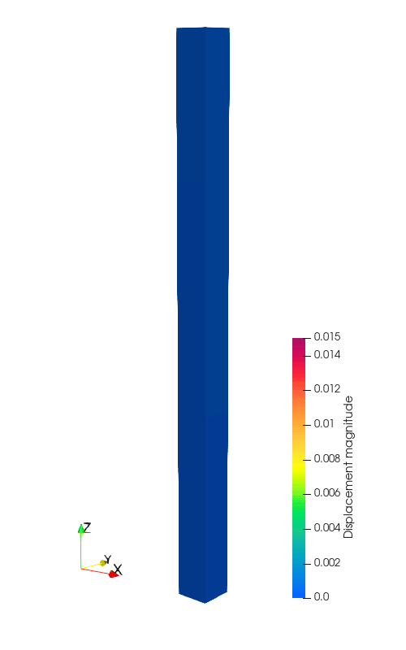
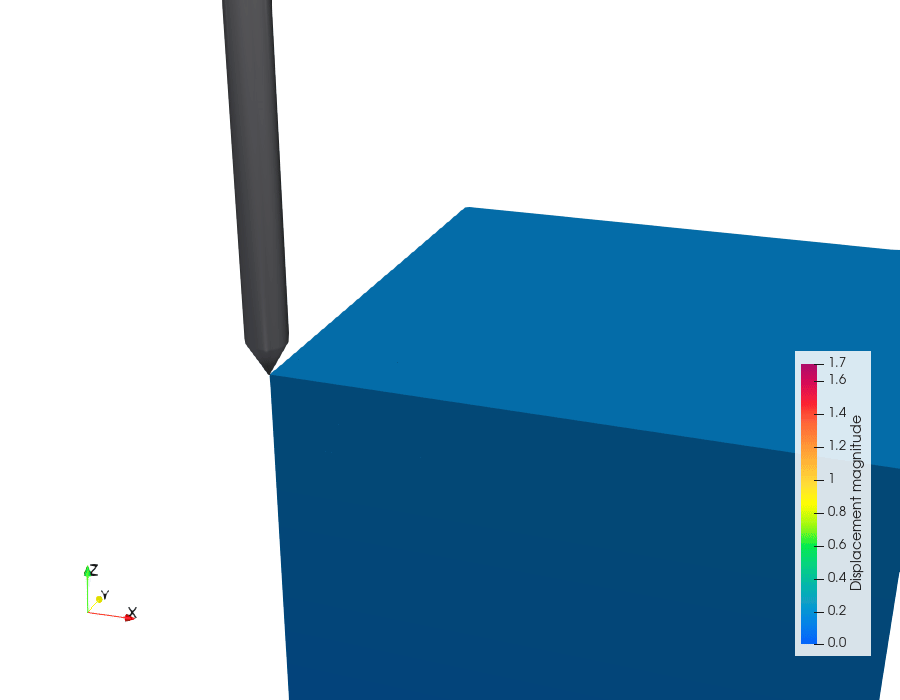
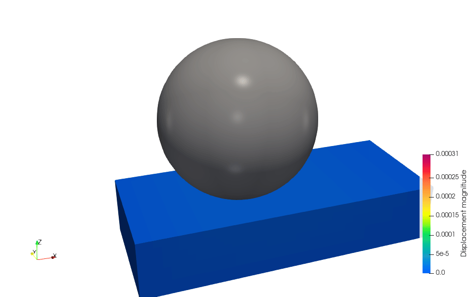
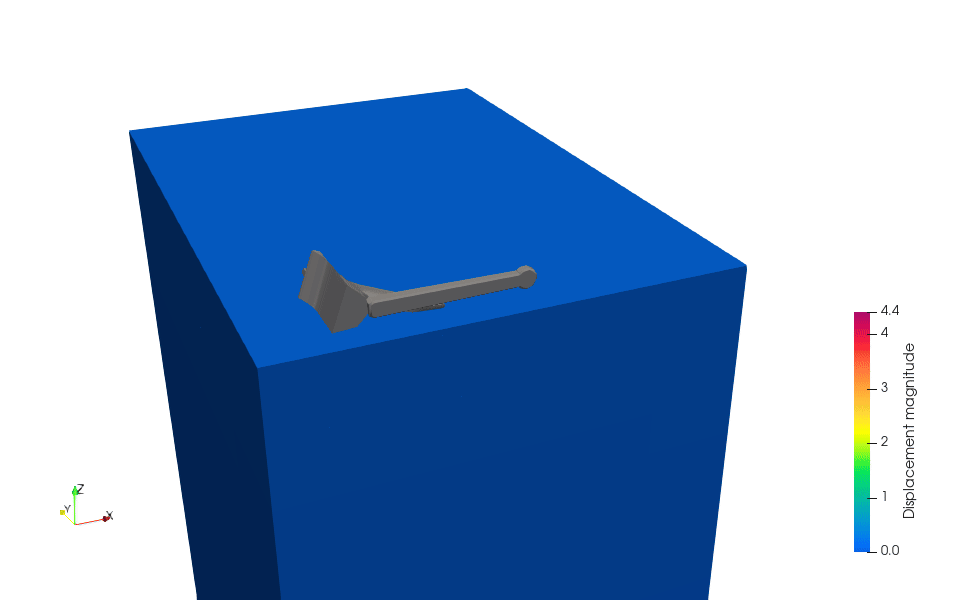

# Introduction

MPM3S is software for large-deformation soil–structure interaction problems, using the Material Point Method (MPM).

[:material-play-circle: Run your first simulation →](GettingStarted/install_and_run.md){ .md-button .md-button--primary }
[:material-school: Explore the tutorials →](TutorialProblems/TutorialProblems.md){ .md-button }

## What is MPM3S?

MPM3S is software for the analysis of soil-structure interactions problems using the Material Point Method which was developed at Durham University between 2025 and 2027 as part of the project [Leveraging The Material Point Method For Large Deformation Soil-Structure Interaction To Realise Net Zero](../project.md). 

The code has its origins in AMPLE ([A Material Point Learning Environment](https://wmcoombs.github.io/AMPLE/)).

## What can it model?

Click an animation to open its tutorial.

<figure>
<figcaption><a href="../TutorialProblems/Tutorial_1/">Tutorial 1: Self-weight column</a></figcaption></figure>
<figure>
<figcaption><a href="../TutorialProblems/Tutorial_2/">Tutorial 2: Compaction via a rigid body</a></figcaption></figure>
<figure>
<figcaption><a href="../TutorialProblems/Tutorial_3/">Tutorial 3: Cone Penetration Test</a></figcaption></figure>
<figure>
<figcaption><a href="../TutorialProblems/Tutorial_5/">Tutorial 5: Rolling sphere</a></figcaption></figure>
<figure>
<figcaption><a href="../TutorialProblems/Tutorial_6/">Tutorial 6: Drag anchor</a></figcaption></figure>

## Key features

- single phase deformable solid material considering large deformation mechanics and elasto-plastic material behaviour
- coupled deformable solid material-rigid body interactions
- implicit solvers for quasi-static and dynamic problems
- automatic mesh generation and evolution with minimal required user intervention
- written in native [Julia](https://julialang.org/) with [Docker](https://www.docker.com/) containers for easy deployment
- unit and validation tests to check correctness and provide user confidence
- JSON ([JavaScript Object Notation](https://www.json.org/json-en.html)) and STL (unstructured triangulated surface rigid body representation) input file formats
- flexible CSV (Comma-Separated Values), VTK (Visualization Toolkit) and VTU (VTK-like, XML-based file supporting compression and parallel processing) output file formats

## Scope and limitations

MPM3S is not intended for:

- problems that could easily be solved with conventional finite element methods
- small strain solid mechanics problems
- analysis of the stresses/deformations *within* a structure interacting with the deformable material

## The Material Point Method

The Material Point Method (MPM) is a computational technique for modelling solid mechanics problems (not just soil-structure interaction) with close links to the Finite Element Method. The advantage of the MPM over many other methods is its ability to return solutions for problems involving very large deformations.

A detailed explanation of the MPM is in the [Material Point Method overview](TechnicalReferences/MPMoverview.md).

## Next steps

-   :material-download:{ .lg .middle } __Install and run__

    ---

    Install Julia and MPM3S, and run your first analysis.

    [:octicons-arrow-right-24: Install and run](GettingStarted/install_and_run.md)

-   :material-school:{ .lg .middle } __Tutorial problems__

    ---

    Hands-on walkthroughs of benchmark problems, from simple to complex.

    [:octicons-arrow-right-24: Tutorial problems](TutorialProblems/TutorialProblems.md)

-   :material-file-document-edit:{ .lg .middle } __Using the software__

    ---

    The `input_data.json` format: every key, and how to write a file.

    [:octicons-arrow-right-24: Input format](UsingTheSoftware/InputFormat/index.md)

-   :material-hammer-wrench:{ .lg .middle } __Interactive builder__

    ---

    Build an `input_data.json` file in your browser, starting from a tutorial's file, and check it as you go.

    [:octicons-arrow-right-24: Interactive builder](UsingTheSoftware/input_builder.md)

-   :material-book-open-variant:{ .lg .middle } __Technical reference__

    ---

    The theory and numerical methods behind MPM3S.

    [:octicons-arrow-right-24: Technical reference](TechnicalReferences/TechnicalReference.md)

