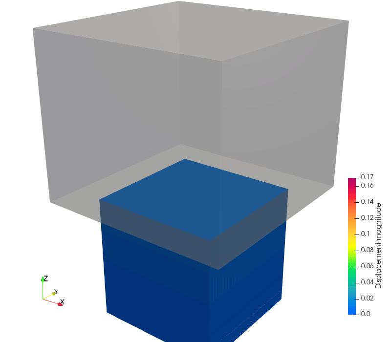
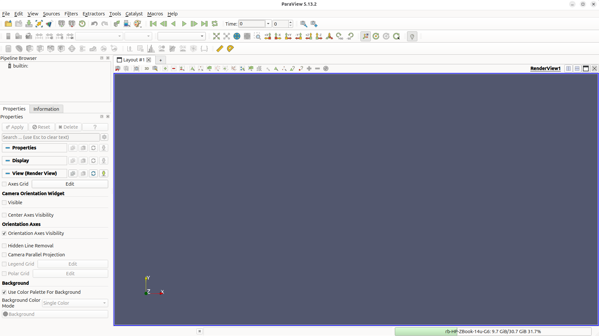
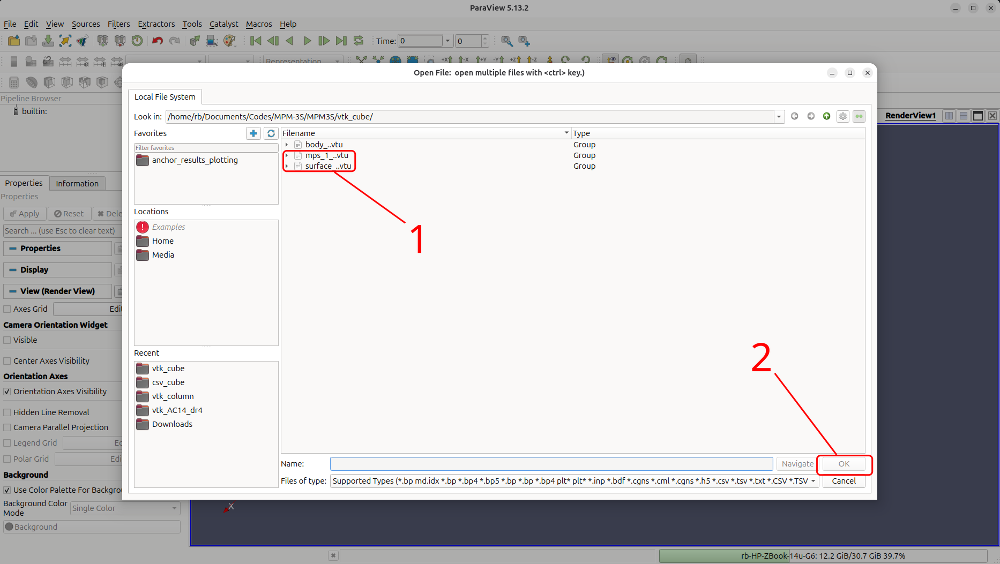
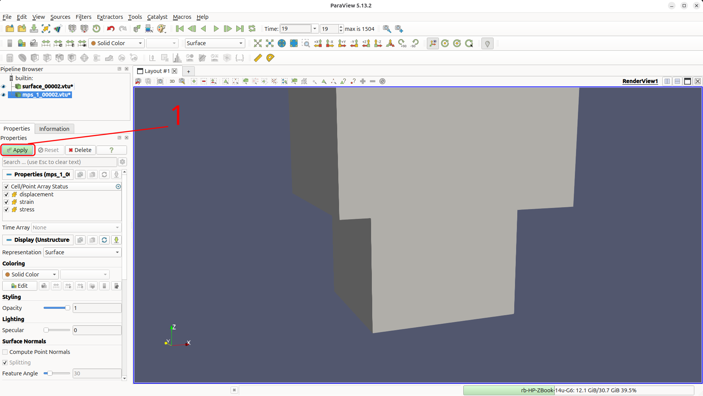
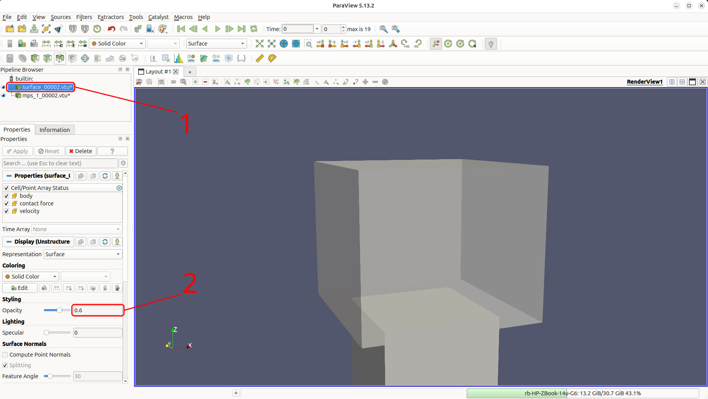
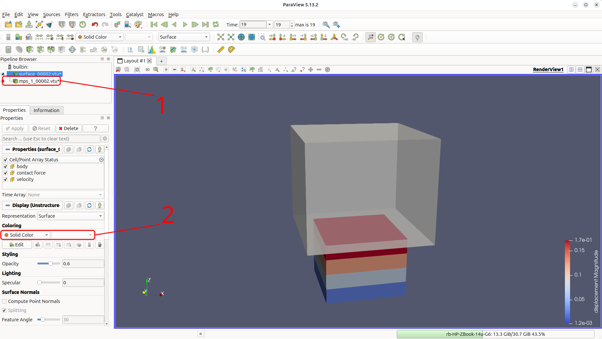
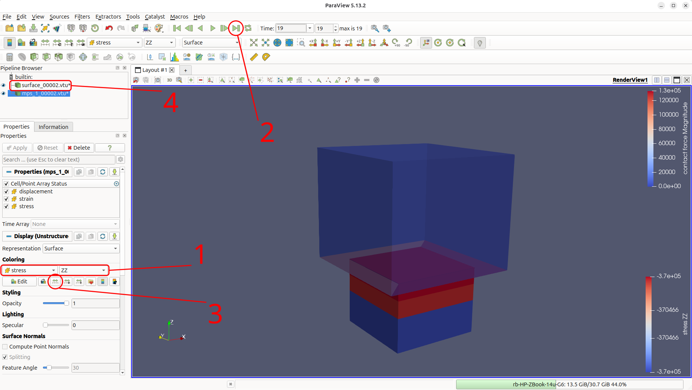

# Tutorial 2: Compaction via a rigid body

<div class="tutorial-head">
<div class="tutorial-facts level-beginner-strip">
<span class="level level-beginner">Beginner</span>
<span><strong>Work through time:</strong> about 45 min</span>
<span><strong>Approx. run time:</strong> a minute on a CPU</span>
<span class="facts-note">You can run every tutorial on your own hardware: the RAM decides whether a problem fits, and the number of CPU or GPU cores how long it takes. The run times are approximate, to give an idea of the hardware needed.</span>
</div>

</div>

## Introduction
This quick start tutorial introduces the concept of a rigid body interacting with the material points. It builds on [Tutorial 1](Tutorial_1.md) and introduces the concept of a rigid body interacting with the material points.

This tutorial analyses a cube of soil compressed by a rigid cube by 25% of its height. It is used to validate that the contact formulation produces the expected uniform vertical stress and displacement fields. This problem has been used to validate our contact formulation [@bird_dynamic_2025] and our adaptive-octree extension [@bird2026implicitoctreebasedadaptivematerial].

This tutorial has three main sections after the introduction:

- [Input setup](#input-setup)
- [Deploying and running the problem](#deploying-and-running-the-problem)
- [Viewing the results](#viewing-the-results)

### Background: rigid-body contact

<div class="json-side" markdown>

<div class="js-text" markdown>

This tutorial extends [Tutorial 1](Tutorial_1.md#background-the-gimpm) to include normal contact. A brief overview is provided here for context; see [equilibrium with rigid-body contact](../TechnicalReferences/EquilibriumEquationsContact.md) for the full technical details. [](#fig-contact-schematic) provides a schematic overview of how the contact between the rigid body and the material points works.

When contact is detected between a GIMP and the rigid body, (a) initial state, a normal contact force is applied at the corners of the GIMP's domain to resist the overlap. This force is proportional to the amount of overlap and can be thought of as a spring whose stiffness resists the overlap. MPM3S calculates the spring stiffness automatically from the GIMP size and material properties,

$$
\epsilon_N = 50\, E_p\, A_p^0,
$$

where $E_p$ is the smallest Young's modulus of the GIMPs in the element and $A_p^0 = (V_p^0)^{2/3}$ is a representation of the contact area, with $V_p^0$ the initial GIMP volume. A tangential stiffness of $25\, E_p\, A_p^0$ is used for friction. The springs are stiff but not rigid, so a small overlap between the rigid body and the GIMPs remains - a few millimetres in this problem.

After the springs have been activated the GIMPs and the mesh deform due to the contact forces created by the springs, (b) deformed state, and once convergence is obtained the mesh is reset, (c) mesh reset.

</div>

<div class="js-code" markdown>

{ #fig-contact-schematic width="100%" }

</div>

</div>

## Input setup

### Problem summary

The aim is to introduce the set-up and modelling of soil-structure interaction problems. The problem is a deformable cube compressed by a rigid cube. Although simple, it is essential, as it validates the contact formulation by confirming that the overlap between the two bodies stays small and that the resulting vertical stress field is uniform throughout the cube and matches the analytical Hencky solution for the Cauchy stress in the vertical direction

$$
\sigma_{zz} = E \ln\!\left(\frac{L}{L_0}\right) \frac{L_0}{L} = \frac{10^6}{0.75} \ln(0.75) \approx -3.84 \times 10^5 \text{ Pa},
$$

where $L_0 = 0.8$ m is the initial cube height, $\Delta z = -0.2$ m is the prescribed compression and $L = L_0 + \Delta z = 0.6$ m is the final height after the $25\%$ axial compression.

As in [Tutorial 1](Tutorial_1.md#background-the-gimpm) the material is homogeneous Hencky elastic, here with $E = 10^6$ Pa, $\nu = 0$ and $\rho = 1000$ kg/m$^3$. The whole $1.6$ m background domain is discretised by a uniform $0.4$ m mesh ($4 \times 4 \times 4 = 64$ elements); the soil fills $2 \times 2 \times 2 = 8$ of them, with a $2 \times 2 \times 2$ grid of GIMPs per element. Roller boundaries are imposed on the four side faces and the base, and the top face is left free for the rigid cube to push on.

The rigid cube is a $1.2 \times 1.2 \times 1.0$ m box, centred over the soil, that overhangs its top by $0.2$ m on every side. It starts resting on the soil and is pushed down $0.2$ m over 20 load steps.

Gravity is switched off, so all of the load on the soil comes from the rigid cube.

{ #fig-cube-mesh width="70%" }

{ #fig-cube-bcs width="50%" }

The simulation is configured through a single JSON object - a human-readable, editable text file. It extends [Tutorial 1](Tutorial_1.md#input-setup) with a rigid body. The complete file for this problem, and the rigid cube geometry, can be found [here](Tutorial_2_input_data.md), and every key is described on the [`input_data.json` file format](../UsingTheSoftware/InputFormat/index.md) page.

<div class="json-side-header">
<div>Description</div>
<div><code>input_data_compress.json</code></div>
</div>

<div class="json-side" markdown>

<div class="js-text" markdown>

### Machine

- `"GPU": "off"` runs the analysis on the CPU ([GPU](../UsingTheSoftware/InputFormat/gpu.md)).
- `"domain update": "stretch"` lets the GIMP domains compress with the soil ([domain update](../UsingTheSoftware/InputFormat/material_points.md#domain-update)).
- Without it, the domains keep their initial size, and the GIMPs next to the base cannot move closer to it.

</div>

<div class="js-code" markdown>

```json
"GPU": "off",

"domain update": "stretch",
```

</div>

</div>

<div class="json-side" markdown>

<div class="js-text" markdown>

### Domain

- The background mesh is a cube, sized automatically to hold the soil plus the same height of empty space above it: here a cube of side $1.6$ m ([domain](../UsingTheSoftware/InputFormat/domain.md)).
- `"gravity"` is zero, so the soil carries no weight.

</div>

<div class="js-code" markdown>

```json
"domain": {
    "gravity": [0.0, 0.0, 0.0]
},
```

</div>

</div>

<div class="json-side" markdown>

<div class="js-text" markdown>

### Material points

- One $0.8$ m layer on a $0.8 \times 0.8$ m footprint ([material points](../UsingTheSoftware/InputFormat/material_points.md)).
- $0.4$ m elements, with $2 \times 2 \times 2$ GIMPs in each.
- The elastic properties from the [Problem summary](#problem-summary).

</div>

<div class="js-code" markdown>

```json
"material points": {
    "extra capacity": 1.2,
    "element size": 0.4,
    "number of material points per element 1": 2,
    "material size": { "min": [0.0, 0.0], "max": [0.8, 0.8] },
    "layers": [
        {
            "thickness": 0.8,
            "material": { "type": "elastic", "E": 1.0e6, "nu": 0.0, "density": 1000.0 }
        }
    ]
},
```

</div>

</div>

<div class="json-side" markdown>

<div class="js-text" markdown>

### Rigid body

- A rigid body is a *system* of one or more [*points*](../UsingTheSoftware/InputFormat/rigid_bodies.md#points). Each point has six degrees of freedom - three displacements and three rotations - and carries a mass and rotational inertia.
- The rigid cube is a single point at its centre, $(0.4, 0.4, 1.3)$ m.
- Its `"boundary conditions"` list the six degrees of freedom in the order $[u_x, u_y, u_z, \theta_x, \theta_y, \theta_z]$:
    - five are `"fixed"`;
    - the vertical displacement is prescribed as $-0.01$ m per load step, so the rigid cube moves $0.2$ m down over the 20 load steps;
    - because every degree of freedom is held, the mass and inertia have no effect.
- The geometry comes from `cube.stl`, attached to point 1 ([STL files](../UsingTheSoftware/InputFormat/rigid_bodies.md#stl-files)):
    - the `"stl"` path is relative to the input file, so a file name on its own means the same folder;
    - it is drawn in global coordinates, the same as point 1, with its base on the top of the soil;
    - on the first run MPM3S builds a tetrahedral mesh of the rigid cube and saves it in `cube_mesh.txt`, which later runs read instead. If you change `cube.stl`, delete `cube_mesh.txt` so that the mesh is rebuilt.

</div>

<div class="js-code" markdown>

```json
"rigid bodies": [
    {
        "points": [
            { "position": [0.4, 0.4, 1.3], "mass": 1.0, "rotational inertia": [0.2, 0.2, 0.24],
              "boundary conditions": ["fixed", "fixed", { "prescribed": -0.01 }, "fixed", "fixed", "fixed"] }
        ],
        "stl files": [
            { "name": "cube", "stl": "cube.stl", "mesh cache": "cube_mesh.txt", "point": 1 }
        ]
    }
],
```

</div>

</div>

<div class="json-side" markdown>

<div class="js-text" markdown>

### Contact

- The contact between the rigid cube and the soil is frictionless ([contact properties](../UsingTheSoftware/InputFormat/contact.md)).
- The contact stiffness is set automatically, as described in the [Background](#background-rigid-body-contact).

</div>

<div class="js-code" markdown>

```json
"contact": {
    "friction coefficient": 0.0
},
```

</div>

</div>

<div class="json-side" markdown>

<div class="js-text" markdown>

### Analysis

- A single static stage of 20 load steps, with the rigid body switched on ([analysis stages](../UsingTheSoftware/InputFormat/analysis.md)).
- Gravity is zero, so `"load": "full"` has nothing to apply; all of the load comes from the rigid cube, which is pushed down a little further at every step.
- `"rigid body surface placement": "on"` moves the rigid cube vertically at the start of the stage, so that its base rests exactly on the top of the soil.
- Rollers on the four sides and the base; the top is free ([boundary conditions](../UsingTheSoftware/InputFormat/analysis.md#boundary-conditions)).
- `"adaptivity": { "type": "uniform" }` meshes the whole background domain at the $0.4$ m element size ([adaptivity](../UsingTheSoftware/InputFormat/analysis.md#adaptivity)). Without it, only the elements holding material points are $0.4$ m, and the empty space is filled with coarser elements.

</div>

<div class="js-code" markdown>

```json
"analysis": [
    {
        "type": "static",
        "load steps": 20,
        "load": "full",
        "rigid bodies": "on",
        "rigid body surface placement": "on",
        "boundary conditions": { "min": ["roller", "roller", "roller"], "max": ["roller", "roller", "free"] },
        "adaptivity": { "type": "uniform" }
    }
],
```

</div>

</div>

<div class="json-side" markdown>

<div class="js-text" markdown>

### Solver

- The same settings as [Tutorial 1](Tutorial_1.md#solver): Newton-Raphson iterations to a tolerance of $10^{-6}$ ([solver](../UsingTheSoftware/InputFormat/solver.md)).
- There are no small overlaps in this example, so there is no need for [ghost stabilisation](../TechnicalReferences/ghostStabilisation.md).

</div>

<div class="js-code" markdown>

```json
"solver": {
    "tolerance": 1.0e-6,
    "max newton iterations": 20,
    "poor factor": 0.25,
    "ghost factor": 0.0,
    "ghost factor mass": 0.0
},
```

</div>

</div>

<div class="json-side" markdown>

<div class="js-text" markdown>

### Output

- VTK and CSV output at every load step ([output](../UsingTheSoftware/InputFormat/output.md)).
- The CSV files record each GIMP's position, domain size (`"lp"`) and stress, and the rigid cube's position and reaction force - the force needed to push it.
- These are used in [Analysing the stress in the domain](#analysing-the-stress-in-the-domain).

</div>

<div class="js-code" markdown>

```json
"output": {
    "vtk": "on",
    "vtk directory": "vtk_cube",
    "vtk percent": 0,
    "vtk material point fields": ["displacement", "stress", "strain"],
    "vtk rigid body fields": ["position", "reaction force"],

    "csv": "on",
    "csv directory": "csv_cube",
    "csv percent": 0,
    "csv material point fields": ["initial position", "position", "lp", "stress"],
    "csv rigid body fields": ["position", "reaction force"]
}
```

</div>

</div>

## Deploying and running the problem

MPM3S is written in the [Julia](https://julialang.org/) programming language, and there are two ways to run the code, both explored on the [deployment page](../UsingTheSoftware/DeployingTheSoftware.md). As this is a small problem that runs quickly, this tutorial uses Julia directly; see the [installation guide](../GettingStarted/install_and_run.md) for installing Julia and MPM3S.

!!! note "Working in the MPM3S folder"
    Julia runs in the `MPM3S` folder - the folder you downloaded - throughout this tutorial, and every path in the commands and scripts is relative to it. The input file is read from `validation_data_and_jsons/input_data_compress.json`, and the output folders `vtk_cube` and `csv_cube` are written to, and read back from, the `MPM3S` folder.

<div class="json-side-header">
<div>Deployment instructions</div>
<div><code>terminal</code></div>
</div>

<div class="json-side" markdown>

<div class="js-text" markdown>

### Setting up and running the problem

The input file for this tutorial comes with MPM3S, as `validation_data_and_jsons/input_data_compress.json`, together with the geometry of the rigid cube, `cube.stl`, and its mesh cache, `cube_mesh.txt`; they are the same files as the ones provided [here](Tutorial_2_input_data.md). The STL and mesh-cache paths in the input file are relative to the input file, so the files must stay in the same folder.

As in [Tutorial 1](Tutorial_1.md#setting-up-and-running-the-problem), open a terminal, start Julia with every CPU thread available (`-t auto`), then move into the folder where you downloaded MPM3S, activate it, install its dependencies with `Pkg.instantiate()` and load MPM3S. The output folders `vtk_cube` and `csv_cube` are created in the `MPM3S` folder.

</div>

<div class="js-code" markdown>

<div class="terminal terminal-full" markdown>

```console
$ julia -t auto

julia> cd("path/to/MPM3S")
julia> using Pkg; Pkg.activate(".")
  Activating project at `path/to/MPM3S`

julia> Pkg.instantiate()

julia> using MPM3S
```

</div>

</div>

</div>

<div class="json-side" markdown>

<div class="js-text" markdown>

### Running the problem

Julia is now running in the `MPM3S` folder and MPM3S loaded. The JSON file for this problem is loaded with MPM3S and is stored in the folder `validation_data_and_jsons`, the simulations are started with:

```
MPM3S.non_linear_solve("validation_data_and_jsons/input_data_compress.json");
```

#### Reading the output

Before the first load step, MPM3S reports the rigid body surface placement: the lowest point of the rigid cube (`body base`) and the top of the soil (`material top`) are both at $0.8$ m, so the rigid cube is moved by just `Δz = 2.23517e-8` m, a small tolerance above the soil.

The progress line then works as in [Tutorial 1](Tutorial_1.md#reading-the-output). The load fraction `t` rises by `Δt 0.05` per load step, each step converges in 4 Newton-Raphson iterations (`NR`), and no steps are cut or material points deleted. The uniform background mesh has `N 125` nodes, a $5 \times 5 \times 5$ grid.

</div>

<div class="js-code" markdown>

<div class="terminal" markdown>

```console
julia> MPM3S.non_linear_solve("validation_data_and_jsons/input_data_compress.json");
[ Info: rigid body surface placement: body base 0.8 → material top 0.8   Δz = 2.23517e-8
stage 1/1 ██░░░░░░░░░░  15.0% t 0.15/1.0 step 4 Δt 0.05 NR 4 cuts 0 del 0 N 125
```

</div>

</div>

</div>

## Viewing the results

The simulation results appear as the simulation runs, so you do not need to wait until it has finished. `vtk_cube` holds three series of files, numbered from `00002` to `00021`: `mps_1_...vtu` for the GIMPs, `surface_...vtu` for the surface of the rigid cube and `body_...vtu` for the rigid cube's point which contains information such as force and moment reactions.

### Visualising the output in ParaView

The walkthrough below follows the same pattern as the [ParaView walkthrough from Tutorial 1](Tutorial_1.md#visualising-the-output-in-paraview), but also loads the surface of the rigid cube and makes it see-through, so that the soil beneath it can be inspected. The same [3D-navigation controls](Tutorial_1.md#visualising-the-output-in-paraview) (left-drag to rotate, scroll to zoom) apply throughout.

<div class="walkthrough" markdown>
<div markdown>
**1. Open ParaView.** Launch ParaView from your applications menu or terminal; you should see an empty render view.
</div>
<div markdown>
{ #fig-paraview-1 }
</div>
</div>

<div class="walkthrough" markdown>
<div markdown>
**2. Open the output files.** Use *File → Open* and navigate to `vtk_cube`. ParaView groups the numbered files into three series: `body_..vtu`, `mps_1_..vtu` and `surface_..vtu`. Hold `Ctrl` and click `mps_1_..vtu` and `surface_..vtu` so both are highlighted (1), then click *OK* (2).
</div>
<div markdown>
{ #fig-paraview-2 }
</div>
</div>

<div class="walkthrough" markdown>
<div markdown>
**3. Apply the readers.** Click *Apply* (1) in the Properties panel. Both series appear in the *Pipeline Browser*, and the render view shows the rigid cube resting on the soil. The rigid cube overhangs the soil and hides it from most directions, so zoom out and rotate the view to see both bodies.
</div>
<div markdown>
{ #fig-paraview-3 }
</div>
</div>

<div class="walkthrough" markdown>
<div markdown>
**4. Make the rigid cube see-through.** Select `surface_..vtu` in the *Pipeline Browser* (1) and set *Opacity*, under *Styling*, to `0.6` (2). The soil can now be seen through the rigid cube, which overhangs it on every side.
</div>
<div markdown>
{ #fig-paraview-4 }
</div>
</div>

<div class="walkthrough" markdown>
<div markdown>
**5. Choose a field to colour the GIMPs by.** Select `mps_1_..vtu` (1) and open the *Coloring* menu (2), which lists the fields written to the VTK files: `displacement`, `strain` and `stress`. Choosing `displacement` → `Magnitude` and stepping through time shows the displacement of the GIMPs increasing evenly from the base to the top of the soil as the rigid cube moves $0.2$ m down.
</div>
<div markdown>
{ #fig-paraview-5 }
</div>
</div>

<div class="walkthrough" markdown>
<div markdown>
**6. Inspect the final stress distribution.** Change the GIMPs' *Coloring* to `stress` → `ZZ` (1), click *Go to Last* (`▶|`) (2) and then *Rescale to Data Range* (3). The soil has been compressed to about $0.6$ m under the rigid cube. Additionally to inspect the contact force select `surface_..vtu` (4) and change its *Coloring* (1) to `contact force` → `Magnitude`. The force is zero over the sides and top of the rigid cube and is carried by the triangles of its base, which is in contact with the soil.
</div>
<div markdown>
{ #fig-paraview-6 }
</div>
</div>


## Analysing the stress in the domain

`csv_cube/rigid_body.csv` has one row per load step for the rigid cube's point, `body1`. The `time` column is the load fraction, `body1_position_z` is the height of the rigid cube's centre and `body1_reaction force_z` is the vertical force needed to push the rigid cube down, in N:

```text
time,body1_position_x,body1_position_y,body1_position_z,body1_reaction force_x,body1_reaction force_y,body1_reaction force_z
0.05,0.4,0.4,1.290000022351742,0.0,0.0,8022.186499840163
0.1,0.4,0.4,1.280000022351742,0.0,0.0,16343.582579162323
...
1.0000000000000002,0.4,0.4,1.1000000223517419,0.0,0.0,237097.96125687487
```

The GIMP files, `csv_cube/mps_1_00002.csv` to `mps_1_00021.csv`, have the same layout as in [Tutorial 1](Tutorial_1.md#analysing-the-stress-variation-with-height), with the addition of the domain half-widths `lp_x`, `lp_y` and `lp_z`.

The short Julia script below compares the final state with the analytical solution from the [Problem summary](#problem-summary). As in [Tutorial 1](Tutorial_1.md#analysing-the-stress-variation-with-height), you can run it in the same Julia session straight after the analysis, either by copying it into the REPL or by saving it as `check_stress.jl` in the `MPM3S` folder and running `include("check_stress.jl")`. It needs only `DelimitedFiles`, which comes with Julia.

```julia
using DelimitedFiles

# the soil at the final load step; skip the "time" line, then read the header
soil, soil_header = readdlm("csv_cube/mps_1_00021.csv", ',', Float64; skipstart=1, header=true)
soil_column(name) = soil[:, findfirst(==(name), vec(soil_header))]
z    = soil_column("position_z")
lp_z = soil_column("lp_z")
szz  = soil_column("stress_zz")

# the rigid cube: one row per load step, so the last row is the final step
rigid, rigid_header = readdlm("csv_cube/rigid_body.csv", ',', Float64; header=true)
rigid_column(name) = rigid[end, findfirst(==(name), vec(rigid_header))]
force_z = rigid_column("body1_reaction force_z")
base_z  = rigid_column("body1_position_z") - 0.5    # the rigid cube is 1 m tall

E, L0, area = 1.0e6, 0.8, 0.8 * 0.8
L = maximum(z + lp_z)                                # final height of the soil
println("final soil height       ", round(L, digits=4), " m (overlap ", round(1000 * (L - base_z), digits=1), " mm)")
println("mean vertical stress    ", round(sum(szz) / length(szz) / 1000, digits=1), " kPa")
println("Hencky at that height   ", round(E * log(L / L0) * L0 / L / 1000, digits=1), " kPa")
println("rigid cube force / area ", round(-force_z / area / 1000, digits=1), " kPa")
```

For this run it prints:

```text
final soil height       0.6046 m (overlap 4.6 mm)
mean vertical stress    -370.5 kPa
Hencky at that height   -370.5 kPa
rigid cube force / area -370.5 kPa
```

The rigid cube overlaps the soil by $4.6$ mm - about $0.6\%$ of the soil's height - so the soil is compressed to $0.6046$ m rather than $0.6$ m. At that height the Hencky solution gives $-370.5$ kPa, matching the mean stress in the GIMPs; the full $0.2$ m of compression would give the $-383.6$ kPa of the [Problem summary](#problem-summary), $3.5\%$ more.

The stress is uniform: every GIMP has the same vertical stress, $-370.5$ kPa, and the rigid cube force divided by the area of the soil gives the same value.

To see the effect of the mesh, set `"element size"` in [Material points](#material-points) to `0.2` and compare the overlap and the stresses.
