---
hide:
  - toc
---

# Tutorial 3: Vertical penetration (Cone Penetration Test)

<div class="tutorial-facts level-intermediate-strip">
<span class="level level-intermediate">Intermediate</span>
<span><strong>Work through time:</strong> about 1 to 1.5 h</span>
<span><strong>Approx. run time:</strong> 15 min on a GPU, 1 h on a CPU</span>
<span class="facts-note">You can run every tutorial on your own hardware: the RAM decides whether a problem fits, and the number of CPU or GPU cores how long it takes. The run times are approximate, to give an idea of the hardware needed.</span>
</div>

## Introduction
This tutorial walks through a Cone Penetration Test (CPT) simulation, a workhorse problem in offshore geotechnical engineering that is used to calibrate soil parameters against in-situ measurements. This tuto

A rigid cone is pushed quasi-statically $4.5$ m into a bed of dry sand, and the cone-tip resistance can be compared against centrifuge data such as that of Davidson *et al.* [@davidson2022physical] and Cerfontaine *et al.* [@Cerfontaine2020]. The problem builds on [Tutorial 2](Tutorial_2.md) and adds four things: an elasto-plastic sand whose stiffness increases with depth, frictional contact, mesh refinement that follows the cone, and an analysis made of two stages.

This tutorial has four sections:

- [Problem description](#problem-description)
- [Input setup](#input-setup)
- [Deploying and running the problem](#deploying-and-running-the-problem)
- [Viewing the results](#viewing-the-results)

## Problem description

You will define the soil, the cone, the two loading stages, the solver and the output in the input file. All the inputs to the simulation are defined using the [`input_data.json` file format](../UsingTheSoftware/InputFormat/index.md).

To reduce the computational cost the symmetry of the problem is exploited and therefore only a quarter of the problem is modelled, using the two vertical planes of symmetry through the cone axis. The cone axis runs down the corner of the soil block at $x = y = 0$, and the two faces that meet there carry roller conditions.

{ #fig-cpt-domain width="25%" }

*Figure adapted from [@bird2026implicitoctreebasedadaptivematerial].*

**Soil block:** $10 \times 10$ m in plan and $20$ m deep, starting with $2 \times 2 \times 2$ material points in each element. The base element size is given as $2.0$ m, but every element size must be a power-of-two multiple of the smallest one - $0.025$ m at the cone - so the base size becomes $0.025 \times 2^6 = 1.6$ m and the footprint is rounded up to seven elements, $11.2 \times 11.2$ m (see [how element sizes set the mesh](../UsingTheSoftware/InputFormat/material_points.md#how-element-sizes-set-the-mesh)).

**Boundary conditions:** Rollers on the four vertical faces and a fixed base, at $x = 0$ and $y = 0$ these are the symmetry conditions. The soil surface is free.

**Material:** an elasto-plastic sand. Yield is governed by a frictional cone with a Willam-Warnke deviatoric section, and plastic flow by a Drucker-Prager cone set by the dilation angle, so the flow is non-associated. The elastic behaviour is linear in logarithmic (Hencky) strain. The model is described in [isotropic elasto-plasticity](../TechnicalReferences/ElastoPlasticity.md#lode-angle-dependent-deviatoric-section). The sand has a relative density of $D_r = 32\%$, and its parameters come from the Brinkgreve correlations [@brinkgreve2010validation]:

<div class="centered-table" markdown>

| Property                     | Correlation                                | Value at $D_r = 32\%$ | Input key                     |
|------------------------------|--------------------------------------------|-----------------------|-------------------------------|
| Reference Young's modulus    | $E^{ref} = 60\,000\; D_r/100$ kPa          | $19.2$ MPa            | `"E": 1.92e7`                 |
| Friction angle               | $\phi = 28 + 12.5\; D_r/100$               | $32^\circ$            | `"friction angle": 32.0`      |
| Dilation angle               | $\psi = -2 + 12.5\; D_r/100$               | $2^\circ$             | `"dilation angle": 2.0`       |
| Dry unit weight              | $\gamma = 15 + 4\; D_r/100$ kN/m$^3$       | $16.28$ kN/m$^3$      | -           |
| Dry density                  | $\rho = \gamma/g$, with $g = 10$ m/s$^2$     | $1628$ kg/m$^3$       | `"density": 1628.0`           |
| Stiffness exponent           | $m = 0.7 - D_r/320$                        | $0.6$                 | `"exponent": 0.6`             |
| Earth pressure at rest       | $K_0 = 1 - \sin\phi$                       | $0.4701$              | `"reference stress"` (below)  |
| Poisson's ratio              | -                                          | $0.25$                | `"nu": 0.25`                  |
| Cohesion                     | -                                          | $0.3$ kPa             | `"cohesion": 300.0`           |

</div>

The density is entered as the unit weight divided by $10$ m/s$^2$.

The Young's modulus increases with depth. Brinkgreve's stiffness law is written in terms of the horizontal stress $K_0 \sigma_v$ and a reference pressure $p^{ref} = 100$ kPa, whereas MPM3S's [stress-dependent stiffness](../UsingTheSoftware/InputFormat/material_points.md#stress-dependent-stiffness) uses the vertical stress $\sigma_v$. The two are the same when the reference stress is $p^{ref}/K_0$:

$$
E = E^{ref} \left( \frac{K_0\, \sigma_v}{p^{ref}} \right)^{m} = E^{ref} \left( \frac{\sigma_v}{\sigma^{ref}} \right)^{m}, \qquad \sigma^{ref} = \frac{p^{ref}}{K_0} = 212.73 \text{ kPa}.
$$

$\sigma_v$ is calculated from the weight of the soil above each material point's initial position, so each point's stiffness is set once and does not change during the analysis.

**Cone:** `CPT.stl`, a cylinder of radius $r = 0.4$ m with a $60^\circ$ conical tip, $10.69$ m long in total and drawn with its tip at the origin. Coulomb friction with $\mu = 0.33$ acts between the cone and the sand, and the contact penalty is set automatically, as described in [Tutorial 2](Tutorial_2.md#background-rigid-body-contact).

**Loading:** Two static stages:

- **Stage 1 - initial stresses:** the cone is switched off and gravity is ramped up over 5 load steps.
- **Stage 2 - penetration:** the cone is placed on the soil surface and pushed down $10$ mm per load step for 450 load steps ($4.5$ m), with the mesh refined to $0.025$ m wherever the cone surface is.

**Solver:** Newton-Raphson, quasi-static, for both stages.

## Input setup
The input file is a single JSON object - a human-readable, editable text file. The complete file for this problem can be found [here](Tutorial_3_input_data.md), and every key is described on the [`input_data.json` file format](../UsingTheSoftware/InputFormat/index.md) page.

<div class="json-side-header">
<div>Description</div>
<div><code>input_data_CPT_dr32.json</code></div>
</div>

<div class="json-side" markdown>

<div class="js-text" markdown>

### Machine

- `"GPU": "on"` runs the analysis on an NVIDIA GPU ([GPU](../UsingTheSoftware/InputFormat/gpu.md)).
- This is recommended here, because refining the cone surface to $0.025$ m creates a large number of material points.
- Set it to `"off"` to run on the CPU.

</div>

<div class="js-code" markdown>

```json
"GPU" : "on"
```

</div>

</div>

<div class="json-side" markdown>

<div class="js-text" markdown>

### Domain

- The background grid is a cube, sized automatically to hold the soil block and the empty space above it: here a cube of side $51.2$ m ([domain](../UsingTheSoftware/InputFormat/domain.md)).
- Gravity acts in $-z$.

</div>

<div class="js-code" markdown>

```json
"domain": {
    "gravity": [0.0, 0.0, -9.81]
}
```

</div>

</div>

<div class="json-side" markdown>

<div class="js-text" markdown>

### Material points

- A single $20$ m layer of Willam-Warnke sand over a $10 \times 10$ m footprint, with the properties from the [Problem description](#problem-description) ([material points](../UsingTheSoftware/InputFormat/material_points.md)).
- The `"E overburden"` block makes the Young's modulus increase with depth ([stress-dependent stiffness](../UsingTheSoftware/InputFormat/material_points.md#stress-dependent-stiffness)).
- `"extra capacity": 1.2` reserves 20% more storage than the initial material points need, because the refinement around the cone splits material points into smaller ones.

</div>

<div class="js-code" markdown>

```json
"material points": {
    "extra capacity": 1.2,
    "element size": 2.0,
    "number of material points per element 1": 2,
    "material size": { "min": [0.0, 0.0], "max": [10.0, 10.0] },
    "layers": [
        {
            "thickness": 20.0,
            "material": { "type": "willam warnke",
                          "E": 1.92e7, "nu": 0.25,
                          "friction angle": 32.0, "dilation angle": 2.0, "cohesion": 300.0,
                          "density": 1628.0,
                          "E overburden": { "reference stress": 2.12729e5, "exponent": 0.6 } }
        }
    ]
}
```

</div>

</div>

<div class="json-side" markdown>

<div class="js-text" markdown>

### Rigid body

- The cone is one system with a single [point](../UsingTheSoftware/InputFormat/rigid_bodies.md#points), placed at its tip - the origin of `CPT.stl`.
- All positions in the file are global, so the point and the STL geometry are given in the same frame.
- `"offset"` shifts the whole cone $10$ mm in $-x$ and $-y$, so its axis sits just outside the corner of the soil block.
- All six degrees of freedom are `"fixed"`, so the cone does not move and its mass and inertia play no part; stage 2 replaces the vertical condition to push the cone down.
- `CPT_mesh.txt` stores the tetrahedral mesh of the cone; if it is missing, it is generated from the STL on the first run ([STL files](../UsingTheSoftware/InputFormat/rigid_bodies.md#stl-files)).

</div>

<div class="js-code" markdown>

```json
"rigid bodies": [
    {
        "offset": [-0.01, -0.01, 0.0],
        "points": [
            { "position": [0.0, 0.0, 0.0], "mass": 39989.6, "rotational inertia": [1626001.9, 1626001.9, 3199.2],
              "boundary conditions": ["fixed", "fixed", "fixed", "fixed", "fixed", "fixed"] }
        ],
        "stl files": [
            { "name": "cpt", "stl": "CPT.stl",
              "mesh cache": "CPT_mesh.txt", "point": 1 }
        ]
    }
]
```

</div>

</div>

<div class="json-side" markdown>

<div class="js-text" markdown>

### Contact

- Coulomb friction with $\mu = 0.33$ between the cone and the sand ([contact properties](../UsingTheSoftware/InputFormat/contact.md)).

</div>

<div class="js-code" markdown>

```json
"contact": {
    "friction coefficient": 0.33
}
```

</div>

</div>

<div class="json-side" markdown>

<div class="js-text" markdown>

### Stage 1: initial stresses

- A static stage with the cone switched off (`"rigid bodies": "off"`) ([analysis stages](../UsingTheSoftware/InputFormat/analysis.md)).
- Gravity is ramped from zero to its full value over 5 load steps, setting up the initial stresses in the sand.
- `"adaptivity": {"type": "none"}` uses the base mesh: elements of the $1.6$ m base size wherever there are material points, and coarser elements in the empty space above the soil ([adaptivity](../UsingTheSoftware/InputFormat/analysis.md#adaptivity)).
- The four vertical faces are rollers and the base is fixed ([boundary conditions](../UsingTheSoftware/InputFormat/analysis.md#boundary-conditions)).
- The top face is fixed too, but it lies at twice the soil depth, in the empty space above the soil, so the soil surface stays free.

</div>

<div class="js-code" markdown>

```json
{
    "type": "static",
    "load steps": 5,
    "load": "gravity ramp",
    "rigid bodies": "off",
    "adaptivity": { "type": "none" },
    "boundary conditions": { "min": ["roller", "roller", "fixed"], "max": ["roller", "roller", "fixed"] }
}
```

</div>

</div>

<div class="json-side" markdown>

<div class="js-text" markdown>

### Stage 2: cone penetration

- The cone is switched on.
- `"rigid body surface placement": "on"` moves it vertically at the start of the stage, so that its tip rests on the soil surface.
- `"load": "full"` keeps gravity at its full value throughout.
- `"rigid body boundary conditions"` replaces the conditions of point 1 of system 1 - the cone - for this stage only, prescribing a vertical displacement of $-0.01$ m per load step: over the 450 load steps the cone penetrates $4.5$ m ([rigid body boundary conditions](../UsingTheSoftware/InputFormat/analysis.md#rigid-body-boundary-conditions)).
- `"rigid body surface"` adaptivity refines the elements the cone surface passes through to $0.025$ m at every step, so the fine mesh travels down with the cone ([adaptivity](../UsingTheSoftware/InputFormat/analysis.md#adaptivity)).
- For a quicker, coarser first run, use `"element size": 0.1`.

</div>

<div class="js-code" markdown>

```json
{
    "type": "static",
    "load steps": 450,
    "load": "full",
    "rigid bodies": "on",
    "rigid body surface placement": "on",
    "adaptivity": {
        "type": "rigid body surface",
        "element size": 0.025
    },
    "rigid body boundary conditions": [
        { "system": 1, "point": 1, "boundary conditions": ["fixed", "fixed", { "prescribed": -0.01 }, "fixed", "fixed", "fixed"] }
    ],
    "boundary conditions": { "min": ["roller", "roller", "fixed"], "max": ["roller", "roller", "fixed"] }
}
```

</div>

</div>

<div class="json-side" markdown>

<div class="js-text" markdown>

### Solver

- Newton-Raphson iterations to a tolerance of $10^{-6}$ in each load step ([solver](../UsingTheSoftware/InputFormat/solver.md)).
- A step that has not converged after 20 iterations is retried with half the increment.
- `"ghost factor"` and `"ghost factor mass"` set the strength of the [ghost stabilisation](../TechnicalReferences/ghostStabilisation.md) of poorly filled elements at the edges of the soil.
- `"poor factor": 0.25` treats elements less than a quarter full as poorly filled.

</div>

<div class="js-code" markdown>

```json
"solver": {
    "tolerance": 1.0e-6,
    "max newton iterations": 20,
    "poor factor": 0.25,
    "ghost factor": 0.025,
    "ghost factor mass": 0.25
}
```

</div>

</div>

<div class="json-side" markdown>

<div class="js-text" markdown>

### Output

- VTK files for [ParaView](https://www.paraview.org/) are written to `vtk_CPT_dr32` every $0.5\%$ of each stage's load steps: every 2 load steps in the 450 of stage 2 ([output](../UsingTheSoftware/InputFormat/output.md)).
- CSV files go to `csv_CPT_dr32` every $0.25\%$: every load step here.
- The rigid-body CSV output includes the `reaction force` on the cone - the total force needed to push it, made up of the resistance at the tip and the friction along the sleeve.
- [Cone resistance](#cone-resistance) shows how the tip resistance is calculated from it.

</div>

<div class="js-code" markdown>

```json
"output": {
    "vtk": "on",
    "vtk directory": "vtk_CPT_dr32",
    "vtk percent": 0.5,
    "vtk material point fields": ["displacement", "velocity", "stress", "strain", "volume"],
    "vtk rigid body fields": ["position", "velocity", "reaction force"],

    "csv": "on",
    "csv directory": "csv_CPT_dr32",
    "csv percent": 0.25,
    "csv material point fields": ["initial position", "position", "stress"],
    "csv rigid body fields": ["position", "velocity", "reaction force", "reaction moment"]
}
```

</div>

</div>

## Deploying and running the problem

MPM3S is written in the [Julia](https://julialang.org/) programming language. See the [installation guide](../GettingStarted/install_and_run.md) for installing Julia and MPM3S, and [Tutorial 1](Tutorial_1.md#deploying-and-running-the-problem) for a first, small run.

!!! note "Working in the MPM3S folder"
    Julia runs in the `MPM3S` folder - the folder you downloaded - throughout this tutorial, and every path in the commands and scripts is relative to it. The input file is read from `validation_data_and_jsons/input_data_CPT_dr32.json`, and the output folders `vtk_CPT_dr32` and `csv_CPT_dr32` are written to, and read back from, the `MPM3S` folder. The CSV files exported from ParaView are saved in `vtk_CPT_dr32` too.

<div class="json-side-header">
<div>Deployment instructions</div>
<div><code>terminal</code></div>
</div>

<div class="json-side" markdown>

<div class="js-text" markdown>

### Setting up the problem

The input file for this tutorial comes with MPM3S, as `validation_data_and_jsons/input_data_CPT_dr32.json`, together with the cone geometry, `CPT.stl`, and its mesh cache, `CPT_mesh.txt`; the input file is the same as the [complete input file](Tutorial_3_input_data.md). The STL and mesh-cache paths in the input file are relative to the input file, so the files must stay in the same folder.

As in [Tutorial 1](Tutorial_1.md#setting-up-and-running-the-problem), open a terminal, start Julia with every CPU thread available (`-t auto`), then move into the folder where you downloaded MPM3S, activate it, install its dependencies with `Pkg.instantiate()` and load MPM3S. The output folders `vtk_CPT_dr32` and `csv_CPT_dr32` are created in the `MPM3S` folder.

### Running the problem

Julia is now running in the `MPM3S` folder and MPM3S loaded. The JSON file for this problem is loaded with MPM3S and is stored in the folder `validation_data_and_jsons`, the simulations are started with:

```
MPM3S.non_linear_solve("validation_data_and_jsons/input_data_CPT_dr32.json");
```

This is a large analysis: with $0.025$ m elements around the cone it is intended for a GPU or an HPC node. On a workstation without a GPU, set `"GPU": "off"` and use `"element size": 0.1` in stage 2.

#### Reading the output

The progress line works as in [Tutorial 1](Tutorial_1.md#reading-the-output), showing `stage 1/2` while the initial stresses are set up and `stage 2/2` during penetration.

At the start of stage 2, MPM3S reports the rigid body surface placement: the cone tip (`body base`, at the origin of `CPT.stl`) is moved up by `Δz` to the soil surface (`material top`), which has settled to $19.85$ m under the weight of the sand.

During penetration `N` grows as the mesh is refined around the cone. Load steps that do not converge are retried with half the increment (`cuts`), and material points next to the cone that become too distorted are deleted (`del`).

</div>

<div class="js-code" markdown>

<div class="terminal terminal-full" markdown>

```console
$ julia -t auto

julia> cd("path/to/MPM3S")
julia> using Pkg; Pkg.activate(".")
  Activating project at `path/to/MPM3S`

julia> Pkg.instantiate()

julia> using MPM3S

julia> MPM3S.non_linear_solve("validation_data_and_jsons/input_data_CPT_dr32.json");
stage 1/2 ████████████ 100.0% t 1.0/1.0 step 6 Δt 0.2 NR 3 cuts 0 del 0 N 1640
stage 2/2 ░░░░░░░░░░░░   0.2% t 0.002222/1.0 step 7 Δt 0.00222 NR 3 cuts 0 del 0 N 56885
[ Info: rigid body surface placement: body base 0.0 → material top 19.8474   Δz = 19.8474
stage 2/2 ████████████ 100.0% t 1.001/1.0 step 457 Δt 0.00222 NR 18 cuts 1 del 1914 N 56744
```

</div>

</div>

</div>

## Viewing the results

!!! note "Displacements and stresses"
    To see the displacements and stresses during the simulation, follow the same steps as for the compression cube in [Tutorial 2](Tutorial_2.md#visualising-the-output-in-paraview). All the VTK files for this problem are in `path/to/MPM3S/vtk_CPT_dr32`. This section shows how to extract the load on the cone and its penetration from them.

### Cone resistance

`csv_CPT_dr32/rigid_body.csv` has one row per output step for the cone's point, `body1`. `body1_position_z` is the height of the cone tip and `body1_reaction force_z` is the vertical force needed to push the cone. Because only a quarter of the soil is modelled, the tip resistance is approximately

$$
q_c = \frac{4\, |F_z|}{\pi r^2}, \qquad r = 0.4 \text{ m},
$$

and the penetration depth is the height at which the cone is placed on the soil, minus `body1_position_z`. The sand settles under its own weight in stage 1, so the surface is at about $19.85$ m rather than $20$ m; MPM3S prints the exact value as `material top` in the `rigid body surface placement` message at the start of stage 2. $F_z$ includes the friction along the sleeve as well as the force on the tip, which is why $q_c$ is approximate. The rows from stage 1 come before the cone is placed on the soil, with zero force, and should be skipped. In a static stage the `time` column is the load fraction, which runs from 0 to 1 over the $4.5$ m of penetration.

#### Tip resistance without the sleeve friction

The reaction force in `rigid_body.csv` includes the friction along the sleeve. To find the force on the tip alone, sum the vertical contact force on the triangles of the conical tip in ParaView, and track the height of the tip:

<div class="walkthrough" markdown>
<div markdown>
**1. Open the cone.** *File → Open*, go to `vtk_CPT_dr32`, select the `surface_..vtu` series on its own, click *OK* and then *Apply*. The cone appears in the render view.
</div>
<div markdown>
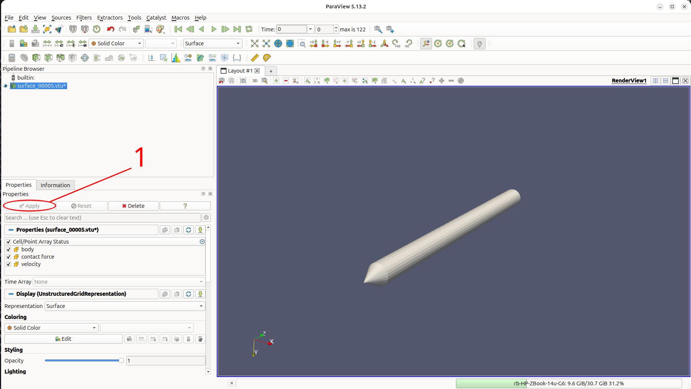{ #fig-cpt-tip-1 }
</div>
</div>

<div class="walkthrough" markdown>
<div markdown>
**2. Select the triangles of the conical tip.** Click *Select Cells On* in the render-view toolbar (or press `S`) and drag a box around the conical tip, so that its triangles are highlighted in pink and the cylindrical sleeve is not. Hold `Ctrl` and drag again to add any triangles that were missed.
</div>
<div markdown>
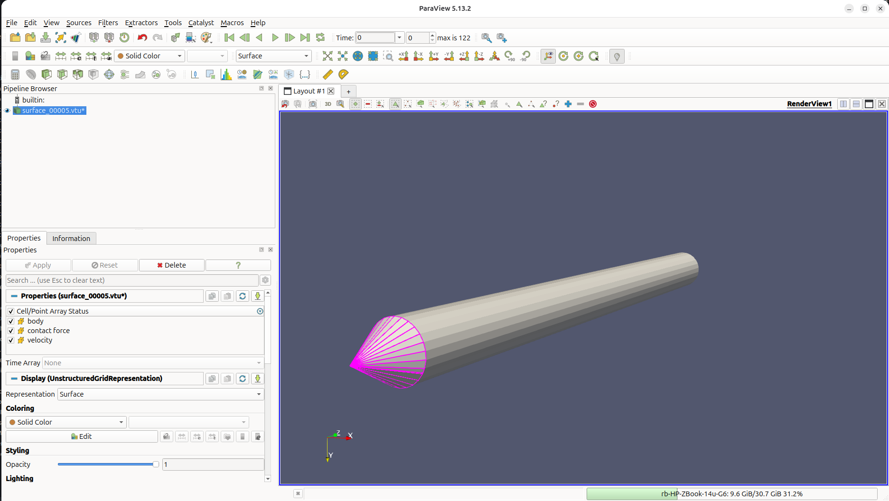{ #fig-cpt-tip-2 }
</div>
</div>

<div class="walkthrough" markdown>
<div markdown>
**3. Find the Extract Selection filter.** Open the *Filters* menu. `Ctrl` + `Space` opens the same filter search from anywhere in ParaView.
</div>
<div markdown>
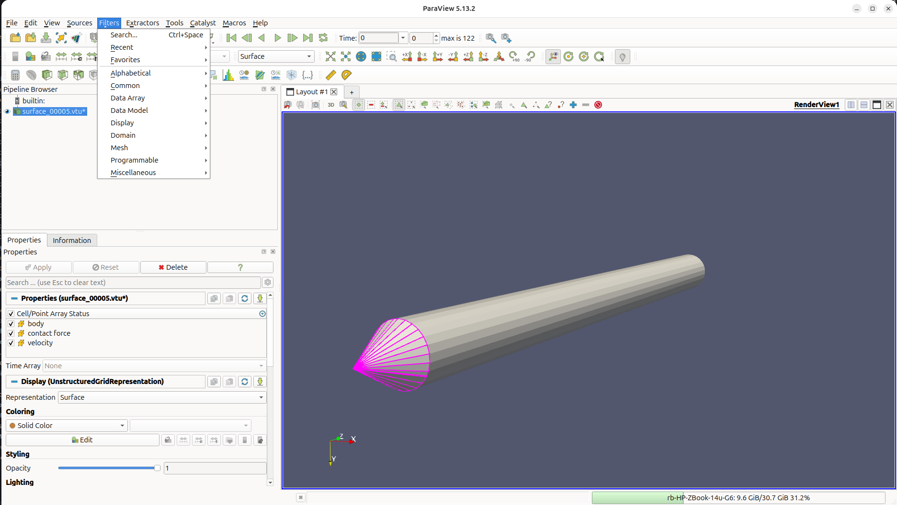{ #fig-cpt-tip-3 }
</div>
</div>

<div class="walkthrough" markdown>
<div markdown>
**4. Extract the selection.** Type `extract sel`, choose *Extract Selection* and press `Enter`.
</div>
<div markdown>
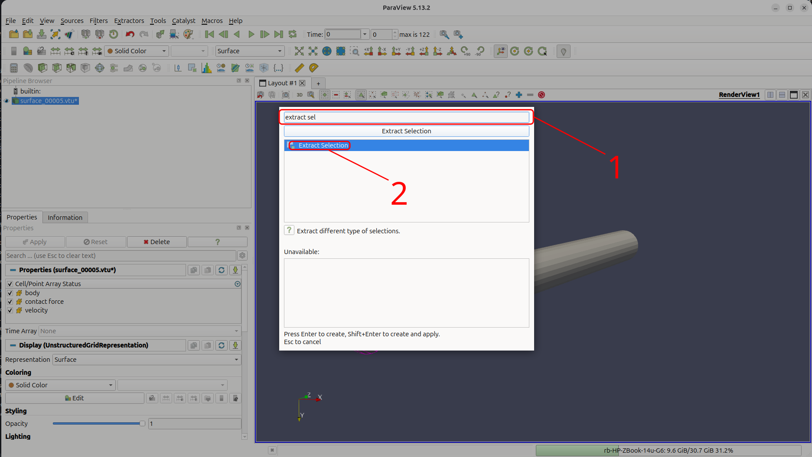{ #fig-cpt-tip-4 }
</div>
</div>

<div class="walkthrough" markdown>
<div markdown>
**5. Apply it, then select the tip point.** `ExtractSelection1` appears in the *Pipeline Browser*; click *Apply*. It holds only the triangles of the tip. Then (1) click *Clear Selection* to remove the selected triangles, and (2) click *Select Points On* (or press `D`) and drag a small box around the very tip of the cone, which is highlighted as a single pink point.
</div>
<div markdown>
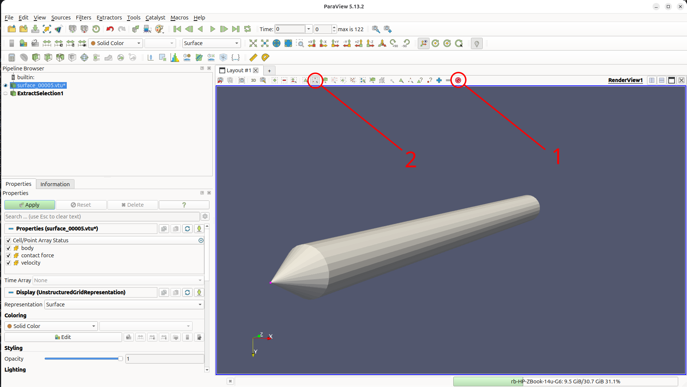{ #fig-cpt-tip-5 }
</div>
</div>

<div class="walkthrough" markdown>
<div markdown>
**6. Extract the tip point and name the two extracts.** Apply *Extract Selection* again to extract the tip point. Right-click each extract in the *Pipeline Browser*, choose *Rename*, and call the triangles `cone load` and the point `cone tip`.
</div>
<div markdown>
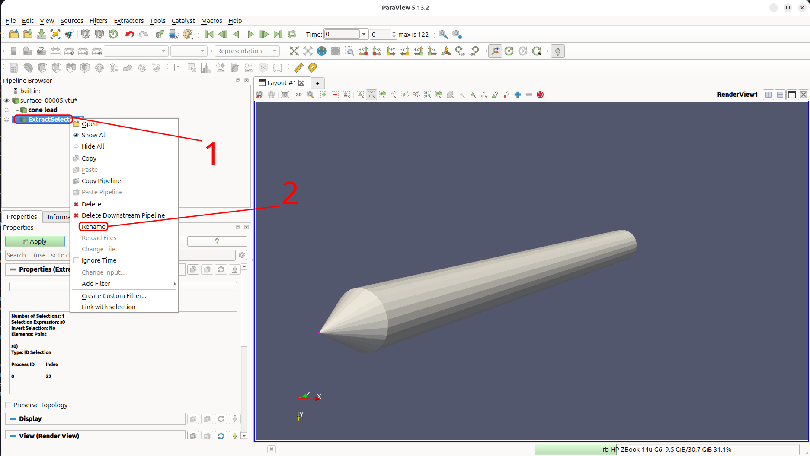{ #fig-cpt-tip-6 }
</div>
</div>

<div class="walkthrough" markdown>
<div markdown>
**7. Check the extracts.** Hide `surface_..vtu` with its eye icon. Only the conical tip is left.
</div>
<div markdown>
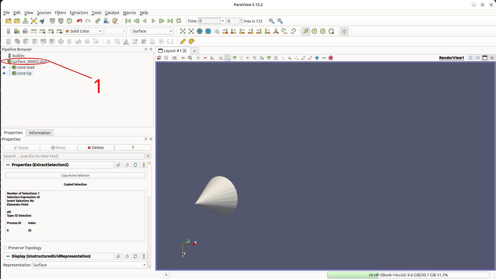{ #fig-cpt-tip-7 }
</div>
</div>

<div class="walkthrough" markdown>
<div markdown>
**8. Open a layout for the plots.** Click `+` beside *Layout #1* to open *Layout #2* and choose *Line Chart View*.
</div>
<div markdown>
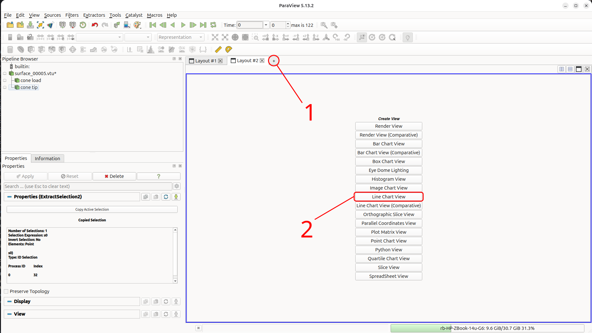{ #fig-cpt-tip-8 }
</div>
</div>

<div class="walkthrough" markdown>
<div markdown>
**9. Plot the load on the tip over time.** Select `cone load`, go to `Filters`, then `Search`, and then type `plot da` and choose *Plot Data Over Time*.
</div>
<div markdown>
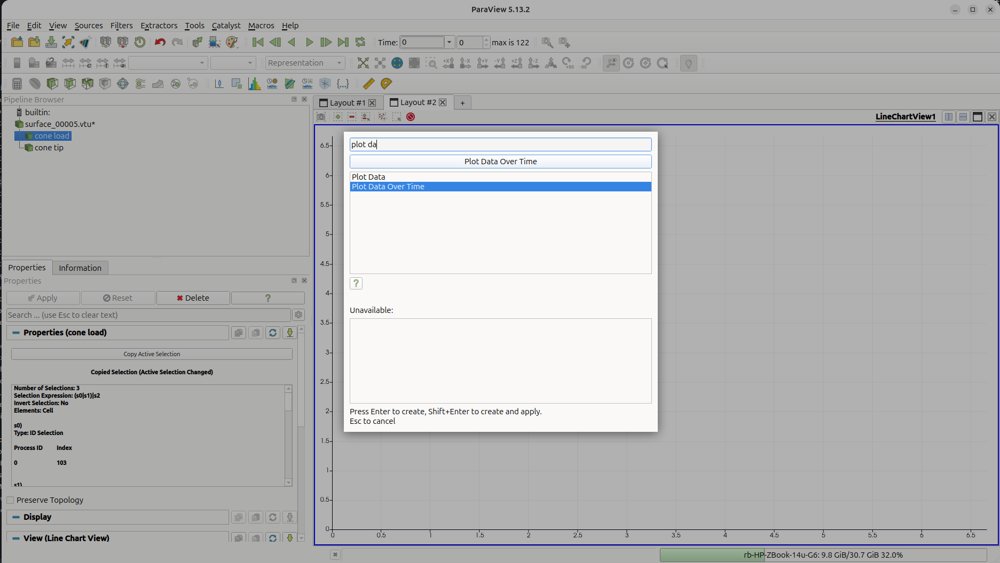{ #fig-cpt-tip-9 }
</div>
</div>

<div class="walkthrough" markdown>
<div markdown>
**10. Use the cell data.** The contact force is stored on the triangles, so set *Field Association* to *Cells*. Keep *Only Report Selection Statistics* ticked and click *Apply*. ParaView reads every output step, which takes a moment, and draws a quartile chart.
</div>
<div markdown>
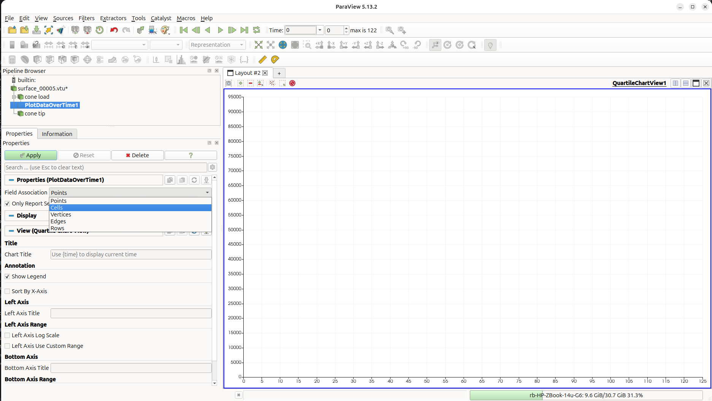{ #fig-cpt-tip-10 }
</div>
</div>

<div class="walkthrough" markdown>
<div markdown>
**11. Choose the vertical force.** In *Series Parameters*, untick every series except `contact force (2) (stats)`, the $z$ component. The chart shows its average over the tip triangles, with the spread between them shaded.
</div>
<div markdown>
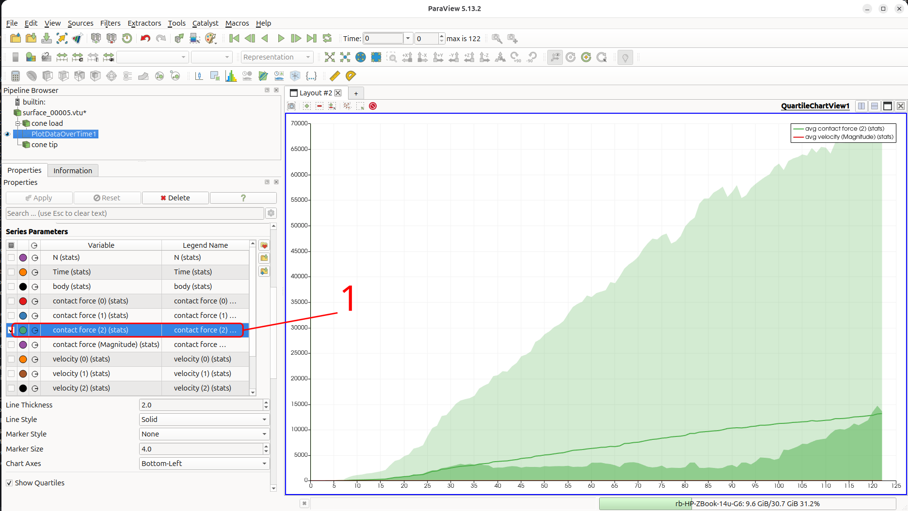{ #fig-cpt-tip-11 }
</div>
</div>

<div class="walkthrough" markdown>
<div markdown>
**12. Show the total.** Further down, untick *Show Quartiles* and *Show Average* and tick *Show Sum*. `sum contact force (2) (stats)` is the vertical force on the tip of the quarter cone, which grows steadily as the cone penetrates.
</div>
<div markdown>
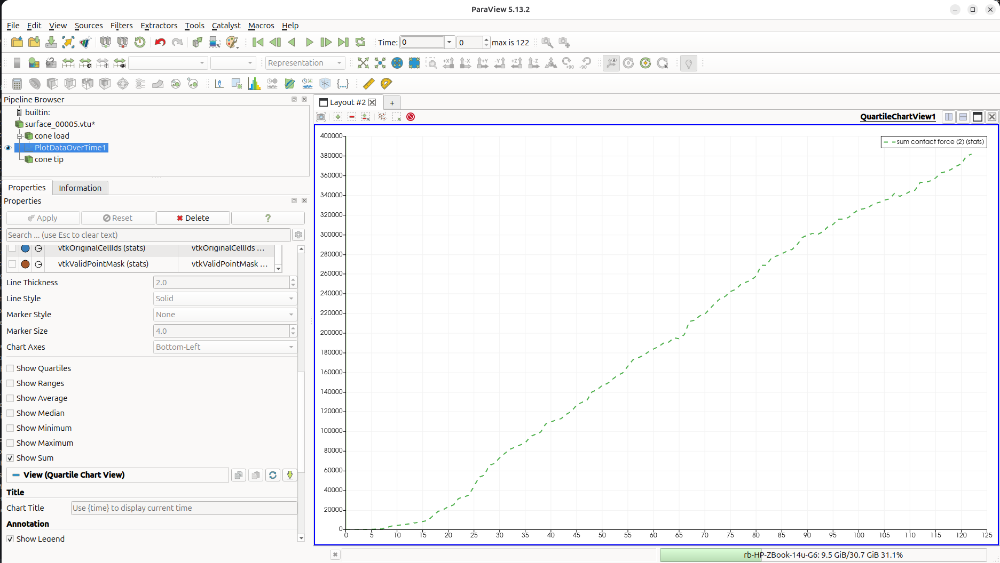{ #fig-cpt-tip-12 }
</div>
</div>

<div class="walkthrough" markdown>
<div markdown>
**13. Export the load.** *File → Export View*, choose *Comma or Tab Delimited Files* and save the chart in `vtk_CPT_dr32` as `load_data.csv`.
</div>
<div markdown>
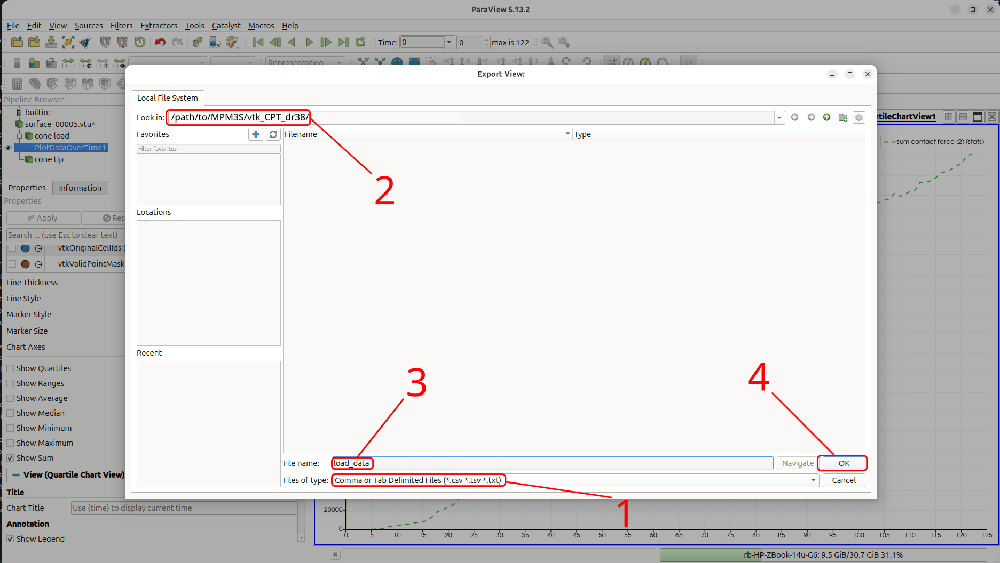{ #fig-cpt-tip-13 }
</div>
</div>

<div class="walkthrough" markdown>
<div markdown>
**14. Plot the tip height.** Select `cone tip` and apply *Plot Data Over Time* again, keeping *Field Association* as *Points*, and show only `Z (stats)`. The tip height is $0$ in stage 1, jumps to the soil surface at about $19.85$ m when the cone is placed at the start of stage 2, and then falls steadily as the cone is pushed down. Export it in the same way, as `position_data.csv` in `vtk_CPT_dr32`.
</div>
<div markdown>
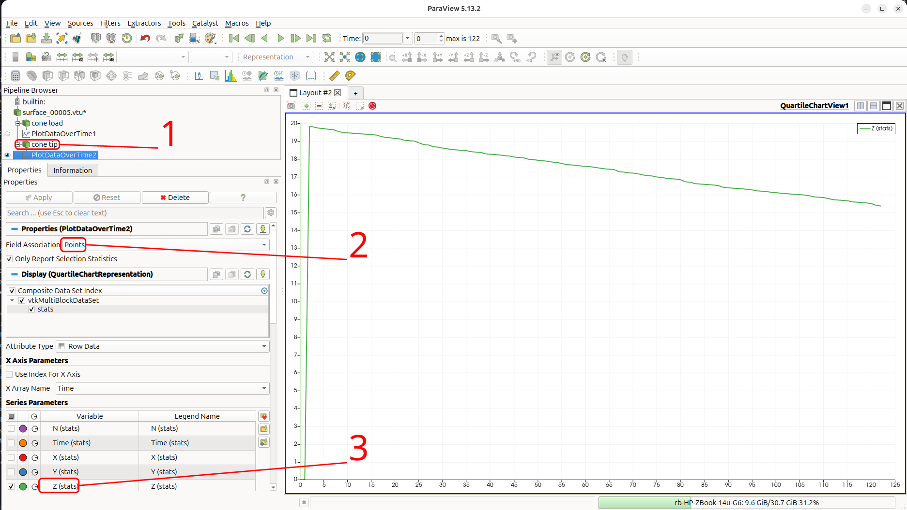{ #fig-cpt-tip-14 }
</div>
</div>

With $F_{tip}$ the summed vertical contact force from `load_data.csv`, the tip resistance of the full cone is

$$
q_c = \frac{4\, F_{tip}}{\pi r^2},
$$

and the penetration depth is the height at which the cone is placed on the soil - $19.8474$ m, the `material top` in the rigid body surface placement message - minus the tip height from `position_data.csv`. Both files have one row per output step; the first rows, from stage 1, have a tip height of $0$ and are skipped.

The short Julia script below plots $q_c$ against the penetration depth. Run it from the `MPM3S` folder, either by copying it into the REPL or by saving it as `plot_qc.jl` and running `include("plot_qc.jl")`. It needs [Plots](https://docs.juliaplots.org/), installed as described in [Tutorial 1](Tutorial_1.md#analysing-the-stress-variation-with-height).

```julia
using DelimitedFiles, Plots

# the two files exported from ParaView, one row per output step
load, _ = readdlm("vtk_CPT_dr32/load_data.csv", ',', Float64; header=true)
tip,  _ = readdlm("vtk_CPT_dr32/position_data.csv", ',', Float64; header=true)
F = load[:, 2]    # vertical contact force on the tip of the quarter cone (N)
z = tip[:, 2]     # height of the cone tip (m)

# skip stage 1, before the cone is placed on the soil (tip height 0)
s2 = z .> 0

r = 0.4               # cone radius (m)
z_surface = 19.8474   # "material top" in the rigid body surface placement message
depth = (z_surface .- z[s2])/r
qc = 4 .* F[s2] ./ (π * r^2) ./ 1e6   # tip resistance of the full cone (MPa)

plot(qc, depth, yflip=true, label="MPM3S", xlabel="tip resistance q_c (MPa)", ylabel="normalised penetration depth (m/m)")
```

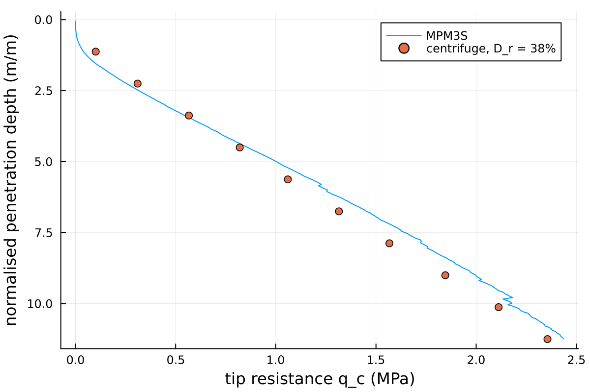{ #fig-cpt-qc width="50%" }

