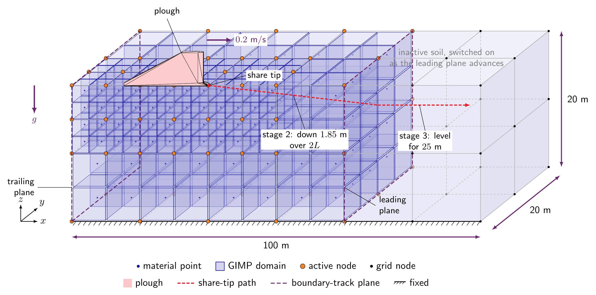
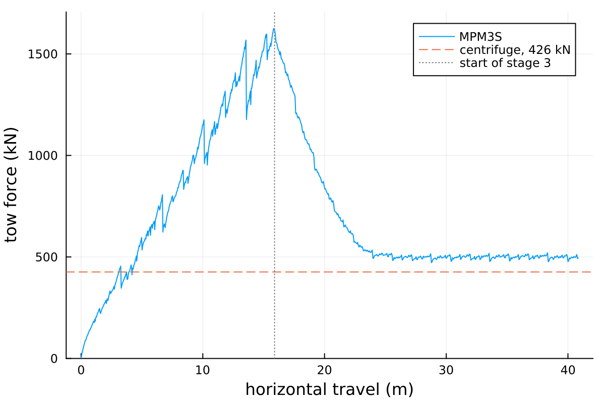

---
hide:
  - toc
---

# Tutorial 4: Plough

<div class="tutorial-head">
<div class="tutorial-facts level-advanced-strip">
<span class="level level-advanced">Advanced</span>
<span><strong>Work through time:</strong> about 1 to 1.5 h</span>
<span><strong>Approx. run time:</strong> to be added (GPU)</span>
<span class="facts-note">You can run every tutorial on your own hardware: the RAM decides whether a problem fits, and the number of CPU or GPU cores how long it takes. The run times are approximate, to give an idea of the hardware needed.</span>
</div>
</div>

## Introduction
This tutorial drives a plough through a bed of dry sand along a prescribed path and compares the force needed to tow it with a reference value of $810$ kN, from the centrifuge tests of Robinson et al. [@robinson2019centrifuge].

The problem uses the gravity stage from [Tutorial 1](Tutorial_1.md), the displacement-controlled rigid body with contact from [Tutorial 2](Tutorial_2.md), the Willam-Warnke sand with depth-dependent stiffness from [Tutorial 3](Tutorial_3.md), and the dynamic time integration, frictional contact and moving boundaries from [Tutorial 5](Tutorial_5.md) and [Tutorial 6](Tutorial_6.md). Unlike the anchor of Tutorial 6, the plough is not free: its whole path is prescribed, so the soil only decides the force needed to move it.

This tutorial has four sections:

- [Problem description](#problem-description)
- [Input setup](#input-setup)
- [Deploying and running the problem](#deploying-and-running-the-problem)
- [Viewing the results](#viewing-the-results)

## Problem description

You will model a plough being driven into, and then along, a bed of sand. To do this, you will define the soil, the plough, the three loading stages, the solver and the output in the input file, using the [`input_data.json` file format](../UsingTheSoftware/InputFormat/index.md).

[](#fig-plough-setup) shows the model at the start of stage 2. To reduce the problem size, only half of the plough and soil is modelled, using the vertical $xz$ plane of symmetry at $y = 0$. The plough starts on the soil surface and moves at $0.2$ m/s down to a depth of $1.85$ m over two plough lengths, then level at $0.1$ m/s for $25$ m. Instead of solving the whole length of soil, a boundary track keeps only a window of soil active, from $5$ m behind to $10$ m ahead of the plough. The elements around the plough are refined down to $0.05$ m; the figure only shows this schematically.

{ #fig-plough-setup width="80%" }

**Material domain:** The soil is $100$ m long, $20$ m wide and $20$ m deep. As in [Tutorial 3](Tutorial_3.md), the mesh is refined around the rigid body: the elements which intersect the plough are refined to $0.05$ m, while those far from it are $5$ m, and every element is created with $2 \times 2 \times 2$ material points. Because the mesh is an octree whose smallest element is $0.05$ m, MPM3S adjusts these sizes (see [how element sizes set the mesh](../UsingTheSoftware/InputFormat/material_points.md#how-element-sizes-set-the-mesh)):

- element sizes are rounded **down** to a power-of-two multiple of $0.05$ m, so the mesh is never coarser than requested: the $5$ m elements become $0.05 \times 2^6 = 3.2$ m;
- the $x$ and $y$ dimensions are rounded **up** to whole elements: $102.4 \times 22.4$ m;
- the depth is rounded **up** to a whole row of material points ($1.6$ m): $20$ m becomes $20.8$ m.

**Loading:** Three stages, with $L = 7.93$ m the length of the plough:

- **Stage 1 - initial stresses:** static; the plough is switched off and gravity is ramped up over 5 load steps.
- **Stage 2 - penetration:** dynamic, $79.3$ s in steps of $0.05$ s; the plough is placed on the soil surface, then moves $0.2$ m/s in $+x$ while it descends, reaching a depth of $1.85$ m after $2L = 15.86$ m.
- **Stage 3 - horizontal penetration:** dynamic, $250$ s in steps of $0.05$ s; the plough moves $0.1$ m/s in $+x$ at a constant depth of $1.85$ m, for $25$ m.

**Boundary conditions:** The boundary conditions are defined separately for each stage. In every stage the base is fixed, and the side at $y = 0$ (the plane of symmetry) and the opposite side carry rollers; the top face lies in the empty space above the soil, so its condition has no effect. Only the two ends, the $x$ faces, change:

- **Stage 1 - initial stresses:** all vertical sides are rollers, the bottom face is fixed.
- **Stages 2 and 3:** a boundary track replaces both ends with fixed planes that move with the plough: one $5$ m behind it, which deletes the soil the plough leaves behind, and one $10$ m ahead of it. Both distances are rounded outward to whole $3.2$ m elements. On the plane of symmetry, $y = 0$, the roller stops the soil moving in $y$ but leaves it free to slide in $x$ and $z$, which is exactly the symmetry condition: the modelled half behaves as one half of the full plough and soil.

**Material:** Willam-Warnke elasto-plastic dry sand at a relative density of $D_r = 44\%$, with the parameters from the Brinkgreve correlations [@brinkgreve2010validation], as in [Tutorial 3](Tutorial_3.md#problem-description):

<div class="centered-table" markdown>

| Property                     | Correlation                                         | Value at $D_r = 44\%$     | Input key                     |
|------------------------------|-----------------------------------------------------|---------------------------|-------------------------------|
| Reference Young's modulus    | $E^{ref} = 60\,000\; D_r/100$ kPa                   | $26.4$ MPa                | `"E": 2.64e7`                 |
| Friction angle               | $\phi = 28 + 12.5\; D_r/100$                        | $33.5^\circ$              | `"friction angle": 33.5`      |
| Dilation angle               | $\psi = -2 + 12.5\; D_r/100$, not below 0           | $3.5^\circ$               | `"dilation angle": 3.5`       |
| Dry unit weight              | $\gamma = 15 + 4\; D_r/100$ kN/m$^3$                | $16.76$ kN/m$^3$          | -            |
| Dry density                  | $\rho = \gamma/g$, with $g = 10$ m/s$^2$            | $1676$ kg/m$^3$           | `"density": 1676.0`           |
| Stiffness exponent           | $m = 0.7 - D_r/320$                                 | $0.5625$                  | `"exponent": 0.5625`          |
| Earth pressure at rest       | $K_0 = 1 - \sin\phi$                                | $0.4481$                  | `"reference stress"` (below)  |
| Poisson's ratio              | -                                                   | $0.25$                    | `"nu": 0.25`                  |
| Cohesion                     | -                                                   | $0.3$ kPa                 | `"cohesion": 300.0`           |

</div>

As in [Tutorial 3](Tutorial_3.md#problem-description), the reference stress for the depth-dependent stiffness is $p^{ref}/K_0 = 100/0.4481 = 223.2$ kPa.

**Plough:** The plough is a blade with a share at its foot, $7.93$ m long, $3.15$ m tall and $0.375$ m wide, drawn in `plough.stl` with the share pointing in $+x$. It is centred on the plane of symmetry, so half its width, $0.1875$ m, lies in the modelled soil. The plough is a single rigid body welded to one `rigid body point` at its centroid. Its motion is prescribed in every stage, so it has no free degree of freedom and its mass plays no part: the point is given a nominal mass of $1$ kg. Frictional contact between the plough and the sand uses $\mu = 0.3$.

**Solver:** Newton-Raphson, pseudo-static for stage 1 and implicit dynamic for stages 2 and 3.

## Input setup
The input file is a single JSON object - a human-readable, editable text file. The complete file for this problem can be found [here](Tutorial_4_input_data.md), and every key is described on the [`input_data.json` file format](../UsingTheSoftware/InputFormat/index.md) page.

<div class="json-side-header">
<div>Description</div>
<div><code>input_data_plough_dr44.json</code></div>
</div>

<div class="json-side" markdown>

<div class="js-text" markdown>

### Machine

- `"GPU": "on"` runs the analysis on an NVIDIA GPU ([GPU](../UsingTheSoftware/InputFormat/gpu.md)).
- Without a GPU, set it to `"off"` to run on the CPU: the results are the same, but the analysis will be much slower.

</div>

<div class="js-code" markdown>

```json
"GPU": "on",
```

</div>

</div>

<div class="json-side" markdown>

<div class="js-text" markdown>

### Domain

- The background mesh is a cube, sized automatically to hold the material domain plus the same height of empty space above it ([domain](../UsingTheSoftware/InputFormat/domain.md)).
- Here the $102.4$ m length governs: the side is a power-of-two number of $3.2$ m elements, $3.2 \times 2^5 = 102.4$ m.
- Gravity acts in $-z$.

</div>

<div class="js-code" markdown>

```json
"domain": {
    "gravity": [0.0, 0.0, -9.81]
},
```

</div>

</div>

<div class="json-side" markdown>

<div class="js-text" markdown>

### Material points

- One layer of Willam-Warnke sand, with the properties from the [Problem description](#problem-description) ([material points](../UsingTheSoftware/InputFormat/material_points.md)).
- A $100 \times 20$ m footprint, whose $y = 0$ side is the plane of symmetry.
- $5$ m base elements (rounded to $3.2$ m), each starting with $2 \times 2 \times 2$ material points.

</div>

<div class="js-code" markdown>

```json
"material points": {
    "extra capacity": 1.2,
    "element size": 5.0,
    "number of material points per element 1": 2,
    "material size": { "min": [0.0, 0.0], "max": [100.0, 20.0] },
    "layers": [
        {
            "thickness": 20.0,
            "material": { "type": "willam warnke",
                          "E": 2.64e7, "nu": 0.25,
                          "friction angle": 33.5, "dilation angle": 3.5, "cohesion": 300.0,
                          "density": 1676.0,
                          "E overburden": { "reference stress": 223183.0, "exponent": 0.5625 } }
        }
    ]
},
```

</div>

</div>

<div class="json-side" markdown>

<div class="js-text" markdown>

### Rigid body

- The plough is one rigid-body system with a single [point](../UsingTheSoftware/InputFormat/rigid_bodies.md#points), at the plough's centroid, $(4.549, 0, 1.244)$ in the frame `plough.stl` is drawn in.
- All six of its degrees of freedom are fixed; stages 2 and 3 replace them with the prescribed motion. Nothing is left free, so the mass and rotational inertia are nominal values of $1$.
- The plough surface is welded to the point ([STL files](../UsingTheSoftware/InputFormat/rigid_bodies.md#stl-files)), and its tetrahedral mesh is stored in the mesh-cache file. `plough.stl` is drawn with its rear at $x = 0$, its base at $z = 0$ and its width centred on $y = 0$.
- `"offset"` moves the whole system $5$ m in $+x$, so that $5$ m of soil lies behind the plough, and $20$ m up, to about the soil surface; stage 2 then places it exactly on the surface.

</div>

<div class="js-code" markdown>

```json
"rigid bodies": [
    {
        "offset": [5.0, 0.0, 20.0],
        "points": [
            { "position": [4.549060, 0.0, 1.244252], "mass": 1.0, "rotational inertia": [1.0, 1.0, 1.0],
              "boundary conditions": ["fixed", "fixed", "fixed", "fixed", "fixed", "fixed"] }
        ],
        "stl files": [
            { "name": "plough", "stl": "plough.stl", "mesh cache": "plough_mesh.txt", "point": 1 }
        ]
    }
],
```

</div>

</div>

<div class="json-side" markdown>

<div class="js-text" markdown>

### Contact

- Coulomb friction with $\mu = 0.3$ between the plough and the sand ([contact properties](../UsingTheSoftware/InputFormat/contact.md)).

</div>

<div class="js-code" markdown>

```json
"contact": {
    "friction coefficient": 0.3
},
```

</div>

</div>

<div class="json-side" markdown>

<div class="js-text" markdown>

### Stage 1: initial stresses

- Static, with the plough switched off.
- Gravity is ramped up from zero over 5 load steps.
- A uniform $3.2$ m mesh ([adaptivity](../UsingTheSoftware/InputFormat/analysis.md#adaptivity)).
- Rollers on the four vertical faces and a fixed base; the top face lies in the empty space above the soil ([boundary conditions](../UsingTheSoftware/InputFormat/analysis.md#boundary-conditions)).

</div>

<div class="js-code" markdown>

```json
"analysis": [
    {
        "type": "static",
        "load steps": 5,
        "load": "gravity ramp",
        "rigid bodies": "off",
        "adaptivity": { "type": "uniform" },
        "boundary conditions": { "min": ["roller", "roller", "fixed"], "max": ["roller", "roller", "fixed"] }
    },
```

</div>

</div>

<div class="json-side" markdown>

<div class="js-text" markdown>

### Stage 2: penetration

- Dynamic, $79.3$ s in steps of $0.05$ s: $1586$ steps.
- `"rigid body surface placement": "on"` first moves the plough vertically so that its base rests on the soil surface.
- `"rigid body boundary conditions"` replaces the plough's conditions (system 1, point 1) for this stage, prescribing every step ([rigid body boundary conditions](../UsingTheSoftware/InputFormat/analysis.md#rigid-body-boundary-conditions)):
    - $0.01$ m in $+x$, which is $0.2$ m/s;
    - $0.0011665$ m in $-z$, which is $1.85/1586$, so the plough reaches $1.85$ m below the surface after $15.86$ m, two plough lengths.
- $\beta = 0.5$ and $\gamma = 1.0$ add numerical damping.
- The mesh is refined to $0.05$ m wherever the plough surface is ([adaptivity](../UsingTheSoftware/InputFormat/analysis.md#adaptivity)).
- `"boundary track"` replaces the two $x$ ends with fixed planes that follow the plough ([boundary track](../UsingTheSoftware/InputFormat/analysis.md#boundary-track)):
    - one $5$ m behind it, which deletes the soil the plough leaves behind;
    - one $10$ m ahead of it; the soil beyond it stays inactive until the plane reaches it.

</div>

<div class="js-code" markdown>

```json
    {
        "type": "dynamic",
        "dt": 0.05,
        "final time": 79.3,
        "beta": 0.5,
        "gamma": 1.0,
        "rigid bodies": "on",
        "rigid body surface placement": "on",
        "adaptivity": { "type": "rigid body surface", "element size": 0.05 },
        "rigid body boundary conditions": [
            { "system": 1, "point": 1,
              "boundary conditions": [{ "prescribed": 0.01 }, "fixed", { "prescribed": -0.0011664565 }, "fixed", "fixed", "fixed"] }
        ],
        "boundary conditions": { "min": ["fixed", "roller", "fixed"], "max": ["roller", "roller", "fixed"] },
        "boundary track": {
            "min": { "type": ["fixed", "off", "off"], "distance": [5.0, 0.0, 0.0],
                     "advance": ["positive", "positive", "positive"], "remove": ["yes", "no", "no"] },
            "max": { "type": ["fixed", "off", "off"], "distance": [10.0, 0.0, 0.0],
                     "advance": ["positive", "positive", "positive"], "remove": ["no", "no", "no"] }
        }
    },
```

</div>

</div>

<div class="json-side" markdown>

<div class="js-text" markdown>

### Stage 3: horizontal penetration

- Dynamic, $250$ s in steps of $0.05$ s: $5000$ steps.
- The plough moves $0.005$ m in $+x$ every step, which is $0.1$ m/s, $25$ m in all, and is held at its depth.
- The plough is already in place, so `"rigid body surface placement"` is `"off"`.
- The refinement and the boundary track are the same as in stage 2.

</div>

<div class="js-code" markdown>

```json
    {
        "type": "dynamic",
        "dt": 0.05,
        "final time": 250.0,
        "beta": 0.5,
        "gamma": 1.0,
        "rigid bodies": "on",
        "rigid body surface placement": "off",
        "adaptivity": { "type": "rigid body surface", "element size": 0.05 },
        "rigid body boundary conditions": [
            { "system": 1, "point": 1,
              "boundary conditions": [{ "prescribed": 0.005 }, "fixed", "fixed", "fixed", "fixed", "fixed"] }
        ],
        "boundary conditions": { "min": ["fixed", "roller", "fixed"], "max": ["roller", "roller", "fixed"] },
        "boundary track": {
            "min": { "type": ["fixed", "off", "off"], "distance": [5.0, 0.0, 0.0],
                     "advance": ["positive", "positive", "positive"], "remove": ["yes", "no", "no"] },
            "max": { "type": ["fixed", "off", "off"], "distance": [10.0, 0.0, 0.0],
                     "advance": ["positive", "positive", "positive"], "remove": ["no", "no", "no"] }
        }
    }
],
```

</div>

</div>

<div class="json-side" markdown>

<div class="js-text" markdown>

### Solver

- Newton-Raphson iterations to a tolerance of $10^{-6}$ in each step ([solver](../UsingTheSoftware/InputFormat/solver.md)).
- A step that has not converged after 20 iterations is retried with half the increment.
- The same [ghost stabilisation](../TechnicalReferences/ghostStabilisation.md) settings as [Tutorial 6](Tutorial_6.md#solver).

</div>

<div class="js-code" markdown>

```json
"solver": {
    "tolerance": 1.0e-6,
    "max newton iterations": 20,
    "poor factor": 0.25,
    "ghost factor": 0.025,
    "ghost factor mass": 0.25
},
```

</div>

</div>

<div class="json-side" markdown>

<div class="js-text" markdown>

### Output

- Only CSV files are written, to `csv_plough_dr44`, every $0.25\%$ of a stage's steps: every 4 steps in stage 2 and every 12 in stage 3 ([output](../UsingTheSoftware/InputFormat/output.md)).
- `rigid_body.csv` records the position, velocity, reaction force and reaction moment of the plough's point; the tow force is calculated from it.

</div>

<div class="js-code" markdown>

```json
"output": {
    "vtk": "off",

    "csv": "on",
    "csv directory": "csv_plough_dr44",
    "csv percent": 0.25,
    "csv material point fields": ["initial position", "position", "stress"],
    "csv rigid body fields": ["position", "velocity", "reaction force", "reaction moment"]
}
```

</div>

</div>

## Deploying and running the problem

MPM3S is written in the [Julia](https://julialang.org/) programming language. See the [installation guide](../GettingStarted/julia.md) for installing Julia and MPM3S, and [Tutorial 1](Tutorial_1.md#deploying-and-running-the-problem) for a first, small run.

!!! note "Working in the MPM3S folder"
    Julia runs in the `MPM3S` folder - the folder you downloaded - throughout this tutorial, and every path in the commands and scripts is relative to it. The input file is read from `validation_data_and_jsons/input_data_plough_dr44.json`, and the output folder `csv_plough_dr44` is written to the `MPM3S` folder.

<div class="json-side-header">
<div>Deployment instructions</div>
<div><code>terminal</code></div>
</div>

<div class="json-side" markdown>

<div class="js-text" markdown>

### Setting up the problem

The input file for this tutorial comes with MPM3S, as `validation_data_and_jsons/input_data_plough_dr44.json`, together with the plough geometry - `plough.stl` and its mesh cache, `plough_mesh.txt`; the input file is the same as the [complete input file](Tutorial_4_input_data.md). The STL and mesh-cache paths in the input file are relative to the input file, so the files must stay in the same folder.

As in [Tutorial 1](Tutorial_1.md#setting-up-and-running-the-problem), open a terminal, start Julia with every CPU thread available (`-t auto`), then move into the folder where you downloaded MPM3S, activate it, install its dependencies with `Pkg.instantiate()` and load MPM3S. The output folder `csv_plough_dr44` is created in the `MPM3S` folder.

### Running the problem

Julia is now running in the `MPM3S` folder and MPM3S loaded. The JSON file for this problem is loaded with MPM3S and is stored in the folder `validation_data_and_jsons`, the simulations are started with:

```
MPM3S.non_linear_solve("validation_data_and_jsons/input_data_plough_dr44.json");
```

This is a large analysis, run on an NVIDIA GPU (`"GPU": "on"`); without one, set `"GPU": "off"` and run it on an HPC node.

#### Reading the output

The progress line works as in [Tutorial 1](Tutorial_1.md#reading-the-output), counting through `stage 1/3`, `stage 2/3` and `stage 3/3`:

- **Stage 1:** the uniform mesh fills the whole $102.4$ m background cube with $3.2$ m elements, $32^3$ of them, hence $33^3 = 35\,937$ nodes (`N`).
- **Start of stage 2:** MPM3S reports the rigid body surface placement: the plough's base (`body base`) is moved by `Δz` to the soil surface (`material top`), which has settled slightly below $20.8$ m under the weight of the sand.
- **Stages 2 and 3:** `N` now counts the nodes of the active window of soil inside the boundary track, refined around the plough. Steps that do not converge are retried with half the increment (`cuts`), and material points next to the plough that become too distorted are deleted (`del`).

</div>

<div class="js-code" markdown>

<div class="terminal terminal-full" markdown>

```console
$ julia -t auto

julia> cd("path/to/MPM3S")
julia> using Pkg; Pkg.activate(".")
  Activating project at `path/to/MPM3S`

julia> Pkg.instantiate()

julia> using MPM3S

julia> MPM3S.non_linear_solve("validation_data_and_jsons/input_data_plough_dr44.json");
```

</div>

</div>

</div>

## Viewing the results

### Tow force

`csv_plough_dr44/rigid_body.csv` has one row per output step, through all three stages, with columns for the plough's point, `body1`:

- **Tow force:** `body1_reaction force_x` is the force the soil exerts on the plough in $x$. It opposes the motion, so the force needed to tow the plough is minus this. Only half the plough is modelled, so the force on the whole plough is twice that.
- **Travel:** `body1_position_x` minus its value at the start of stage 2. The plough does not move in $x$ before then.

**Reference tow force:** Robinson et al. [@robinson2019centrifuge] predict the tow force of a plough as $F = C_w W' + C_s \gamma' D^3$, plus a rate term that is zero for drained ploughing. The first term is friction from the plough's own weight $W'$; the plough here has no weight, so only the second, depth-dependent term applies. With $C_s = 12.9$, their value for medium-dense sand, $\gamma' = 9.89$ kN/m$^3$ and $D = 1.85$ m, it is $810$ kN.

The short Julia script below plots the tow force on the whole plough against its horizontal travel, with the reference value of $810$ kN, and prints the mean tow force in stage 3, once the plough has reached its full depth. Run it from the `MPM3S` folder, either by copying it into the REPL or by saving it as `plough_force.jl` and running `include("plough_force.jl")`. It needs [Plots](https://docs.juliaplots.org/), installed as described in [Tutorial 1](Tutorial_1.md#analysing-the-stress-variation-with-height).

```julia
using DelimitedFiles, Plots

# one row per output step, through all three stages
data, header = readdlm("csv_plough_dr44/rigid_body.csv", ',', Float64; header=true)
column(name) = data[:, findfirst(==(name), vec(header))]
x  = column("body1_position_x")         # the plough (m)
Fx = column("body1_reaction force_x")   # force of the soil on the half plough (N)

travel = x .- x[1]                      # horizontal travel since the start of stage 2 (m)
force  = -2 .* Fx ./ 1e3                # tow force on the whole plough: twice the half model (kN)

# stage 3: the plough reaches its full depth, 1.85 m, after two plough lengths
L = 7.93
steady = travel .> 2L
println("mean tow force in stage 3: ", round(sum(force[steady]) / count(steady)), " kN, reference 810 kN")

plot(travel, force, label="MPM3S", xlabel="horizontal travel (m)", ylabel="tow force (kN)", legend=:bottomright)
hline!([810], linestyle=:dash, label="reference, 810 kN")
vline!([2L], linestyle=:dot, color=:gray, label="full depth reached")
```

<!-- After the reference run: add what the script prints, and the figure, e.g.
{ #fig-plough-force width="50%" }
-->
