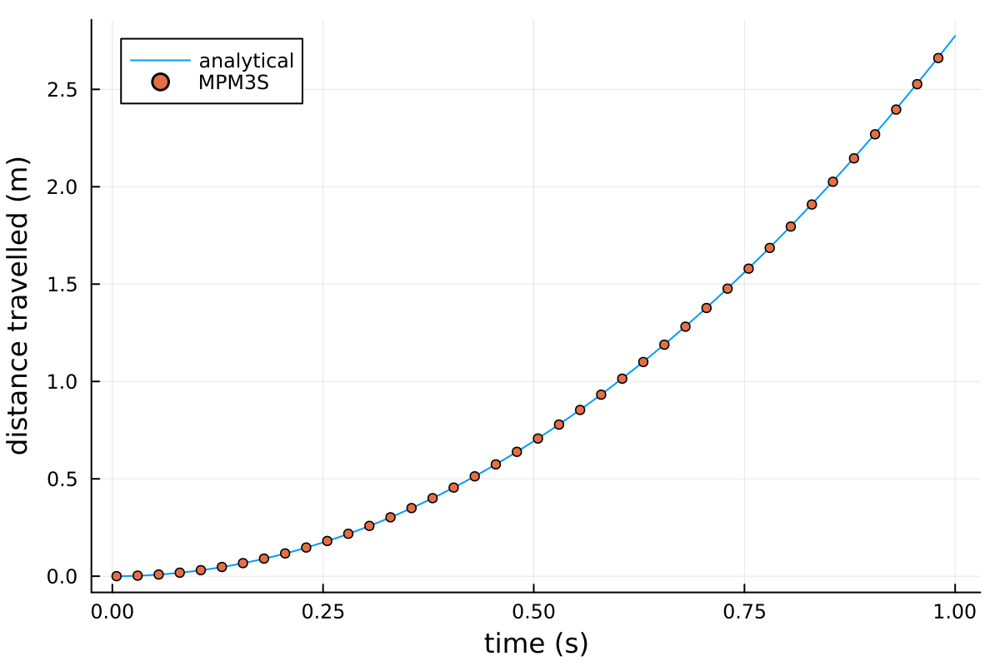
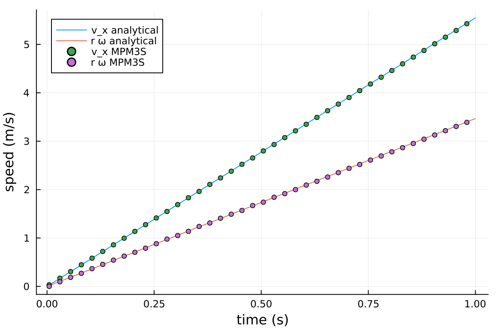

---
hide:
  - toc
---

# Tutorial 5: Rolling sphere

## Introduction
This is the first dynamic tutorial in MPM3S. A rigid sphere rolls down a slope under gravity, and the distance it travels is compared against the analytical slip/stick solution for a range of friction coefficients.

The problem validates frictional contact and dynamic time integration together. As the sphere moves, the elements beneath it are refined to a fine mesh that travels with it, and a boundary track keeps only the part of the slope around the sphere active.

This tutorial has four sections:

- [Problem description](#problem-description)
- [Input setup](#input-setup)
- [Deploying and running the problem](#deploying-and-running-the-problem)
- [Viewing the results](#viewing-the-results)

## Problem description

You will define the slope, the sphere, the dynamic stage, the solver and the output in the input file. All the inputs to the simulation are defined using the [`input_data.json` file format](../UsingTheSoftware/InputFormat/index.md).

To keep the slope aligned with the background grid, the slope is kept horizontal and gravity is tilted by $45^\circ$ instead (see [](#fig-sphere-setup)). The sphere then rolls along $+x$ under the in-plane component of gravity.

{ #fig-sphere-setup width="70%" }

*Figure adapted from [@bird2026implicitoctreebasedadaptivematerial].*

**Slope:** A slab $12.8$ m long, $1.6$ m wide and $0.8$ m thick, made of $0.8$ m base elements with $2 \times 2 \times 2$ material points in each. The elements the sphere touches are refined to $0.025$ m.

**Boundary conditions:** The two ends of the slab ($x = 0$ and $x = 12.8$ m) and its base are fixed, and its two sides are rollers. The top surface is free.

**Material:** A very stiff Hencky elastic slab: Young's modulus $E = 10^9$ Pa, Poisson's ratio $\nu = 0$ and density $\rho = 1000$ kg/m$^3$. It deforms negligibly, but modelling it with material points is what exercises the contact between a rigid body and a refined mesh - the point of the test.

**Sphere:** `sphere.stl`, a sphere of radius $r = 1$ m made of 3120 triangles on a latitude-longitude grid, drawn centred on the origin. Its point is at the centre, with mass $m = 5000$ kg and rotational inertia $I = \tfrac{2}{5} m r^2 = 2000$ kg$\cdot$m$^2$, a solid sphere. The sphere can move in $x$ and $z$ and rotate about $y$; its other three degrees of freedom are fixed.

**Friction:** The friction coefficient $\mu$ is the parameter you sweep. Try $\mu \in \{0,\, 0.1,\, 0.2,\, 0.4,\, 1.0\}$ to cover both the slipping ($\tan\theta_s > 3.5\mu$) and sticking regimes.

**Loading:** A single dynamic stage lasting $1$ s, with a time step of $0.005$ s. Gravity is applied as a tilted vector

$$
g_i = 9.81 \times \left[ \tfrac{1}{\sqrt{2}},\, 0,\, -\tfrac{1}{\sqrt{2}} \right] \text{ m/s}^2,
$$

equivalent to a $45^\circ$ slope under vertical gravity.

**Solver:** Newton-Raphson, implicit dynamic. The sphere's velocity, angular velocity and rotation evolve through time under gravity and contact.

The analytical solution to compare against is the distance the sphere has travelled along $+x$ as a function of time:

$$
d_x(t) =
\begin{cases}
\dfrac{g t^2}{2} \left[ \sin\theta_s - \mu \cos\theta_s \right] & \text{slipping, } \tan\theta_s > 3.5\mu \\[6pt]
\dfrac{5\, g t^2 \sin\theta_s}{14} & \text{sticking, otherwise}
\end{cases}
$$

with $g = 9.81$ m/s$^2$ and $\theta_s = 45^\circ$.

## Input setup
The input file is a single JSON object - a human-readable, editable text file. The complete file for this problem can be found [here](Tutorial_5_input_data.md), and every key is described on the [`input_data.json` file format](../UsingTheSoftware/InputFormat/index.md) page.

<div class="json-side-header">
<div>Description</div>
<div><code>input_data_sphere.json</code></div>
</div>

<div class="json-side" markdown>

<div class="js-text" markdown>

### Machine and domain

`"GPU": "off"` runs the analysis on the CPU. The background grid is sized automatically to hold the slab, and its $12.8$ m length makes the grid a $12.8$ m cube.

`"gravity"` is the tilted vector from the [Problem description](#problem-description): its two non-zero components are $9.81/\sqrt{2} \approx 6.93672$ m/s$^2$.

</div>

<div class="js-code" markdown>

```json
"GPU": "off",

"domain": {
    "gravity": [6.93672, 0.0, -6.93672]
}
```

</div>

</div>

<div class="json-side" markdown>

<div class="js-text" markdown>

### Material points

A single $0.8$ m layer over a $12.8 \times 1.6$ m footprint, with the stiff elastic properties from the [Problem description](#problem-description). The refinement size used later, $0.025$ m, is $0.8/2^5$, so the base element size needs no rounding.

</div>

<div class="js-code" markdown>

```json
"material points": {
    "extra capacity": 1.2,
    "element size": 0.8,
    "number of material points per element 1": 2,
    "material size": { "min": [0.0, 0.0], "max": [12.8, 1.6] },
    "layers": [
        {
            "thickness": 0.8,
            "material": { "type": "elastic", "E": 1.0e9, "nu": 0.0, "density": 1000.0 }
        }
    ]
}
```

</div>

</div>

<div class="json-side" markdown>

<div class="js-text" markdown>

### Rigid body

The sphere is one system with one point at its centre. The point's six boundary conditions, in the order $[u_x, u_y, u_z, \theta_x, \theta_y, \theta_z]$, leave it free to move in $x$ and $z$ and to rotate about $y$.

`sphere.stl` is drawn centred on the origin, the same place as the point. `"offset"` then places the whole sphere with its centre above $x = 1.5$ m, halfway across the slab's width and $1.8$ m up - resting on the slab surface at $0.8$ m.

</div>

<div class="js-code" markdown>

```json
"rigid bodies": [
    {
        "offset": [1.5, 0.8, 1.8],
        "points": [
            { "position": [0.0, 0.0, 0.0], "mass": 5000.0, "rotational inertia": [2000.0, 2000.0, 2000.0],
              "boundary conditions": ["free", "fixed", "free", "fixed", "free", "fixed"] }
        ],
        "stl files": [
            { "name": "sphere", "stl": "sphere.stl", "mesh cache": "sphere_mesh.txt", "point": 1 }
        ]
    }
]
```

</div>

</div>

<div class="json-side" markdown>

<div class="js-text" markdown>

### Contact

The friction coefficient between the sphere and the slab, here $\mu = 0.2$. This is below $\tan(45^\circ)/3.5 \approx 0.286$, so the sphere slips as it rolls. Change it between runs to reproduce the friction sweep, and change the output directory names to match so the runs do not overwrite each other.

</div>

<div class="js-code" markdown>

```json
"contact": {
    "friction coefficient": 0.2
}
```

</div>

</div>

<div class="json-side" markdown>

<div class="js-text" markdown>

### Analysis

A single dynamic stage: $1$ s of motion in steps of $0.005$ s. The Newmark parameters $\beta = 0.5$ and $\gamma = 1.0$ add numerical damping, which keeps the stiff contact stable. `"rigid body surface placement": "on"` makes sure the sphere starts exactly on the slab surface.

`"rigid body surface"` adaptivity refines the elements the sphere's surface passes through to $0.025$ m at every step. The slab's ends and base are fixed and its sides are rollers.

`"boundary track"` makes the $x$ boundaries follow the sphere: a fixed plane at the back of the sphere deletes the slab it leaves behind (`"remove": "yes"`), and a fixed plane $1$ m ahead of it keeps the slab further ahead inactive until the sphere approaches. Tracking is `"off"` in $y$ and $z$.

</div>

<div class="js-code" markdown>

```json
"analysis": [
    {
        "type": "dynamic",
        "dt": 0.005,
        "final time": 1.0,
        "beta": 0.5,
        "gamma": 1.0,
        "rigid bodies": "on",
        "rigid body surface placement": "on",
        "adaptivity": {
            "type": "rigid body surface",
            "element size": 0.025
        },
        "boundary conditions": { "min": ["fixed", "roller", "fixed"], "max": ["fixed", "roller", "free"] },
        "boundary track": {
            "min": { "type": ["fixed", "off", "off"], "distance": [0.0, 0.0, 0.0],
                     "advance": ["positive", "positive", "positive"], "remove": ["yes", "no", "no"] },
            "max": { "type": ["fixed", "off", "off"], "distance": [1.0, 0.0, 0.0],
                     "advance": ["positive", "positive", "positive"], "remove": ["no", "no", "no"] }
        }
    }
]
```

</div>

</div>

<div class="json-side" markdown>

<div class="js-text" markdown>

### Solver

Newton-Raphson iterations to a tolerance of $10^{-6}$ in each time step, with at most 20 iterations before the step is retried with half the time step. The [ghost stabilisation](../TechnicalReferences/ghostStabilisation.md) uses `"ghost factor": 10.0` for the stiffness and `"ghost factor mass": 0.25` for the mass.

</div>

<div class="js-code" markdown>

```json
"solver": {
    "tolerance": 1.0e-6,
    "max newton iterations": 20,
    "poor factor": 0.25,
    "ghost factor": 10.0,
    "ghost factor mass": 0.25
}
```

</div>

</div>

<div class="json-side" markdown>

<div class="js-text" markdown>

### Output

`"vtk percent": 0` writes a VTK frame at every time step, with every field, to `vtk_sphere_mu0.2`. The CSV output writes no material-point files (an empty list) but records the sphere's position, velocity, acceleration and angular velocity in `csv_sphere_mu0.2/rigid_body.csv`.

</div>

<div class="js-code" markdown>

```json
"output": {
    "vtk": "on",
    "vtk directory": "vtk_sphere_mu0.2",
    "vtk percent": 0,

    "csv": "on",
    "csv directory": "csv_sphere_mu0.2",
    "csv percent": 0,
    "csv material point fields": [],
    "csv rigid body fields": ["position", "velocity", "acceleration", "angular velocity"]
}
```

</div>

</div>

## Deploying and running the problem

MPM3S is written in the [Julia](https://julialang.org/) programming language. See the [installation guide](../GettingStarted/install_and_run.md) for installing Julia and MPM3S, and [Tutorial 1](Tutorial_1.md#deploying-and-running-the-problem) for a first, small run.

!!! note "Working in the MPM3S folder"
    Julia runs in the `MPM3S` folder - the folder you downloaded - throughout this tutorial, and every path in the commands and scripts is relative to it. The input file is read from `validation_data_and_jsons/input_data_sphere.json`, and the output folders `vtk_sphere_mu0.2` and `csv_sphere_mu0.2` are written to, and read back from, the `MPM3S` folder.

<div class="json-side-header">
<div>Deployment instructions</div>
<div><code>terminal</code></div>
</div>

<div class="json-side" markdown>

<div class="js-text" markdown>

### Setting up the problem

The input file for this tutorial comes with MPM3S, as `validation_data_and_jsons/input_data_sphere.json`, together with the sphere geometry, `sphere.stl`, and its mesh cache, `sphere_mesh.txt`; the input file is the same as the [complete input file](Tutorial_5_input_data.md). The STL and mesh-cache paths in the input file are relative to the input file, so the files must stay in the same folder.

As in [Tutorial 1](Tutorial_1.md#setting-up-and-running-the-problem), open a terminal, start Julia with every CPU thread available (`-t auto`), then move into the folder where you downloaded MPM3S, activate it, install its dependencies with `Pkg.instantiate()` and load MPM3S. The output folders are created in the `MPM3S` folder.

### Running the problem

Julia is now running in the `MPM3S` folder and MPM3S loaded. The JSON file for this problem is loaded with MPM3S and is stored in the folder `validation_data_and_jsons`, the simulations are started with:

```
MPM3S.non_linear_solve("validation_data_and_jsons/input_data_sphere.json");
```

The analysis runs on a workstation CPU but takes a while; set `"GPU": "on"` if a GPU is available.

#### Reading the output

Before the first time step, MPM3S reports the rigid body surface placement: the lowest point of the sphere (`body base`) and the top of the slab (`material top`) are both at $0.8$ m, so the sphere is moved by only `Δz = 1.87755e-7` m.

The progress line works as in [Tutorial 1](Tutorial_1.md#reading-the-output), except that in a dynamic stage `t` is the simulated time, out of the $1$ s final time. The $200$ time steps of `Δt 0.005` s end at `step 201`, each converging in about 4 Newton-Raphson iterations (`NR`) with no steps cut or material points deleted. `N` is large, over $100\,000$ nodes, because the mesh is refined to $0.025$ m around the sphere.

</div>

<div class="js-code" markdown>

<div class="terminal terminal-full" markdown>

```console
$ julia -t auto

julia> cd("path/to/MPM3S")
julia> using Pkg; Pkg.activate(".")
  Activating project at `path/to/MPM3S`

julia> Pkg.instantiate()

julia> using MPM3S

julia> MPM3S.non_linear_solve("validation_data_and_jsons/input_data_sphere.json");
[ Info: rigid body surface placement: body base 0.8 → material top 0.8   Δz = 1.87755e-7
stage 1/1 ████████████ 100.0% t 1.0/1.0 step 201 Δt 0.005 NR 4 cuts 0 del 0 N 109572
```

</div>

</div>

</div>

## Viewing the results

!!! note "Watching the sphere roll"
    The VTK files in `path/to/MPM3S/vtk_sphere_mu0.2` can be opened in ParaView to watch the sphere roll, following the same steps as for the compression cube in [Tutorial 2](Tutorial_2.md#visualising-the-output-in-paraview). Everything needed to check the result is in `rigid_body.csv`, used below.

### Distance travelled

`csv_sphere_mu0.2/rigid_body.csv` has one row per time step. The distance travelled is $d_x = $ `body1_position_x` $- 1.5$ m, to be plotted against the `time` column and compared with $d_x(t)$ from the [Problem description](#problem-description). When the sphere sticks, it rolls without slipping, so `body1_angular velocity_y` equals `body1_velocity_x` (the radius is $1$ m); when it slips, the angular velocity lags behind.

The short Julia script below compares the distance travelled with the analytical solution. Run it from the `MPM3S` folder, either by copying it into the REPL or by saving it as `distance.jl` and running `include("distance.jl")`. It needs [Plots](https://docs.juliaplots.org/), installed as described in [Tutorial 1](Tutorial_1.md#analysing-the-stress-variation-with-height).

```julia
using DelimitedFiles, Plots

# one row per time step for the sphere's point, body1
data, header = readdlm("csv_sphere_mu0.2/rigid_body.csv", ',', Float64; header=true)
column(name) = data[:, findfirst(==(name), vec(header))]
t  = column("time")
dx = column("body1_position_x") .- 1.5   # distance travelled (m)

# analytical solution: the sphere slips if tan θ > 3.5 μ, otherwise it rolls without slipping
g, θ, μ = 9.81, π/4, 0.2
slipping = tan(θ) > 3.5μ
a = slipping ? g * (sin(θ) - μ * cos(θ)) : 5/7 * g * sin(θ)   # acceleration along x (m/s²)
dx_exact = a .* t.^2 ./ 2

println(slipping ? "slipping" : "sticking")
println("distance after 1 s: MPM3S ", round(dx[end], digits=3), " m, analytical ", round(dx_exact[end], digits=3), " m")

plot(t, dx_exact, label="analytical", xlabel="time (s)", ylabel="distance travelled (m)")
scatter!(t[1:5:end], dx[1:5:end], label="MPM3S", markersize=3)
```

For this run it prints:

```text
slipping
distance after 1 s: MPM3S 2.77 m, analytical 2.775 m
```

{ #fig-sphere-distance width="50%" }

The second script, run after the first, compares the speed of the sphere's centre, $v_x$, with the speed of its surface, $r\omega$. With $\mu = 0.2$ the sphere slips, so $r\omega$ grows more slowly than $v_x$; with $\mu \geq 0.286$ it rolls without slipping and the two lines lie on top of each other.

```julia
# run after distance.jl, which reads the data and sets t, g, θ, μ, a and slipping
vx = column("body1_velocity_x")           # speed of the centre (m/s)
ω  = column("body1_angular velocity_y")   # spin (rad/s)
r  = 1.0                                   # sphere radius (m)

# analytical: the centre speeds up at a; while slipping, friction spins the sphere up at 5μg cos θ / 2r
v_exact  = a .* t
rω_exact = slipping ? 2.5 * μ * g * cos(θ) .* t : v_exact

plot(t, v_exact, label="v_x analytical", xlabel="time (s)", ylabel="speed (m/s)")
plot!(t, rω_exact, label="r ω analytical")
scatter!(t[1:5:end], vx[1:5:end], label="v_x MPM3S", markersize=3)
scatter!(t[1:5:end], r .* ω[1:5:end], label="r ω MPM3S", markersize=3)
```

{ #fig-sphere-slip width="50%" }
