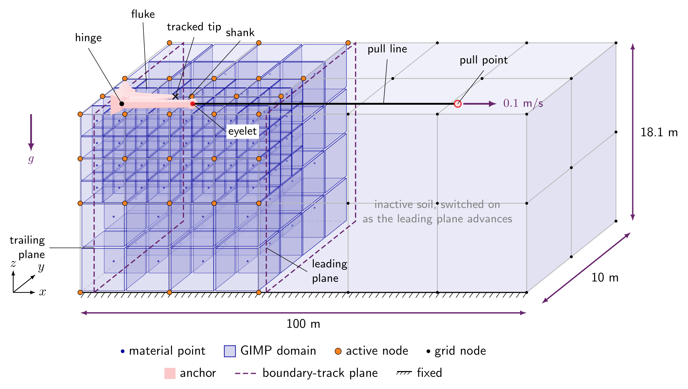
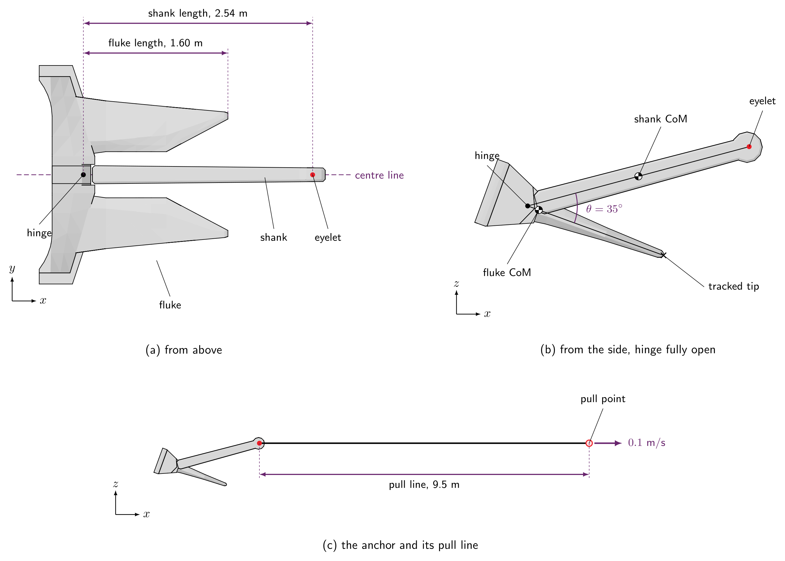
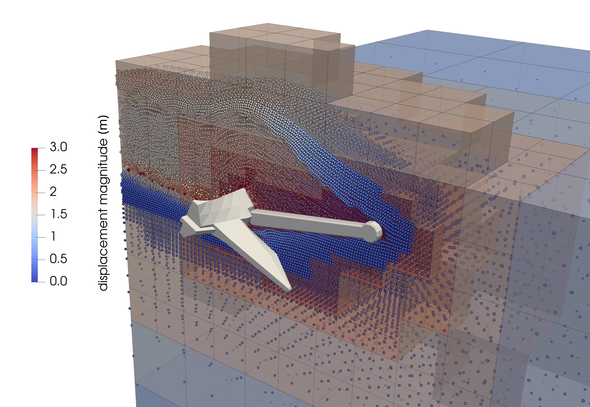
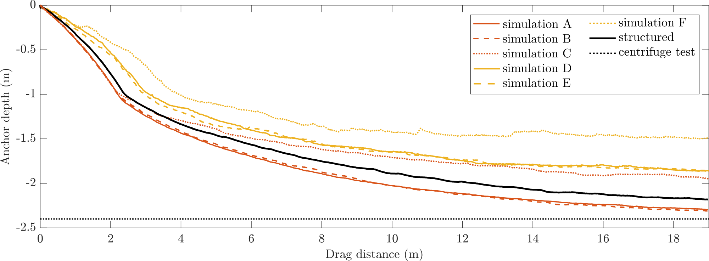

---
hide:
  - toc
---

# Tutorial 6: Drag anchor

<div class="tutorial-facts level-advanced-strip">
<span class="level level-advanced">Advanced</span>
<span><strong>Work through time:</strong> about 1.5 to 2 h</span>
<span><strong>Approx. run time:</strong> 45 min on a GPU, 6 h on a CPU</span>
<span class="facts-note">You can run every tutorial on your own hardware: the RAM decides whether a problem fits, and the number of CPU or GPU cores how long it takes. The run times are approximate, to give an idea of the hardware needed.</span>
</div>

## Introduction
This tutorial combines all the features of the previous tutorials to create a 3D dynamic simulation of an AC-14 drag anchor being pulled through a bed of loose sand.

The problem combines many features of MPM3S: the gravity stage from [Tutorial 1](Tutorial_1.md), the displacement-controlled rigid body with contact from [Tutorial 2](Tutorial_2.md), the Willam-Warnke sand with depth-dependent stiffness from [Tutorial 3](Tutorial_3.md), the frictional contact, dynamic time integration and moving boundaries from [Tutorial 5](Tutorial_5.md), and an articulated anchor built from three points joined by a hinge, an angle stop and a pull line.

This tutorial has four sections:

- [Problem description](#problem-description)
- [Input setup](#input-setup)
- [Deploying and running the problem](#deploying-and-running-the-problem)
- [Viewing the results](#viewing-the-results)

## Problem description

You will model an anchor (AC14) being dragged through a subsurface soil. To do this, you will define the soil, the anchor, the three loading stages, the solver and the output in the input file, using the [`input_data.json` file format](../UsingTheSoftware/InputFormat/index.md).

[](#fig-anchor-setup) shows the model at the start of stage 2. To reduce the problem size, only half of the anchor and soil is modelled, using the vertical $xz$ plane of symmetry at $y = 0$. The anchor's fluke and shank are joined at a hinge, with the fluke starting turned $20^\circ$ tip-down, and a pull line drags the anchor at $0.1$ m/s. A tracked node at the fluke tip records its position as the anchor embeds. Instead of solving the whole length of soil the anchor passes through, a boundary track keeps only a window of soil active, from $0.5$ m behind to $2.5$ m ahead of the anchor. The elements around the anchor are refined down to $0.1$ m; the figure only shows this schematically.

{ #fig-anchor-setup width="80%" }

**Soil block:** The soil is $120$ m long, $10$ m wide and $18.123$ m deep. As in [Tutorial 3](Tutorial_3.md), the mesh is refined around the rigid body: the elements which intersect the anchor are refined to $0.1$ m, while those far from it are $2.0$ m, and every element is created with $2 \times 2 \times 2$ material points. Because the mesh is an octree whose smallest element is $0.1$ m, MPM3S adjusts these sizes (see [how element sizes set the mesh](../UsingTheSoftware/InputFormat/material_points.md#how-element-sizes-set-the-mesh)):

- element sizes are rounded **down** to a power-of-two multiple of $0.1$ m, so the mesh is never coarser than requested: the $2.0$ m elements become $0.1 \times 2^4 = 1.6$ m;
- the $x$ and $y$ dimensions are rounded **up** to whole elements: $120 \times 11.2$ m;
- the depth is rounded **up** to a whole row of material points ($0.8$ m), as the top is a free surface rather than a boundary and therefore no boundary conditions need to be applied at nodes: $18.123$ m becomes $18.4$ m  

**Loading:** Three stages:

- **Stage 1 - initial stresses:** static; the anchor is switched off and gravity is ramped up over 5 load steps.
- **Stage 2 - settling:** dynamic, $1$ s in steps of $0.005$ s; the anchor is placed on the soil surface and settles under its own weight with the pull point held still.
- **Stage 3 - drag:** dynamic, $800$ s in steps of $0.04$ s; the pull point moves in $+x$ at $0.1$ m/s, dragging the anchor $80$ m.

**Boundary conditions:** The boundary conditions are defined separately for each stage. In every stage the base is fixed, and the side at $y = 0$ (the plane of symmetry) and the opposite side carry rollers; the top face lies in the empty space above the soil, so its condition has no effect. Only the two ends, the $x$ faces, change:

- **Stage 1 - initial stresses:** all vertical sides are rollers, the bottom face is fixed.
- **Stage 2 - settling:** a boundary track replaces both ends with fixed planes that move with the anchor: one $0.5$ m behind it, which deletes the soil the anchor leaves behind, and one $2.5$ m ahead of it (for the purposes of this tutorial - default would be to set it to $5.0$ m). The two $y$ sides stay rollers. On the plane of symmetry, $y = 0$, the roller stops the soil moving in $y$ but leaves it free to slide in $x$ and $z$, which is exactly the symmetry condition: the modelled half behaves as one half of the full anchor and soil. The opposite side, at $y = 11.2$ m (the $10$ m width rounded up to whole elements), is held the same way, far enough from the anchor that it has little effect. The base stays fixed.
- **Stage 3 - drag:** same boundary conditions as stage 2, with the leading plane moved to $5$ m ahead of the anchor.

**Material:** Willam-Warnke elasto-plastic sand at a relative density of $D_r = 32\%$, fully drained conditions, with the parameters from the Brinkgreve correlations [@brinkgreve2010validation]:

<div class="centered-table" markdown>

| Property                     | Correlation                                         | Value at $D_r = 32\%$     | Input key                     |
|------------------------------|-----------------------------------------------------|---------------------------|-------------------------------|
| Reference Young's modulus    | $E^{ref} = 60\,000\; D_r/100$ kPa                   | $19.2$ MPa                | `"E": 1.92e7`                 |
| Friction angle               | $\phi = 28 + 12.5\; D_r/100$                        | $32^\circ$                | `"friction angle": 32.0`      |
| Dilation angle               | $\psi = -2 + 12.5\; D_r/100$, not below 0           | $2^\circ$                 | `"dilation angle": 2.0`       |
| Buoyant unit weight          | $\gamma' = 19 + 1.6\; D_r/100 - \gamma_w$ kN/m$^3$  | $9.702$ kN/m$^3$          | -            |
| Buoyant density              | $\rho' = \gamma'/g$, with $g = 10$ m/s$^2$          | $970.2$ kg/m$^3$          | `"density": 970.2`            |
| Stiffness exponent           | $m = 0.7 - D_r/320$                                 | $0.6$                     | `"exponent": 0.6`             |
| Earth pressure at rest       | $K_0 = 1 - \sin\phi$                                | $0.4701$                  | `"reference stress"` (below)  |
| Poisson's ratio              | -                                                   | $0.25$                    | `"nu": 0.25`                  |
| Cohesion                     | -                                                   | $0.3$ kPa                 | `"cohesion": 300.0`           |

</div>

$\gamma_w = 9.81$ kN/m$^3$ is the unit weight of water, note that the buoyant density and weights are used as the sand is submerged. As in [Tutorial 3](Tutorial_3.md#problem-description), the reference stress for the depth-dependent stiffness is $p^{ref}/K_0 = 100/0.4701 = 212.7$ kPa.

**Anchor:** The AC-14 anchor (see [](#fig-anchor-design)) has two parts, a **fluke** and a **shank**, joined by a hinge. Each part is a rigid body welded to a `rigid body point` at its centre of mass. A third `rigid body point` with no geometry is the end of the pull line; moving it drags the anchor. Because only half the anchor is modelled, the masses are halved (the full anchor is $8700$ kg). As in the reference simulations, the fluke starts turned $20^\circ$ tip-down about the hinge: `AC14_fluke_rot20.stl` is drawn already turned, and point 1, the fluke's end of the opening-angle stop and the tracked tip are turned with it.

{ #fig-anchor-design width="80%" }

*Figure adapted from [@birdanchors2026].*

The anchor is made of three points, and three constraints join them:

<div class="small-tables" markdown>

| Point | Represents             | Position as drawn (m) | Mass (kg) | Rotational inertia (kg$\cdot$m$^2$) | Geometry               |
|:-----:|------------------------|:---------------------:|:---------:|:-----------------------------------:|------------------------|
| 1     | Fluke centre of mass   | $(0.6121, 0, -0.0448)$ | $3291.6$ | $275$                               | `AC14_fluke_rot20.stl` |
| 2     | Shank centre of mass   | $(1.7592, 0, 0)$      | $1058.4$  | $337.5$                             | `AC14_shank.stl`       |
| 3     | Pull point             | $(12.5123, 0, -0.5703)$ | $1$       | $10^{-6}$                           | none                   |

| Constraint          | Type               | Points | Details                                                                                                           |
|---------------------|--------------------|:------:|-------------------------------------------------------------------------------------------------------------------|
| Hinge               | `"rotation lock"`  | 1, 2   | Pin at $(0.489, 0, 0)$ with the axis of rotation along $y$; pin stiffness $10^9$ N/m, axis stiffness $10^8$ N$\cdot$m.       |
| Opening-angle stop  | `"distance stop"`  | 1, 2   | Starts with the hinge open $20^\circ$ and goes taut when it has opened $35^\circ$; stiffness $EA/l = 8.58 \times 10^9$ N/m, with $EA = 10^{10}$ N and $l = 1.165$ m the distance between the two centres of mass at $35^\circ$.                                 |
| Pull line           | `"distance lock"`  | 2, 3   | A $9.5$ m rod from the shank's eyelet at $(3.0294, 0, 0)$ to the pull point; stiffness $EA/L$ with $EA = 10^{10}$ N. |

</div>

Frictional contact between the anchor and the sand uses $\mu = 0.45$.

**Solver:** Newton-Raphson, pseudo-static for stage 1 and implicit dynamic for stages 2 and 3.

## Input setup
The input file is a single JSON object - a human-readable, editable text file. The complete file for this problem can be found [here](Tutorial_6_input_data.md), and every key is described on the [`input_data.json` file format](../UsingTheSoftware/InputFormat/index.md) page.

<div class="json-side-header">
<div>Description</div>
<div><code>input_data_AC14_dr32.json</code></div>
</div>

<div class="json-side" markdown>

<div class="js-text" markdown>

### Machine

- `"GPU": "on"` runs the analysis on an NVIDIA GPU, as the reference simulations were run ([GPU](../UsingTheSoftware/InputFormat/gpu.md)).
- Without a GPU, set it to `"off"` to run on the CPU: the results are the same, but the analysis will be slower.

</div>

<div class="js-code" markdown>

```json
"GPU": "on",
```

</div>

</div>

<div class="json-side" markdown>

<div class="js-text" markdown>

### Domain

- The background mesh is a cube, sized automatically to hold the soil block plus the same height of empty space above it ([domain](../UsingTheSoftware/InputFormat/domain.md)).
- Here the $120$ m length governs: the side is rounded up to a power-of-two number of $1.6$ m elements, $1.6 \times 2^7 = 204.8$ m.
- Gravity acts in $-z$.

</div>

<div class="js-code" markdown>

```json
"domain": {
    "gravity": [0.0, 0.0, -9.81]
},
```

</div>

</div>

<div class="json-side" markdown>

<div class="js-text" markdown>

### Material points

- One layer of Willam-Warnke sand, with the properties from the [Problem description](#problem-description) ([material points](../UsingTheSoftware/InputFormat/material_points.md)).
- A $120 \times 10$ m footprint, whose $y = 0$ side is the plane of symmetry.
- $2.0$ m base elements (rounded to $1.6$ m), each starting with $2 \times 2 \times 2$ material points.

</div>

<div class="js-code" markdown>

```json
"material points": {
    "extra capacity": 1.2,
    "element size": 2.0,
    "number of material points per element 1": 2,
    "material size": { "min": [0.0, 0.0], "max": [120.0, 10.0] },
    "layers": [
        {
            "thickness": 18.123,
            "material": { "type": "willam warnke",
                          "E": 1.92e7, "nu": 0.25,
                          "friction angle": 32.0, "dilation angle": 2.0, "cohesion": 300.0,
                          "density": 970.2,
                          "E overburden": { "reference stress": 212729.0, "exponent": 0.6 } }
        }
    ]
},
```

</div>

</div>

<div class="json-side" markdown>

<div class="js-text" markdown>

### Rigid body: points

- The anchor is one rigid-body system of three [points](../UsingTheSoftware/InputFormat/rigid_bodies.md#points).
- Points 1 and 2 are the centres of mass of the fluke and the shank:
    - their boundary conditions leave them free to move in the $xz$ plane and to turn about $y$;
    - the other three degrees of freedom are fixed by the symmetry.
- Point 3 is the end of the pull line:
    - it has no geometry and only a nominal mass, so all six of its degrees of freedom are fixed;
    - stage 3 replaces its $x$ condition to pull it.
- The shank is drawn along the $x$ axis, with the fluke turned $20^\circ$ tip-down below it, so point 1 sits just below the axis.
- Point 3 is drawn level with the fluke tip, the anchor's lowest node, so that when the anchor is placed on the soil the pull point rests on the surface too.
- `"offset"` moves the whole system $1$ m in $+x$, so that the anchor does not overhang the soil.

</div>

<div class="js-code" markdown>

```json
"rigid bodies": [
    {
        "offset": [1.0, 0.0, 0.0],
        "points": [
            { "position": [0.6121, 0.0, -0.044805], "mass": 3291.6, "rotational inertia": [275.0, 275.0, 275.0],
              "boundary conditions": ["free", "fixed", "free", "fixed", "free", "fixed"] },
            { "position": [1.7592, 0.0, 0.0], "mass": 1058.4, "rotational inertia": [337.5, 337.5, 337.5],
              "boundary conditions": ["free", "fixed", "free", "fixed", "free", "fixed"] },
            { "position": [12.51226633, 0.0, -0.5703035], "mass": 1.0, "rotational inertia": [1.0e-6, 1.0e-6, 1.0e-6],
              "boundary conditions": ["fixed", "fixed", "fixed", "fixed", "fixed", "fixed"] }
        ],
```

</div>

</div>

<div class="json-side" markdown>

<div class="js-text" markdown>

### Rigid body: constraints

- **[`"rotation lock"`](../UsingTheSoftware/InputFormat/rigid_bodies.md#rotation-lock)** - the hinge between the fluke (point 1) and the shank (point 2):
    - the two parts are pinned together at the `"rotation centre"`, $(0.489, 0, 0)$;
    - `"direction 1"` and `"direction 2"`, the hinge axis carried by each part, are both along $y$ and are kept aligned, so the parts can only turn relative to each other about $y$;
    - `"stiffness"`, $10^9$ N/m, holds the pin together, and `"rotational stiffness"`, $10^8$ N$\cdot$m, keeps the two axes aligned.
- **[`"distance stop"`](../UsingTheSoftware/InputFormat/rigid_bodies.md#distance-stop)** - limits how far the hinge opens (the angle between the fluke and the shank):
    - it is a penalty force between two constraint points, one moving with point 1 and one with point 2;
    - `"position 1"`, carried by the fluke, starts at the fluke's centre of mass, $(0.6121, 0, -0.0448)$, and `"position 2"`, carried by the shank, starts where that centre would be with the hinge closed, $(0.62, 0, 0)$, so the opening about the `"rotation centre"` starts at $20^\circ$;
    - as the hinge opens further the two points move apart, and when the opening reaches the `"angle limit"`, $35^\circ$, the penalty force becomes active and resists any more opening;
    - `"stiffness"`, $8.58 \times 10^9$ N/m, is $EA/l$ with $EA = 10^{10}$ N and $l = 1.165$ m, the distance between the two centres of mass at $35^\circ$.
- **[`"distance lock"`](../UsingTheSoftware/InputFormat/rigid_bodies.md#distance-lock)** - the pull line between the shank (point 2) and the pull point (point 3):
    - a $9.5$ m rod from the shank's eyelet, `"position 1"`, $(3.0294, 0, 0)$, to the pull point, `"position 2"`, $(12.5123, 0, -0.5703)$;
    - `"stiffness"`, $1.05 \times 10^9$ N/m, is $EA/L$ with $EA = 10^{10}$ N and $L = 9.5$ m.

</div>

<div class="js-code" markdown>

```json
        "constraints": [
            { "type": "rotation lock", "points": [1, 2],
              "rotation centre": [0.489, 0.0, 0.0],
              "direction 1": [0.0, 1.0, 0.0],
              "direction 2": [0.0, 1.0, 0.0],
              "stiffness": 1.0e9, "rotational stiffness": 1.0e8 },

            { "type": "distance stop", "points": [1, 2],
              "rotation centre": [0.489, 0.0, 0.0],
              "position 1": [0.6121, 0.0, -0.044805],
              "position 2": [0.62, 0.0, 0.0],
              "angle limit": 35.0, "stiffness": 8.5814e9 },

            { "type": "distance lock", "points": [2, 3],
              "position 1": [3.0294, 0.0, 0.0],
              "position 2": [12.51226633, 0.0, -0.5703035],
              "distance": 9.5, "stiffness": 1.0526e9 }
        ],
```

</div>

</div>

<div class="json-side" markdown>

<div class="js-text" markdown>

### Rigid body: geometry

- The fluke surface is welded to point 1 and the shank surface to point 2 ([STL files](../UsingTheSoftware/InputFormat/rigid_bodies.md#stl-files)).
- Both STL files are drawn in global coordinates, in the same frame as the points; `AC14_fluke_rot20.stl` has the fluke already turned $20^\circ$ tip-down.
- Their tetrahedral meshes are stored in the mesh-cache files.
- `"tracked nodes"` adds a marker at the fluke tip, $(1.994, 0.6489, -0.5478)$, welded to point 1 ([tracked nodes](../UsingTheSoftware/InputFormat/rigid_bodies.md#tracked-nodes)):
    - it has no mass and takes no part in the contact;
    - its position is written to `rigid_body.csv` as `track1_x`, `track1_y` and `track1_z`, following the fluke tip through the drag.

</div>

<div class="js-code" markdown>

```json
        "stl files": [
            { "name": "fluke", "stl": "AC14_fluke_rot20.stl",
              "mesh cache": "AC14_fluke_rot20_mesh.txt", "point": 1 },
            { "name": "shank", "stl": "AC14_shank.stl",
              "mesh cache": "AC14_shank_mesh.txt", "point": 2 }
        ],
        "tracked nodes": [
            { "position": [1.994, 0.6489, -0.5478], "point": 1 }
        ]
    }
],
```

</div>

</div>

<div class="json-side" markdown>

<div class="js-text" markdown>

### Contact

- Coulomb friction with $\mu = 0.45$ between the anchor and the sand ([contact properties](../UsingTheSoftware/InputFormat/contact.md)).

</div>

<div class="js-code" markdown>

```json
"contact": {
    "friction coefficient": 0.45
},
```

</div>

</div>

<div class="json-side" markdown>

<div class="js-text" markdown>

### Stage 1: initial stresses

- Static, with the anchor switched off.
- Gravity is ramped up from zero over 5 load steps.
- A uniform $1.6$ m mesh ([adaptivity](../UsingTheSoftware/InputFormat/analysis.md#adaptivity)).
- Rollers on the four vertical faces and a fixed base; the top face lies in the empty space above the soil ([boundary conditions](../UsingTheSoftware/InputFormat/analysis.md#boundary-conditions)).

</div>

<div class="js-code" markdown>

```json
"analysis": [
    {
        "type": "static",
        "load steps": 5,
        "load": "gravity ramp",
        "rigid bodies": "off",
        "adaptivity": { "type": "uniform" },
        "boundary conditions": { "min": ["roller", "roller", "fixed"], "max": ["roller", "roller", "fixed"] }
    },
```

</div>

</div>

<div class="json-side" markdown>

<div class="js-text" markdown>

### Stage 2: settling

- Dynamic, $1$ s in steps of $0.005$ s: the anchor settles into the sand under its own weight while the pull point stays where it is.
- `"rigid body surface placement": "on"` first moves the anchor vertically so that it rests on the soil surface.
- $\beta = 0.5$ and $\gamma = 1.0$ add numerical damping.
- The mesh is refined to $0.1$ m wherever the fluke and shank surfaces are ([adaptivity](../UsingTheSoftware/InputFormat/analysis.md#adaptivity)).
- `"boundary track"` replaces the two $x$ ends with fixed planes that follow the anchor ([boundary track](../UsingTheSoftware/InputFormat/analysis.md#boundary-track)):
    - one $0.5$ m behind it, which deletes the soil the anchor leaves behind;
    - one $2.5$ m ahead of it; the soil beyond it stays inactive until the plane reaches it.

</div>

<div class="js-code" markdown>

```json
    {
        "type": "dynamic",
        "dt": 5.0e-3,
        "final time": 1.0,
        "beta": 0.5,
        "gamma": 1.0,
        "rigid bodies": "on",
        "rigid body surface placement": "on",
        "adaptivity": {
            "type": "rigid body surface",
            "element size": 0.1
        },
        "boundary conditions": { "min": ["fixed", "roller", "fixed"], "max": ["roller", "roller", "fixed"] },
        "boundary track": {
            "min": { "type": ["fixed", "off", "off"], "distance": [0.5, 0.0, 0.0],
                     "advance": ["positive", "positive", "positive"], "remove": ["yes", "no", "no"] },
            "max": { "type": ["fixed", "off", "off"], "distance": [2.5, 0.0, 0.0],
                     "advance": ["positive", "positive", "positive"], "remove": ["no", "no", "no"] }
        }
    },
```

</div>

</div>

<div class="json-side" markdown>

<div class="js-text" markdown>

### Stage 3: drag

- The drag itself: dynamic, $800$ s in steps of $0.04$ s.
- `"rigid body boundary conditions"` replaces the pull point's conditions (system 1, point 3) for this stage only, prescribing $0.004$ m in $+x$ every step - $0.1$ m/s ([rigid body boundary conditions](../UsingTheSoftware/InputFormat/analysis.md#rigid-body-boundary-conditions)).
- The anchor is already in place, so `"rigid body surface placement"` is `"off"`.
- The leading plane of the boundary track moves to $5$ m ahead of the anchor.
- `"region": 0.06` also refines the elements within $0.06$ m of those the anchor's surface passes through to `"element size in region"`, $0.1$ m, so the fine mesh extends just beyond the anchor.
- `"final time": 800.0` drags the pull point $80$ m in $20\,000$ steps. For a quick first run, reduce it, for example to $3.0$ s for a $0.3$ m drag.

</div>

<div class="js-code" markdown>

```json
    {
        "type": "dynamic",
        "dt": 0.04,
        "final time": 800.0,
        "beta": 0.5,
        "gamma": 1.0,
        "rigid bodies": "on",
        "rigid body surface placement": "off",
        "adaptivity": {
            "type": "rigid body surface",
            "element size": 0.1,
            "region": 0.06,
            "element size in region": 0.1
        },
        "rigid body boundary conditions": [
            { "system": 1, "point": 3, "boundary conditions": [{ "prescribed": 0.004 }, "fixed", "fixed", "fixed", "fixed", "fixed"] }
        ],
        "boundary conditions": { "min": ["fixed", "roller", "fixed"], "max": ["roller", "roller", "fixed"] },
        "boundary track": {
            "min": { "type": ["fixed", "off", "off"], "distance": [0.5, 0.0, 0.0],
                     "advance": ["positive", "positive", "positive"], "remove": ["yes", "no", "no"] },
            "max": { "type": ["fixed", "off", "off"], "distance": [5.0, 0.0, 0.0],
                     "advance": ["positive", "positive", "positive"], "remove": ["no", "no", "no"] }
        }
    }
],
```

</div>

</div>

<div class="json-side" markdown>

<div class="js-text" markdown>

### Solver

- Newton-Raphson iterations to a tolerance of $10^{-6}$ in each step ([solver](../UsingTheSoftware/InputFormat/solver.md)).
- A step that has not converged after 20 iterations is retried with half the increment.
- The same [ghost stabilisation](../TechnicalReferences/ghostStabilisation.md) settings as [Tutorial 3](Tutorial_3.md).

</div>

<div class="js-code" markdown>

```json
"solver": {
    "tolerance": 1.0e-6,
    "max newton iterations": 20,
    "poor factor": 0.25,
    "ghost factor": 0.025,
    "ghost factor mass": 0.25
},
```

</div>

</div>

<div class="json-side" markdown>

<div class="js-text" markdown>

### Output

- VTK files for ParaView are written to `vtk_AC14_dr32` every $1\%$ of a stage's steps ([output](../UsingTheSoftware/InputFormat/output.md)).
- CSV files are written to `csv_AC14_dr32` every $0.25\%$.
- `rigid_body.csv` records the position, velocity, reaction force and reaction moment of all three points, then the position of the tracked fluke tip; the anchor's trajectory and holding force are calculated from it.

</div>

<div class="js-code" markdown>

```json
"output": {
    "vtk": "on",
    "vtk directory": "vtk_AC14_dr32",
    "vtk percent": 1.0,
    "vtk material point fields": ["displacement", "velocity", "stress", "strain", "volume"],
    "vtk rigid body fields": ["position", "velocity", "reaction force"],

    "csv": "on",
    "csv directory": "csv_AC14_dr32",
    "csv percent": 0.25,
    "csv material point fields": ["initial position", "position", "stress"],
    "csv rigid body fields": ["position", "velocity", "reaction force", "reaction moment"]
}
```

</div>

</div>

## Deploying and running the problem

MPM3S is written in the [Julia](https://julialang.org/) programming language. See the [installation guide](../GettingStarted/install_and_run.md) for installing Julia and MPM3S, and [Tutorial 1](Tutorial_1.md#deploying-and-running-the-problem) for a first, small run.

!!! note "Working in the MPM3S folder"
    Julia runs in the `MPM3S` folder - the folder you downloaded - throughout this tutorial, and every path in the commands and scripts is relative to it. The input file is read from `validation_data_and_jsons/input_data_AC14_dr32.json`, and the output folder `csv_AC14_dr32` (and `vtk_AC14_dr32`, if VTK output is switched on) is written to the `MPM3S` folder.

<div class="json-side-header">
<div>Deployment instructions</div>
<div><code>terminal</code></div>
</div>

<div class="json-side" markdown>

<div class="js-text" markdown>

### Setting up the problem

The input file for this tutorial comes with MPM3S, as `validation_data_and_jsons/input_data_AC14_dr32.json`, together with the anchor geometry - `AC14_fluke_rot20.stl`, `AC14_shank.stl` and their mesh caches, `AC14_fluke_rot20_mesh.txt` and `AC14_shank_mesh.txt`; the input file is the same as the [complete input file](Tutorial_6_input_data.md). The STL and mesh-cache paths in the input file are relative to the input file, so the files must stay in the same folder.

As in [Tutorial 1](Tutorial_1.md#setting-up-and-running-the-problem), open a terminal, start Julia with every CPU thread available (`-t auto`), then move into the folder where you downloaded MPM3S, activate it, install its dependencies with `Pkg.instantiate()` and load MPM3S. The output folder `csv_AC14_dr32` is created in the `MPM3S` folder.

### Running the problem

Julia is now running in the `MPM3S` folder and MPM3S loaded. The JSON file for this problem is loaded with MPM3S and is stored in the folder `validation_data_and_jsons`, the simulations are started with:

```
MPM3S.non_linear_solve("validation_data_and_jsons/input_data_AC14_dr32.json");
```

This is a large analysis, run on an NVIDIA GPU (`"GPU": "on"`); without one, set `"GPU": "off"` and run it on an HPC node.

`validation_data_and_jsons` also has the same problem in sand at $D_r = 7$, $64$ and $88\%$ (`input_data_AC14_dr7.json`, `input_data_AC14_dr64.json` and `input_data_AC14_dr88.json`), and for the Hall anchor at all four densities (`input_data_Hall_dr7.json` to `input_data_Hall_dr88.json`).

#### Reading the output

The progress line works as in [Tutorial 1](Tutorial_1.md#reading-the-output), counting through `stage 1/3`, `stage 2/3` and `stage 3/3`:

- **Stage 1:** the uniform mesh fills the whole $204.8$ m background cube with $1.6$ m elements, hence the 2.1 million nodes (`N`).
- **Start of stage 2:** MPM3S reports the rigid body surface placement. The anchor's lowest node, the fluke tip (`body base`, at $-0.5703$ m in the drawn frame), is moved up by `Δz` to the soil surface (`material top`), which has settled from $18.4$ m to $18.2894$ m under the weight of the sand.
- **Stage 2:** `N` drops to a few thousand: the background mesh now covers only the active window of soil inside the boundary track, refined around the anchor.
- **Stage 3:** the output shows the drag part-way through, at $54\%$. Steps that do not converge are retried with half the increment (`cuts`), and material points next to the anchor that become too distorted are deleted (`del`).

</div>

<div class="js-code" markdown>

<div class="terminal terminal-full" markdown>

```console
$ julia -t auto

julia> cd("path/to/MPM3S")
julia> using Pkg; Pkg.activate(".")
  Activating project at `path/to/MPM3S`

julia> Pkg.instantiate()

julia> using MPM3S

julia> MPM3S.non_linear_solve("validation_data_and_jsons/input_data_AC14_dr32.json");
stage 1/3 ████████████ 100.0% t 1.0/1.0 step 6 Δt 0.2 NR 3 cuts 0 del 0 N 2146689
[ Info: rigid body surface placement: body base -0.570303 → material top 18.2894   Δz = 18.8597
stage 2/3 ████████████ 100.0% t 1.0/1.0 step 206 Δt 0.005 NR 4 cuts 0 del 0 N 4500
stage 3/3 ██████░░░░░░  54.0% t 432.0/800.0 step 11117 Δt 0.04 NR 10 cuts 220 del 19814 N 6856
```

</div>

</div>

</div>

## Viewing the results

### Visualising the output in ParaView

The VTK files are written to `vtk_AC14_dr32` (see [Output](#output)). The walkthrough below uses the same ParaView controls as [Tutorial 1](Tutorial_1.md#visualising-the-output-in-paraview). Only active material points are written, so once the anchor is on the soil the output shows the window of soil around it rather than the whole block.

<div class="walkthrough" markdown>
<div markdown>
**1. Open the soil and the anchor.** *File → Open*, go to `vtk_AC14_dr32`, hold `Ctrl` and select the `mps_1_..vtu` (soil) and `surface_..vtu` (fluke and shank) series, click *OK* and then *Apply*.
</div>
<div markdown>
!!! example "Placeholder: ParaView screenshot"
    `img/Tutorial_6/paraview_1.png` - the soil and the anchor after *Apply*.
</div>
</div>

<div class="walkthrough" markdown>
<div markdown>
**2. Mirror the half model.** Select `mps_1_..vtu` and apply *Filters → Alphabetical → Reflect* with *Plane* `Y` and *Center* `0`. Do the same for `surface_..vtu` to show the whole anchor.
</div>
<div markdown>
!!! example "Placeholder: ParaView screenshot"
    `img/Tutorial_6/paraview_2.png` - the full soil window and the full anchor after reflecting.
</div>
</div>

<div class="walkthrough" markdown>
<div markdown>
**3. Cut the soil away from the anchor.** Select the reflected soil and apply *Filters → Common → Clip* with *Normal* `(0, 1, 0)` and *Origin* `(0, 0, 0)`, and untick *Show Plane*. Adjust the clip until the embedded anchor can be seen through the section.
</div>
<div markdown>
!!! example "Placeholder: ParaView screenshot"
    `img/Tutorial_6/paraview_3.png` - the anchor embedded in the clipped soil.
</div>
</div>

<div class="walkthrough" markdown>
<div markdown>
**4. Colour by displacement at the final step.** Colour the clipped soil by `displacement` → `Magnitude` and the anchor surface by `contact force` → `Magnitude`, click *Go to Last* (`▶|`) and then *Rescale to Data Range*.
</div>
<div markdown>
!!! example "Placeholder: ParaView screenshot"
    `img/Tutorial_6/paraview_4.png` - soil displacement and contact force on the anchor at the end of the drag.
</div>
</div>

<div class="walkthrough" markdown>
<div markdown>
**5. Play the drag.** Click *Play* (`▶`) to watch the anchor settle and then drag, with the refined mesh and the window of active soil moving with it.
</div>
<div markdown>
!!! example "Placeholder: ParaView screenshot"
    `img/Tutorial_6/paraview_5.png` - a frame part-way through the drag.
</div>
</div>

### Anchor trajectory and holding force

`csv_AC14_dr32/rigid_body.csv` has one row per output step, with columns for each point - `body1` the fluke, `body2` the shank and `body3` the pull point - followed by `track1_x`, `track1_y` and `track1_z`, the position of the tracked fluke tip:

- **Pull-line force:** `body3_reaction force_x` is the force needed to move the pull point, i.e. the tension the anchor develops.
- **Drag distance:** `body3_position_x` minus its value at the start of stage 3.
- **Embedment:** the height of the soil surface minus `track1_z`, the height of the fluke tip. The sand settles under its own weight in stage 1, so take the surface height from the `material top` that MPM3S prints in the rigid body surface placement message at the start of stage 2 - $18.2894$ m here.

The `time` column restarts at the start of each stage.

!!! example "Placeholder: results plot"
    `img/Tutorial_6/anchor_trajectory.png` - embedment depth and pull-line force against drag distance.

### Published results

The figures below are reproduced from [@bird2026implicitoctreebasedadaptivematerial], for anchors dragged $19$ m and compared against the structured-mesh reference solution of Bird et al. [@birdanchors2026] and the centrifuge measurements of Sharif et al. [@sharif]. The octree background mesh and GIMP distribution around the anchor at $19$ m of drag, with elements coloured by refinement age (oldest blue, youngest red), is shown in [](#fig-anchor-example):

{ #fig-anchor-example width="70%" }

*Figure reproduced from [@bird2026implicitoctreebasedadaptivematerial].*

The anchor trajectories (penetration depth against horizontal travel) are compared in [](#fig-anchor-results):

{ #fig-anchor-results width="70%" }

*Figure reproduced from [@bird2026implicitoctreebasedadaptivematerial].*

In that study, simulations A and B (both with a smallest element size of $0.1$ m) match or exceed the accuracy of the structured-mesh reference. Simulation B is $5.5$ times faster than the structured-mesh reference and emits approximately $21$ times less CO$_2$e. The trajectory becomes insensitive to the size of the refined region once its element size is at least twice the smallest element size, showing that the octree refinement is well converged in the near field.
