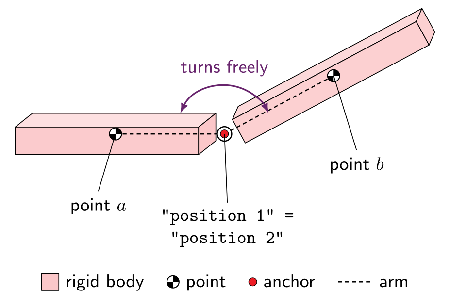
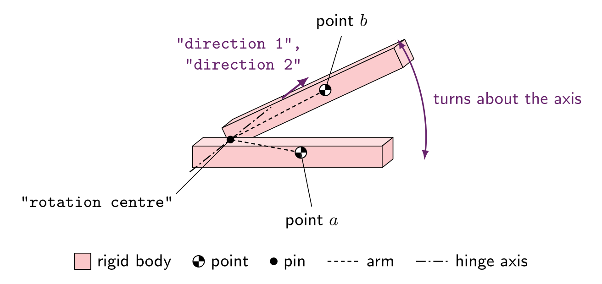
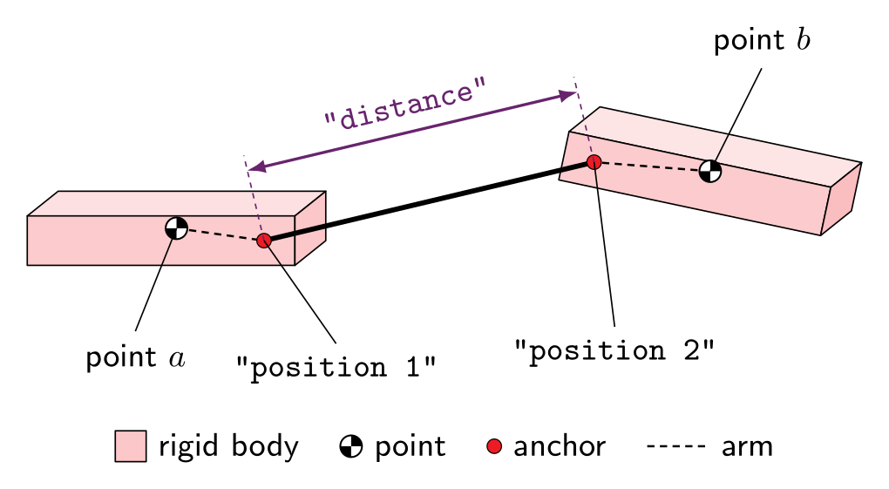
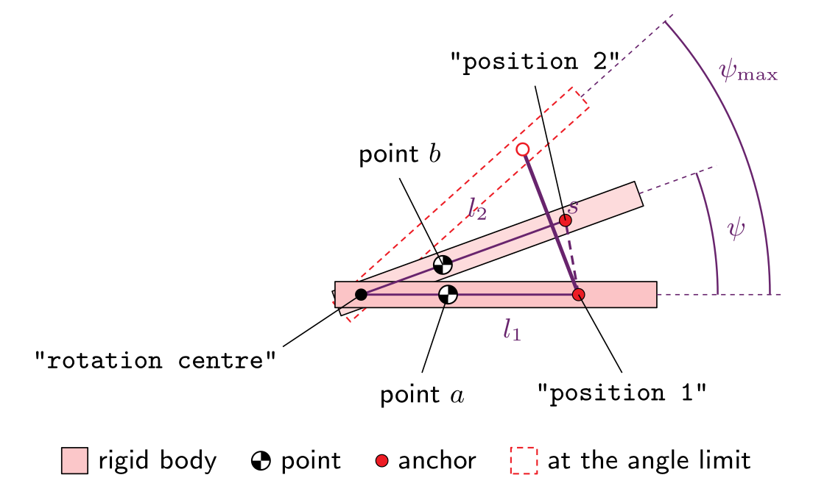
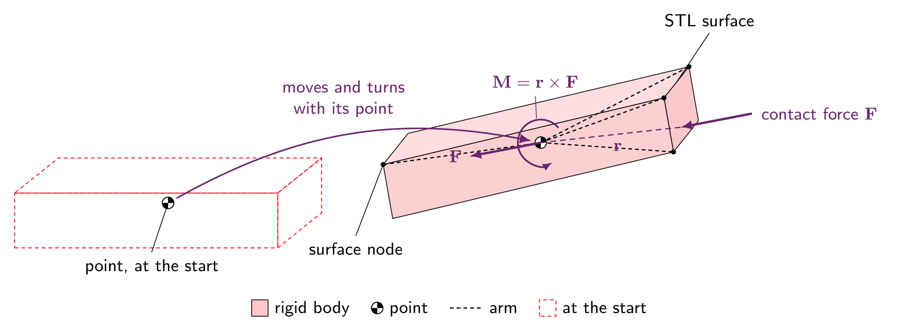

---
hide:
  - toc
---

# Rigid bodies

The `"rigid bodies"` key defines the structures that interact with the soil. Their friction is set separately, in [contact properties](contact.md). The status labels are explained on the [format overview](index.md#how-to-read-these-pages).

A list of rigid-body **systems**. Use `"rigid bodies": []` for an analysis without bodies.

Each system is built from **points**: 6-degree-of-freedom frames (3 displacements, 3 rotations) that carry mass and inertia. STL surfaces are welded to a point, several points can be joined by **constraints**, and a point without any geometry acts as a handle - for example the end of a towing line.

```json
"rigid bodies": [
    {
        "offset": [7.0, 0.0, 0.0],
        "points": [
            { "position": [-3.899, 0.0, -2.9891], "mass": 8886.6, "rotational inertia": [31288.2, 31288.2, 31288.2],
              "boundary conditions": ["free", "fixed", "free", "fixed", "free", "fixed"] },
            { "position": [25.8895, 0.0, -4.3353], "mass": 1.0, "rotational inertia": [1.0e-6, 1.0e-6, 1.0e-6],
              "boundary conditions": ["fixed", "fixed", "fixed", "fixed", "fixed", "fixed"] }
        ],
        "constraints": [
            { "type": "distance lock", "points": [1, 2],
              "position 1": [0.0, 0.0, 0.0], "position 2": [25.8895, 0.0, -4.3353],
              "distance": 26.25, "stiffness": 3.8e8 }
        ],
        "stl files": [
            { "name": "anchor", "stl": "bruce_razor.stl", "mesh cache": "bruce_razor_mesh.txt", "point": 1 }
        ],
        "tracked nodes": [
            { "position": [-1.778, 0.785, -3.704], "point": 1 }
        ]
    }
]
```

Each system:

<div class="small-table" markdown>

| Key                | Status   | Type             | Default     | Description                                                                                                                                  |
|--------------------|----------|------------------|-------------|----------------------------------------------------------------------------------------------------------------------------------------------|
| `"points"`         | Required | array of objects | -           | The points of this system.                                                                                                                  |
| `"constraints"`    | Optional | array of objects | none        | Connections between pairs of points in this system.                                                                                          |
| `"stl files"`      | Optional | array of objects | none        | Surface geometry welded to points. Only surfaces take part in contact, so a system without STL files does not touch the soil.                |
| `"tracked nodes"`  | Optional | array of objects | none        | Marker positions that move with a point and are written to the output, e.g. to follow a fluke tip.                                            |
| `"offset"`         | Optional | [x, y, z] (m)    | `[0, 0, 0]` | Translates the whole system - points, anchors, STL surfaces and tracked nodes - after it is assembled, so it can be repositioned without editing its coordinates or STL files. |

</div>

## Points

<div class="small-table" markdown>

| Key                      | Status   | Type                     | Default | Description                                                                                                       |
|--------------------------|----------|--------------------------|---------|-------------------------------------------------------------------------------------------------------------------|
| `"position"`             | Required | [x, y, z] (m)            | -       | Position of the point, normally the centre of mass of the body welded to it.                                      |
| `"mass"`                 | Required | number (kg)              | -       | Mass.                                                                                                             |
| `"rotational inertia"`   | Required | [Ixx, Iyy, Izz] (kg·m$^2$) | -     | Moments of inertia about the $x$, $y$ and $z$ axes through the point; products of inertia are taken as zero.       |
| `"boundary conditions"`  | Required | array of 6 entries       | -       | One entry per degree of freedom $[u_x, u_y, u_z, \theta_x, \theta_y, \theta_z]$ (below).                          |

</div>

Each boundary-condition entry is one of:

<div class="small-table" markdown>

| Entry                   | Meaning                                                                                                                                                                                                    |
|-------------------------|------------------------------------------------------------------------------------------------------------------------------------------------------------------------------------------------------------|
| `"free"`                | The degree of freedom is solved for. Any other string - including a typo such as `"fix"` - is also treated as `"free"`.                                                                                  |
| `"fixed"`               | Held: zero increment every step.                                                                                                                                                                           |
| `{"prescribed": q}`     | Moved by `q` (m, or radians for rotations) every step: every load step in a static stage, every `"dt"` in a dynamic stage. When the solver cuts a step, the increment is cut with it, so the prescribed path is unchanged. |

</div>

These are the conditions for every stage, unless a stage replaces them with its own [`"rigid body boundary conditions"`](analysis.md#rigid-body-boundary-conditions) - for example to hold a body still while the soil settles and then pull it.

A point with no STL surface, such as a pull point, has nothing to resist its motion except its own mass and inertia, so either prescribe or fix its degrees of freedom, or give it mass.

## Constraints

Constraints join two points of the same system with penalty springs. Positions are global anchor points and directions are global vectors, both at the start of the analysis; each anchor then moves with its own point.

<div class="small-table wrap-code" markdown>

| Key                       | `"coincidence"` | `"rotation lock"` | `"distance lock"` | `"distance stop"` | Type          | Description                                                                         |
|---------------------------|-----------------|-------------------|-------------------|-------------------|---------------|-------------------------------------------------------------------------------------|
| `"type"`                  | Required        | Required          | Required          | Required          | string        | Any value other than the four names is treated as `"coincidence"`.                  |
| `"points"`                | Required        | Required          | Required          | Required          | [a, b]        | The two points joined, numbered within this system.                                 |
| `"stiffness"`             | Required        | Required          | Required          | Required          | number (N/m)  | Penalty stiffness. For a rotation lock, the stiffness of the pin.                   |
| `"position 1"`            | Required        | Ignored           | Required          | Required          | [x, y, z] (m) | Anchor carried by point `a`.                                                         |
| `"position 2"`            | Required        | Ignored           | Required          | Required          | [x, y, z] (m) | Anchor carried by point `b`.                                                         |
| `"rotation centre"`       | Ignored         | Required          | Ignored           | Required          | [x, y, z] (m) | The hinge pin (rotation lock), or the centre the angle limit is measured about (distance stop). |
| `"direction 1"`           | Ignored         | Required          | Ignored           | Ignored           | [x, y, z]     | Hinge axis carried by point `a`.                                                     |
| `"direction 2"`           | Ignored         | Required          | Ignored           | Ignored           | [x, y, z]     | Hinge axis carried by point `b`, normally the same vector as `"direction 1"`.       |
| `"rotational stiffness"`  | Ignored         | Required          | Ignored           | Ignored           | number (N·m)  | Stiffness keeping the two axes aligned.                                              |
| `"distance"`              | Ignored         | Ignored           | Required          | Ignored           | number (m)    | Length of the rod.                                                                   |
| `"angle limit"`           | Ignored         | Ignored           | Ignored           | Required          | number (°)    | Opening angle at which the stop engages.                                             |

</div>

<div class="small-table" markdown>

| Type                 | Joint                | Behaviour                                                                                                                                                                                                     |
|----------------------|----------------------|---------------------------------------------------------------------------------------------------------------------------------------------------------------------------------------------------------------|
| `"coincidence"`      | Ball joint           | The two anchors are held together. Removes 3 degrees of freedom.                                                                                                                                              |
| `"rotation lock"`    | Hinge                | The two points are pinned at the rotation centre and their axes are kept aligned, leaving rotation about the axis free. Removes 5.                                                                           |
| `"distance lock"`    | Rod                  | The two anchors are held the given distance apart. Removes 1.                                                                                                                                                  |
| `"distance stop"`    | Cable / angle stop   | One-sided: slack until the anchors are $s = \sqrt{l_1^2 + l_2^2 - 2 l_1 l_2 \cos\psi_\text{max}}$ apart, then resists further separation. $l_1$, $l_2$ are the anchors' distances from the rotation centre and $\psi_\text{max}$ the angle limit, so with a hinge it stops the hinge opening past the limit. |

</div>

### How the constraints work { #how-the-constraints-work }

- Every constraint joins two points of the same system, $a$ and $b$, given as `"points": [a, b]`.
- Its anchors (`"position 1"`, `"position 2"`, `"rotation centre"`) and axes (`"direction 1"`, `"direction 2"`) are given in global coordinates at the start of the analysis. MPM3S stores each one as an arm from its point, so it moves and turns with that point as if fixed to its body.
- Each constraint is a penalty spring, so it is only met approximately: the stiffer the spring, the smaller the error, but too stiff a spring makes the Newton iterations harder to converge. The axial stiffness of a real rod or cable, $EA/L$, is a good choice; [Tutorial 6](../../TutorialProblems/Tutorial_6.md#problem-description) uses $EA = 10^{10}$ N.
- Place the anchors where the constraint is met at the start. A constraint that starts out of place pulls its points into place in the first step.

<div class="json-side-header">
<div>Constraint</div>
<div><code>input_data.json</code></div>
</div>

<div class="json-side" markdown>

<div class="js-text" markdown>

#### Coincidence: a ball joint { #coincidence }

{ #fig-coincidence }

- `"position 1"`, carried by point $a$, and `"position 2"`, carried by point $b$, are pulled together by a spring of `"stiffness"` $k$, with energy $E = \tfrac{1}{2} k \lvert \mathbf{x}_2 - \mathbf{x}_1 \rvert^2$.
- The two positions are normally the same point, the centre of the joint.
- The bodies can still turn freely about the joint, so it removes 3 of the two points' 12 degrees of freedom.

</div>

<div class="js-code" markdown>

```json
{
    "type": "coincidence",
    "points": [1, 2],
    "position 1": [1.75, 0.0, 0.0],
    "position 2": [1.75, 0.0, 0.0],
    "stiffness": 1.0e9
}
```

</div>

</div>

<div class="json-side" markdown>

<div class="js-text" markdown>

#### Rotation lock: a hinge { #rotation-lock }

{ #fig-rotation-lock }

- **Pin:** both points carry an arm to the `"rotation centre"`, and the two ends are held together by a spring of `"stiffness"` $k$, as in a coincidence.
- **Axis:** `"direction 1"`, carried by point $a$, and `"direction 2"`, carried by point $b$, are kept aligned by `"rotational stiffness"` $k_r$. Only their directions matter, not their lengths, and they are normally the same vector.
- The energy is $E = \tfrac{1}{2} k \lvert \mathbf{x}_b - \mathbf{x}_a \rvert^2 + k_r (1 - \hat{\mathbf{d}}_1 \cdot \hat{\mathbf{d}}_2)$, where $\mathbf{x}_a$ and $\mathbf{x}_b$ are the two ends of the pin and $\hat{\mathbf{d}}_1$, $\hat{\mathbf{d}}_2$ the unit axes.
- The bodies can only turn relative to each other about the axis, so it removes 5 degrees of freedom.

</div>

<div class="js-code" markdown>

```json
{
    "type": "rotation lock",
    "points": [1, 2],
    "rotation centre": [0.489, 0.0, 0.0],
    "direction 1": [0.0, 1.0, 0.0],
    "direction 2": [0.0, 1.0, 0.0],
    "stiffness": 1.0e9,
    "rotational stiffness": 1.0e8
}
```

</div>

</div>

<div class="json-side" markdown>

<div class="js-text" markdown>

#### Distance lock: a rod { #distance-lock }

{ #fig-distance-lock }

- `"position 1"` and `"position 2"` are held `"distance"` $s$ apart, with energy $E = \tfrac{1}{2} k \left( \lvert \mathbf{x}_2 - \mathbf{x}_1 \rvert - s \right)^2$.
- Like a rod, it pushes as well as pulls, and the bodies can swing and turn about the anchors, so it removes 1 degree of freedom.
- [Tutorial 6](../../TutorialProblems/Tutorial_6.md#problem-description) uses one as the pull line between the anchor's eyelet and the pull point.

</div>

<div class="js-code" markdown>

```json
{
    "type": "distance lock",
    "points": [2, 3],
    "position 1": [3.0294, 0.0, 0.0],
    "position 2": [12.51226633, 0.0, -0.5703035],
    "distance": 9.5,
    "stiffness": 1.0526e9
}
```

</div>

</div>

<div class="json-side" markdown>

<div class="js-text" markdown>

#### Distance stop: an angle stop { #distance-stop }

{ #fig-distance-stop }

- It is a cable between `"position 1"` and `"position 2"`: while the anchors are closer than its length $s$ it is slack and does nothing, and once they are further apart it acts as the rod above. Its energy is $E = \tfrac{1}{2} k \left\langle \lvert \mathbf{x}_2 - \mathbf{x}_1 \rvert - s \right\rangle^2$, where $\langle \cdot \rangle$ is zero when negative.
- Its length is set from the `"angle limit"` $\psi_\mathrm{max}$ and the anchors' distances $l_1$ and $l_2$ from the `"rotation centre"` at the start: $s = \sqrt{l_1^2 + l_2^2 - 2 l_1 l_2 \cos\psi_\mathrm{max}}$.
- Used with a rotation lock at the same rotation centre, the distance between the anchors grows steadily with the hinge angle $\psi$ between them, from $0^\circ$ to $180^\circ$, so the stop goes taut exactly when the hinge has opened to $\psi_\mathrm{max}$. The rotation centre is only used to work out $s$; the stop itself acts between the two anchors.
- It removes nothing while slack and 1 degree of freedom when taut. [Tutorial 6](../../TutorialProblems/Tutorial_6.md#problem-description) uses one to stop the anchor's fluke opening beyond $35^\circ$.

</div>

<div class="js-code" markdown>

```json
{
    "type": "distance stop",
    "points": [1, 2],
    "rotation centre": [0.489, 0.0, 0.0],
    "position 1": [0.6121, 0.0, -0.044805],
    "position 2": [0.62, 0.0, 0.0],
    "angle limit": 35.0,
    "stiffness": 8.5814e9
}
```

</div>

</div>

#### Combining constraints

- A **weld** is a rotation lock plus a second rotation lock about a non-parallel axis.
- [Tutorial 6](../../TutorialProblems/Tutorial_6.md#problem-description) uses a hinge, an angle stop and a pull line together.

## STL files

<div class="small-table" markdown>

| Key             | Status   | Type    | Default | Description                                                                                                                                                  |
|-----------------|----------|---------|---------|--------------------------------------------------------------------------------------------------------------------------------------------------------------|
| `"stl"`         | Required | string  | -       | STL file, relative to the folder containing the input file. It must be a closed surface. Its coordinates are global and are never scaled or recentred.      |
| `"mesh cache"`  | Required | string  | -       | File holding the tetrahedral mesh generated from the STL, relative to the input file. Written if it does not exist and reused if it does - **delete it whenever the STL changes**. |
| `"point"`       | Required | integer | -       | The point the surface is welded to. A point may carry several surfaces.                                                                                     |
| `"name"`        | Ignored  | string  | -       | A label for your own reference.                                                                                                                               |

</div>

### How a surface is welded to its point { #welded-surfaces }

<div class="json-side-header">
<div>Description</div>
<div><code>input_data.json</code></div>
</div>

<div class="json-side" markdown>

<div class="js-text" markdown>

{ #fig-point-surface }

- When the analysis starts, every node of the surface, and of its tetrahedral mesh, is stored as an arm $\mathbf{r}_0$ from the point named in `"point"`: the node's position minus the point's `"position"`.
- From then on the surface moves and turns rigidly with its point: each node is at $\mathbf{x} = \mathbf{c} + \mathbf{R}\,\mathbf{r}_0$, where $\mathbf{c}$ is the point's current position and $\mathbf{R}$ its rotation.
- The surface has no mass of its own: the body's mass and inertia are the point's `"mass"` and `"rotational inertia"`, so the point is normally placed at the body's centre of mass. The STL file only gives the body its shape.
- The surface is what touches the soil. A contact force $\mathbf{F}$ on it, at arm $\mathbf{r}$ from the point, acts on the point as the force $\mathbf{F}$ and the moment $\mathbf{M} = \mathbf{r} \times \mathbf{F}$.
- A point may carry several surfaces, which then move as one body. A point with no surface is a handle, such as a pull point.
- [Tracked nodes](#tracked-nodes) are attached in the same way, as arms from their point.

</div>

<div class="js-code" markdown>

```json
"points": [
    { "position": [0.6121, 0.0, -0.044805],
      "mass": 3291.6,
      "rotational inertia": [275.0, 275.0, 275.0],
      "boundary conditions": ["free", "fixed", "free",
                              "fixed", "free", "fixed"] }
],
"stl files": [
    { "name": "fluke",
      "stl": "AC14_fluke_rot20.stl",
      "mesh cache": "AC14_fluke_rot20_mesh.txt",
      "point": 1 }
]
```

</div>

</div>

## Tracked nodes

<div class="small-table" markdown>

| Key           | Status   | Type          | Default | Description                                                  |
|---------------|----------|---------------|---------|--------------------------------------------------------------|
| `"position"`  | Required | [x, y, z] (m) | -       | Global position of the marker at the start of the analysis.  |
| `"point"`     | Required | integer       | -       | The point it moves with.                                     |

</div>

Tracked nodes have no mass and no effect on the analysis. They are numbered in the output as `track1`, `track2`, ... and written to [`rigid_body.csv`](output.md#output-files) and `tracked_*.vtu`.
